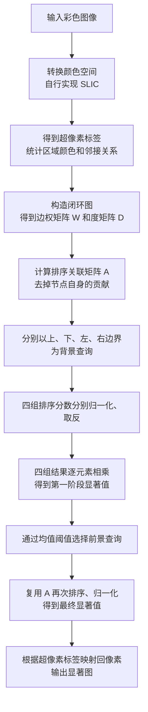
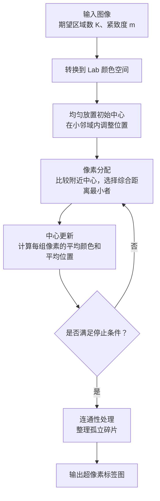
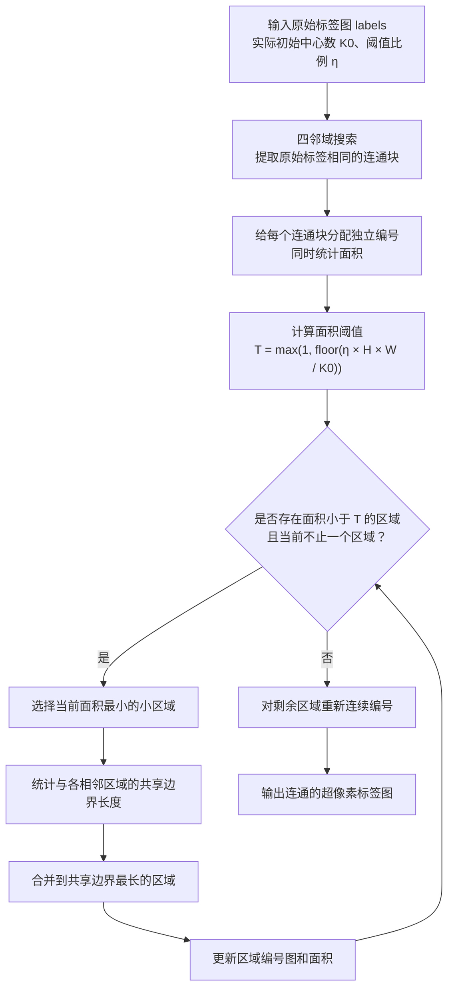

# AI 使用记录

## 第 1 次问答

时间：2026-10-21 21:56:31 +08:00｜使用者：本项目作者｜工具／模型：Codex / gpt-6-astra

**用户：**

请你先列出这个实验的实现步骤和整体的实现逻辑，让我们对整个论文的实现有一个整体的把握

**助手（2026-10-21 21:59:47 +08:00）：**

这个实验的整体逻辑是：**先把图像表示成超像素图，再利用图上的关联关系，先找出“不像背景”的区域，再用这些区域寻找完整的显著前景。**

实现可以拆成 **超像素分割、图构建、排序计算、两阶段查询、像素级输出** 五个部分。下面按实际的数据流梳理，让我们先看清每一步接收什么、完成什么、交给下一步什么。

我已经核对了论文第 2—4 节及 Algorithm 1：[Yang 等，CVPR 2013 论文](Yang_Saliency_Detection_via_2013_CVPR_paper.pdf)

整个过程如下：



这里最重要的关系是：**一幅图像只构建一次图，两阶段共用同一个排序关联矩阵。改变的是查询节点，以及排序分数的含义。**

背景查询时，分数高表示“与背景关联强”，所以要取反；前景查询时，分数高表示“与前景关联强”，直接作为显著值。

**第一步，明确输入、输出和数据表示。** 输入是一幅 \(H\times W\) 的彩色图像；输出是一幅同样大小的显著图，内部使用 \([0,1]\) 浮点数表示显著程度，保存时可以转换成灰度图。

先约定几个符号，后面的模块都沿用：

| 符号 | 含义 | 数据形状 |
|---|---|---|
| \(I\) | 输入彩色图像 | \(H\times W\times3\) |
| \(K\) | 希望得到的超像素数量 | 一个整数 |
| \(L\) | 每个像素所属的超像素编号 | \(H\times W\) |
| \(N\) | 分割后实际得到的超像素数量 | 一个整数 |
| \(C\) | 每个超像素的平均 Lab 颜色 | \(N\times3\) |
| \(W\) | 图中节点之间的直接连接权重 | \(N\times N\) |
| \(y\) | 查询节点指示向量 | 长度为 \(N\) |
| \(s\) | 每个超像素的显著值 | 长度为 \(N\) |
| \(S\) | 映射回像素后的显著图 | \(H\times W\) |

\(K\) 是期望数量，\(N\) 是实际数量。连通性处理等操作可能使两者略有不同，后面的矩阵尺寸应使用实际的 \(N\)。

**第二步，自行实现 SLIC，把像素组织成超像素。** 这一部分决定后续图的节点是什么。

SLIC 同时考虑颜色和位置。颜色相近、位置也接近的像素，更容易被分到同一个区域。其距离可以写成：

\[
d=\sqrt{d_c^2+\left(\frac{m}{h}\right)^2d_s^2},
\qquad
h\approx\sqrt{\frac{HW}{K}}
\]

这里 \(d_c\) 是 Lab 颜色距离，\(d_s\) 是空间距离，\(m\) 是紧致度，\(h\) 是初始中心的大致间隔。

实现时依次进行：

1. 将图像转换为 Lab 颜色空间。
2. 按网格放置初始中心，并在小邻域内调整到较低梯度的位置。
3. 每个中心在附近约 \(2h\times2h\) 的区域内比较距离，完成像素分配。
4. 根据当前分配，更新各中心的颜色与位置。
5. 重复分配和更新，直到达到停止条件。
6. 做连通性处理，并将最终标签连续编号。

输出是标签图 \(L\)。例如，\(L[r,c]=7\) 就表示该位置的像素属于第 7 个超像素。标准 SLIC 使用统一的紧致度参数，符合这次作业要求的可调节形式。[SLIC 作者项目页](https://www.epfl.ch/labs/ivrl/research/slic-superpixels/)

这一模块完成后，要能单独展示超像素边界，检查区域是否连通，以及改变 \(K\)、\(m\) 后结果是否合理。

**第三步，从标签图提取每个区域的信息。** 后续计算主要在区域层面进行，因此需要把像素信息汇总起来。

对每个超像素统计平均 Lab 颜色：

\[
c_i=\frac{1}{|R_i|}\sum_{p\in R_i}I_{\mathrm{Lab}}(p)
\]

其中 \(R_i\) 是第 \(i\) 个超像素包含的像素集合。

同时提取两类关系：

- **空间邻接关系**：哪些超像素共享边界。实现上可以扫描标签图中水平方向、竖直方向相邻的像素，记录不同标签之间的接触关系。
- **四侧边界集合**：分别记录接触图像上、下、左、右边缘的超像素编号。

一个超像素可能同时属于两个边界集合，比如位于左上角的区域。

**第四步，按论文规则构造闭环图。** 每个超像素作为一个节点，边决定哪些区域可以直接交换信息。

构图包含三类连接：空间直接相邻的节点、通过一个空间邻居能到达的两跳节点，以及任意两个图像边界节点。实现时可以先得到原始空间邻接，再扩展两跳关系，最后加入边界节点之间的连接。

对已经连接的节点，根据平均 Lab 颜色差设置边权：

\[
W_{ij}=
\begin{cases}
\exp\left(-\dfrac{\|c_i-c_j\|_2}{\sigma^2}\right),
& i,j\text{ 之间有边且 }i\ne j,\\[6pt]
0,&\text{其他情况}.
\end{cases}
\]

颜色越接近，权重越大。这里按照论文公式，分子使用颜色差的欧氏距离；颜色数值的范围与 \(\sigma\) 的尺度需要统一。

需要区分两个概念：**构图时所有边界节点相互连接；查询时四条边仍分别使用。** 前者规定信息如何传播，后者规定本次以谁作为参照。

随后计算度矩阵：

\[
D_{ii}=\sum_j W_{ij}
\]

\(D\) 是对角矩阵，表示每个节点连接权重的总和。

**第五步，建立可以重复使用的排序计算。** 这一模块接收查询向量 \(y\)，输出每个区域与查询集合的关联分数。

查询向量的定义很简单：

\[
y_i=
\begin{cases}
1,&i\text{ 是本次查询节点},\\
0,&\text{其他节点}.
\end{cases}
\]

先计算：

\[
B=(D-\alpha W)^{-1}
\]

再去掉自身关联：

\[
A=B-\operatorname{diag}(\operatorname{diag}(B))
\]

最后对任意查询向量计算：

\[
f=Ay
\]

因此，\(f_i\) 可以理解为“第 \(i\) 个区域与本次所有查询区域的关联程度之和”。

这里的 \(W\) 表示直接连接，而 \(A\) 还包含图中间接路径带来的关联。例如，两个区域没有直接连接，也可能通过若干颜色相近的中间区域产生较强关联。

实现时可以用基础线性方程求解功能计算 \(B\)，不需要自行编写矩阵求逆算法。**去掉对角元素这一步发生在求出 \(B\) 之后。**

**第六步，进行第一阶段：四侧背景查询与融合。** 以图像上边界为例，把接触上边界的超像素设为查询：

\[
f^{\mathrm{top}}=Ay^{\mathrm{top}}
\]

此时，\(f^{\mathrm{top}}\) 越大，说明该区域与上边界背景线索的关联越强。将它归一化到 \([0,1]\)，再取反：

\[
s^{\mathrm{top}}
=
1-\operatorname{Norm}\left(f^{\mathrm{top}}\right)
\]

对下、左、右边界重复同样的操作，得到四组显著值。然后逐元素相乘：

\[
s^{(1)}_i
=
s^{\mathrm{top}}_i
s^{\mathrm{bottom}}_i
s^{\mathrm{left}}_i
s^{\mathrm{right}}_i
\]

这就是第一阶段结果。

从乘法本身可以看出：如果某个区域在某一侧查询下被认为很像背景，其融合值就会受到抑制。因此，这一阶段可能突出物体的一部分，同时仍存在漏检或背景残留。我们需要保存四侧结果和融合结果，才能判断问题出现在哪一步。

归一化也要处理分数全部相同的情况，避免最大值等于最小值时发生除零。

**第七步，进行第二阶段：选择前景，再次排序。** 第一阶段已经提供了一些较显著的区域，现在用它们作为新的参照。

论文使用第一阶段显著值的均值作为阈值。为明确实现，在我们的节点表示下可写成：

\[
\tau=\frac{1}{N}\sum_{i=1}^{N}s_i^{(1)}
\]

\[
y_i^{\mathrm{fg}}
=
\begin{cases}
1,&s_i^{(1)}>\tau,\\
0,&\text{其他情况}.
\end{cases}
\]

这里约定使用超像素分数的均值；如果改成像素均值，就会引入区域面积权重，属于需要明确记录的实现差异。

复用前面得到的 \(A\)：

\[
f^{\mathrm{fg}}=Ay^{\mathrm{fg}},
\qquad
s^{(2)}=\operatorname{Norm}\left(f^{\mathrm{fg}}\right)
\]

这次查询代表前景，所以较高关联直接对应较高显著性。第二阶段的目的，是利用初步前景区域的颜色和图关联，进一步突出相关区域、抑制背景。

需要记住：**第二阶段不重新分割图像，也不重新构图。**

**第八步，把区域分数映射回像素。** 最终每个超像素都有一个显著值 \(s_i^{(2)}\)，利用标签图即可得到输出：

\[
S(r,c)=s^{(2)}_{L(r,c)}
\]

也就是：像素属于哪个超像素，就取那个超像素的显著值。因此，输出具有原图的空间尺寸，同一超像素内的像素共享分数。

先完成这个核心输出，并保留原始浮点结果。额外的平滑或后处理可以作为之后的独立实验，便于判断它具体改变了什么。

在代码开发上，我建议按以下顺序推进，每一阶段都能独立检查：

| 开发阶段 | 主要工作 | 完成标志 |
|---|---|---|
| 1. SLIC | 中心初始化、局部分配、中心更新、连通性处理 | 输出正确标签和边界图，参数变化合理 |
| 2. 区域与图 | 颜色统计、邻接、四侧集合、闭环连接、边权 | 在人工构造的小例子上核对连接；\(W\) 对称、度计算正确 |
| 3. 排序 | 计算关联矩阵、去除自身贡献、查询计算 | 小规模图计算可核对，结果无异常数值 |
| 4. 两阶段流程 | 四侧查询、融合、前景选择、再次排序 | 保存所有中间图，得到完整像素级显著图 |
| 5. 实验与分析 | 固定图像集、参数比较、模块对比、失败分析 | 每项结论都对应真实配置和结果 |

实验可以围绕几个具体问题设计：增加超像素数量是否改善边界、紧致度变化如何影响结果、加入边界连接带来了什么、第二阶段相比第一阶段改善了哪些图像。评价时使用有像素级标注的数据，保留显著图、精确率—召回率结果和运行时间；MAE 可以作为补充指标。

**第一轮实现的范围就定在 SLIC：输入一幅图像和 \(K,m\)，输出连通的标签图、实际区域数及边界可视化。** 等这一模块的输入输出和验证标准明确后，就可以开始实现，为后面的图与排序模块打好基础。

---

## 第 2 次问答

时间：2026-10-22 10:09:27 +08:00｜使用者：本项目作者｜工具／模型：Codex / gpt-6-astra

**用户：**

请你先为我讲解SLIC的做法

**助手（2026-10-22 10:13:28 +08:00）：**

**SLIC 的做法是：先在图像上均匀放置一批“区域中心”，再根据颜色和位置，把附近像素分给这些中心；随后更新中心，重复这个过程，最后整理成连通的超像素。**

它的全称是 *Simple Linear Iterative Clustering*，可以理解为一种适合图像的局部聚类方法。对于我们的大作业，它负责把大量像素组织成几百个小区域，后面的图流形排序再判断这些区域的显著程度。

我们用一张“绿色草地上有一朵红花”的照片来理解：草地会被分成多个小区域，花朵也会被分成多个小区域。理想情况下，这些小区域的边界能尽量贴合花朵与草地之间的颜色边界。

整个过程可以先看这张图：



先理解它最核心的两个概念：**怎么衡量像素与中心的距离，以及为什么要反复分配、更新。**

**一个像素由“颜色＋位置”共同描述。** SLIC 通常使用 Lab 颜色空间，将像素写成：

\[
p=[L,a,b,x,y]
\]

其中，\(L,a,b\) 描述颜色，\(x,y\) 描述它在图像中的位置。Lab 颜色空间中的距离可以较好地反映颜色差异。

一个聚类中心也用同样的形式表示：

\[
C_k=[L_k,a_k,b_k,x_k,y_k]
\]

初始化时，它来自某个像素；迭代之后，它代表一组像素的平均颜色和平均位置，因此不一定恰好对应某个实际像素。

同时考虑颜色与位置，是因为我们希望形成的区域具有两个特点：

- 内部颜色尽量相近，便于贴合图像边界。
- 空间位置比较集中，便于形成紧凑的小区域。

例如，两片相隔很远的红色花瓣虽然颜色相近，空间距离仍会阻止它们轻易归入同一个超像素。

**像素与中心的综合距离，是 SLIC 最重要的公式。**

先计算颜色距离：

\[
d_c=
\sqrt{(L-L_k)^2+(a-a_k)^2+(b-b_k)^2}
\]

再计算空间距离：

\[
d_s=
\sqrt{(x-x_k)^2+(y-y_k)^2}
\]

最后合成：

\[
\boxed{
D=\sqrt{d_c^2+\left(\frac{m}{S}\right)^2d_s^2}
}
\]

这里：

- \(S\) 是初始中心之间的大致间隔。
- \(m\) 是紧致度参数，控制空间距离的重要程度。

公式及局部搜索方式对应原论文第 3 节。[SLIC 原论文](https://www.cs.jhu.edu/~ayuille1/JHUcourses/VisionAsBayesianInference2022/4/Achanta_SLIC_PAMI2012.pdf)

\(S\) 用来调整空间距离的尺度。一个像素距离中心 10 个像素，对于很小的超像素可能已经很远，对于很大的超像素则未必如此；用 \(d_s/S\) 可以表达这种相对距离。

\(m\) 则控制分组偏好：

| 参数变化 | 影响 |
|---|---|
| \(m\) 较小 | 更重视颜色一致性，区域更容易沿颜色边界变化，形状可能更不规则 |
| \(m\) 较大 | 更重视位置接近，区域通常更紧凑、规整，也更可能跨过某些颜色边界 |

可以用一个**手算示例**体会这种变化。假设 \(S=20\)，某个像素有两个候选中心：

- 中心 A：颜色距离 \(d_c=2\)，空间距离 \(d_s=16\)，颜色很接近，但位置较远。
- 中心 B：颜色距离 \(d_c=6\)，空间距离 \(d_s=4\)，颜色差异较大，但位置很近。

为了比较大小，直接使用 \(D^2\) 即可：

| 紧致度 | 到中心 A 的 \(D^2\) | 到中心 B 的 \(D^2\) | 分配结果 |
|---|---:|---:|---|
| \(m=5\) | \(2^2+(5/20)^2\times16^2=20\) | \(6^2+(5/20)^2\times4^2=37\) | 分给 A |
| \(m=20\) | \(2^2+(20/20)^2\times16^2=260\) | \(6^2+(20/20)^2\times4^2=52\) | 分给 B |

因此，同一个像素在不同紧致度下可能属于不同区域。这就是 \(m\) 能改变超像素形状的原因。

接下来按执行顺序看完整算法。

**第一步，根据期望区域数初始化中心。** 假设图像有 \(H\times W\) 个像素，希望得到约 \(K\) 个超像素，那么每个区域的平均面积约为：

\[
\frac{HW}{K}
\]

把它近似看成正方形，边长就是：

\[
S\approx\sqrt{\frac{HW}{K}}
\]

例如，图像尺寸为 \(400\times300\)，希望得到 \(300\) 个超像素：

\[
S=\sqrt{\frac{400\times300}{300}}=20
\]

于是可以大约每隔 20 个像素放置一个中心。每个超像素预计覆盖约 \(20\times20=400\) 个像素。

这是初始安排。经过迭代后，各区域的形状与面积会随图像内容变化。

**第二步，把初始中心稍微移离明显边缘。** 均匀放置的中心可能恰好落在花朵与草地的交界处，这样的起点不太稳定。

SLIC 会在每个初始中心周围的 \(3\times3\) 邻域内，寻找梯度较小的位置，把中心移过去。梯度可以理解为局部颜色变化的强弱：变化较小的位置通常处于相对平坦的区域内部。

这是初始化时的小范围调整，目的是减少明显边缘或噪声对起点的影响。

**第三步，让像素选择附近最合适的中心。** 对每个中心，只检查它附近约 \(2S\times2S\) 的窗口，也就是横向、纵向各向两侧延伸约 \(S\)。

对于窗口内的像素：

1. 计算它到当前中心的综合距离 \(D\)。
2. 与它到其他候选中心的距离比较。
3. 保存距离最小的中心编号。

一个像素可能落入多个中心的搜索窗口，因此这些中心会竞争它的归属。最终它只保留一个标签。

局部搜索能明显减少计算量。假设有 12 万个像素和 300 个中心，如果每个像素都与全部中心比较，一轮需要约 3600 万次距离计算；限定附近窗口后，每个像素只需要比较少数候选中心。

需要注意，**\(2S\times2S\) 是候选搜索范围，最终超像素的形状由距离比较决定。**

**第四步，根据分配结果更新中心。** 完成一轮分配后，每个中心都有了一组属于自己的像素。

设第 \(k\) 组像素集合为 \(R_k\)，新的中心取这组像素五维特征的平均值：

\[
C_k^{\mathrm{new}}
=
\frac{1}{|R_k|}
\sum_{p\in R_k}
[L_p,a_p,b_p,x_p,y_p]
\]

也就是同时更新：

- 平均颜色；
- 平均横坐标；
- 平均纵坐标。

例如，一个中心最初放得偏左，但分给它的像素主要位于右侧，更新后中心就会向右移动。如果它所包含的像素大多是红色，它的平均颜色也会更接近红色。

**第五步，重复“分配—更新”。** 中心变化后，像素到中心的距离也发生变化，所以需要重新判断归属：

> 用当前中心分配像素 → 用当前像素分组更新中心 → 再次分配像素。

随着迭代，中心位置和区域边界通常会逐渐稳定。停止方式可以采用最大迭代次数，也可以结合中心变化量设置停止条件。

这里要理解：初始化只给出了一个粗略起点，**反复分配和更新才让区域逐渐适应图像内容。**

**第六步，检查并修正连通性。** 前面的距离规则鼓励像素聚集，但不能严格保证“拥有相同标签的所有像素都连在一起”。

例如，大部分标签为 7 的像素聚集成一块，另有几个标签为 7 的像素落在附近另一块区域中，形成孤立小碎片。如果直接把标签 7 当成一个图节点，后面的空间邻接关系就不够合理。

因此需要增加连通性处理。我们后续可以明确采用四邻域，也就是上下左右相邻，并按以下方式实现：

- 找出各标签包含的连通块。
- 将过小的孤立碎片并入接触它的合适区域。
- 对最终区域重新编号。
- 检查每个标签是否只对应一个连通区域。

这是把论文的连通性要求落实到程序中的具体策略；碎片阈值和合并规则需要在实现时明确记录。处理后，实际超像素数量可能与期望的 \(K\) 略有差异。

**SLIC 最终交给下一模块的是标签图。** 它是一个与原图同高、同宽的整数数组，例如：

```text
0 0 0 1 1
0 0 0 1 1
2 2 2 1 1
2 2 2 3 3
```

相同编号表示属于同一个超像素。程序中的含义可以写成：

```text
labels[y, x] = k
```

即位置 \((x,y)\) 的像素属于区域 \(k\)。有了这个标签图，后续才能统计每个区域的平均颜色、面积和邻接关系，进一步构建显著性检测所需的图。

我们实现这个模块时，首先验证四件事：

1. 每个像素都被分配了有效标签。
2. 每个最终标签对应的区域都连通。
3. 改变 \(K\) 时，区域数量和大小出现合理变化；改变 \(m\) 时，区域形状出现合理变化。
4. 在简单双色图像上观察边界，再用真实图像检查效果。

第一版的输出应同时包含**标签图、实际区域数，以及叠加在原图上的超像素边界图**。这三项能让我们检查实现，也能为后续实验报告保留直观证据。

---

## 第 3 次问答

时间：2026-10-22 10:13:54 +08:00｜使用者：本项目作者｜工具／模型：Codex / gpt-6-astra

**用户：**

这部分对应论文的那几页，我要去看一看论文

**助手（2026-10-22 10:14:49 +08:00）：**

我们刚才讲的 SLIC，对应 **Achanta 等人的《SLIC Superpixels Compared to State-of-the-Art Superpixel Methods》（TPAMI 2012）**。

重点看 **PDF 的第 2—4 页，也就是印在页面上的期刊页码 2275—2277**，主要内容在 **第 3 节 “SLIC Superpixels”**。

你可以直接打开这份论文：[SLIC 论文 PDF，从第 2 页开始](https://www.cs.jhu.edu/~ayuille1/JHUcourses/VisionAsBayesianInference2022/4/Achanta_SLIC_PAMI2012.pdf#page=2)。

| PDF 页码 | 页面印刷页码 | 重点位置 | 对应我们刚才讲的内容 |
|---|---:|---|---|
| **第 2 页** | **2275** | **§3 SLIC Superpixels、§3.1 Algorithm** | SLIC 的基本思想；均匀初始化中心；在 \(3\times3\) 邻域内调整中心；局部分配；更新中心；迭代 |
| **第 3 页** | **2276** | **Algorithm 1、Figure 2、§3.2 Distance Measure** | 完整算法伪代码；\(2S\times2S\) 搜索窗口示意图；颜色距离、空间距离及其归一化 |
| **第 4 页** | **2277** | **公式 (3)、§3.3 Postprocessing、§3.4 Complexity** | 最终距离公式；紧致度 \(m\) 的作用；连通性处理；算法为什么计算较快 |

我建议第一次按这个顺序阅读：

1. **先看第 2275 页的 §3.1。** 对照“初始化 → 分配像素 → 更新中心 → 重复”的流程，理解一轮迭代做了什么。
2. **再看第 2276 页的 Figure 2 和 Algorithm 1。** 图中较小的 \(S\times S\) 方框表示预期区域大小，较大的 \(2S\times2S\) 方框表示搜索范围。
3. **接着读 §3.2，一直读到第 2277 页的公式 (3)。** 我们刚才用的就是：
   \[
   D=\sqrt{d_c^2+\left(\frac{d_s}{S}\right)^2m^2}
   \]
   重点理解为什么要除以 \(S\)，以及 \(m\) 如何调节颜色与位置的相对重要性。
4. **最后看 §3.3。** 这一小节解释为什么聚类完成后还要进行连通性处理，对你作业中“输出连通超像素”的要求很重要。

读的时候注意一个符号差异：**SLIC 原论文中的 \(N\) 表示图像的像素总数**，所以它写 \(S=\sqrt{N/K}\)。在我们后续讨论显著性检测时，曾用 \(N\) 表示超像素数量；阅读两篇论文时要留意这个区别。

---

## 第 4 次问答

时间：2026-10-22 10:27:59 +08:00｜使用者：本项目作者｜工具／模型：Codex / gpt-6-astra

**用户：**

我刚刚看了一下论文，我对这一步大概的理解如下：这一步的核心就是将整个图像分成一个一个的小区域，这些小区域会被组织成超像素，然后后面我们的图形流排序再去判断这些区域的显著程度。这样就不用一个像素一个像素的进行计算。

1. 首先我们将图像转换到Lab颜色空间，p=[L,a,b,x,y]，这样即描述了颜色，有描述了位置
2. 接着我们计算距离。从直观上来想，距离应该包含两个层面：空间上的距离和时间上的距离。颜色越近，距离越近越应该认为属于一个区域。所以f恩别计算这两个距离，然后再取加权均方
3. 然后我们呢在图上放置一些初始的区域中心，根据我们期望的区域数来均匀放置
4. 然后开始循环更新像素中心：对每个中心，检查它附近的窗口，计算窗口内像素点到其他点的综合距离，然后将这个区域的中心更新到综合距离最小的点，更新中心。这样重复进行，姐可以得到一个比较合理的区域分配
5. 最后对这些区域调整连通性

**助手（2026-10-22 10:29:34 +08:00）：**

你的整体理解是对的：**SLIC 把图像划分成小区域，每个小区域就是一个超像素，后续图流形排序以这些超像素为节点计算显著程度。** 这样减少的是后续图排序的计算量；SLIC 本身仍然需要处理和分配各个像素。

你这段描述里，**最需要修正的是第 4 步：先把像素分给合适的中心，再对每组像素取平均来更新中心。** 我们逐项核对一下。

1. **转换到 Lab 颜色空间：理解正确。**

   每个像素用
   \[
   p=[L,a,b,x,y]
   \]
   表示，其中前三项描述颜色，后两项描述位置。聚类中心也用同样的五维形式表示。

2. **综合距离：思路正确，需要改两个表述。**

   你写的“空间上的距离和时间上的距离”，这里应当是 **空间距离和颜色距离**。我们处理的是一幅静态图像，没有用到时间维度。

   “颜色越接近、空间距离越近，越容易属于同一个区域”，这个理解是正确的。综合距离具体为：
   \[
   D(p,C_k)=
   \sqrt{d_c^2+\left(\frac{m}{S}\right)^2d_s^2}
   \]

   更准确的说法是：**将颜色距离和经过尺度调整的空间距离平方后相加，再开平方。** 这里没有求平均，所以称为“加权欧氏距离”比“加权均方”更准确。

3. **根据期望区域数均匀放置中心：理解正确。**

   对于 \(H\times W\) 的图像，希望分成约 \(K\) 个区域，中心间距约为：
   \[
   S=\sqrt{\frac{HW}{K}}
   \]

   还需要补上一个初始化细节：**在每个初始中心附近的 \(3\times3\) 邻域内，寻找梯度较小的位置，将中心稍作调整**，降低中心恰好落在明显边缘上的可能性。

4. **迭代过程：需要区分“分配像素”和“更新中心”两个操作。**

   你写到：

   > 计算窗口内像素点到其他点的综合距离，然后将这个区域的中心更新到综合距离最小的点。

   这里有两处需要改正：

   - 比较的是**像素与候选聚类中心之间的距离**，不是窗口内所有像素之间的两两距离。
   - “距离最小”用于决定**像素归哪个中心**；中心更新则使用**已分配像素的平均颜色和平均位置**。

5. **最后处理连通性：理解正确。**

   距离聚类可能产生孤立碎片，所以还需要检查连通块、处理碎片，并对最终区域重新编号。

我们把第 4 步展开看一下，这是 SLIC 的核心。

**先固定中心，让像素选择归属。** 假设某个像素 \(p\) 同时处于中心 A、B、C 的搜索窗口内，算出：

| 候选中心 | 像素到中心的综合距离 |
|---|---:|
| A | 8 |
| B | 3 |
| C | 6 |

于是把像素 \(p\) 分给 B。**此时改变的是像素的标签，中心 B 暂时不移动。**

对所有中心附近的像素完成距离比较后，就得到这一轮的区域分配。

**再固定像素分组，对每组取平均，更新中心。** 假设分给中心 B 的像素集合是 \(R_B\)，那么：

\[
C_B^{\mathrm{new}}
=
\frac{1}{|R_B|}
\sum_{p\in R_B}
[L_p,a_p,b_p,x_p,y_p]
\]

也就是说，新的中心包含：

- 这一组像素的平均 \(L,a,b\)；
- 这一组像素的平均 \(x,y\)。

举一个只看位置的例子：假设某组有三个像素，位置分别为

\[
(2,2),\quad(4,2),\quad(6,5)
\]

那么更新后的中心位置是：

\[
\left(
\frac{2+4+6}{3},
\frac{2+2+5}{3}
\right)
=(4,3)
\]

中心位置由平均值计算得到，**不必是这组像素中某个像素的位置，也不必是整数坐标**。颜色部分同样取平均。

接着用更新后的中心，再进行下一轮像素分配。于是形成循环：


这正对应论文 Algorithm 1 中的 **Assignment（分配）** 和 **Update（更新）** 两部分，可以再对照 [PDF 第 3 页的算法框](https://www.cs.jhu.edu/~ayuille1/JHUcourses/VisionAsBayesianInference2022/4/Achanta_SLIC_PAMI2012.pdf#page=3) 看一下。

你的第 4 步可以修订为下面这样，作为参考：

> 对每个聚类中心，在它附近约 \(2S\times2S\) 的窗口内，计算像素与该中心的综合距离。一个像素可能被多个中心的窗口覆盖，将它分配给综合距离最小的中心。完成这一轮分配后，对每组像素的 Lab 颜色和位置分别取平均，得到新的聚类中心。重复像素分配与中心更新，直到达到停止条件。

你可以重点对照这句话再看论文：**最小距离决定像素归属，组内平均值决定新的中心。**

---

## 第 5 次问答

时间：2026-10-22 10:36:52 +08:00｜使用者：本项目作者｜工具／模型：Codex / gpt-6-astra

**用户：**

意思更新迭代是：

1. 计算像素与中心的综合距离，一个像素可能归属到多个不同中心的区域中，然后将其归入到距离最小的中心
2. 在区域范围确定下来之后再在区域中取平均值，决定新的中心

**助手（2026-10-22 10:37:28 +08:00）：**

对，这次你理解准确了。只需要把第 1 点中的“可能归属到多个区域”说得更精确一点：**一个像素可能有多个候选中心，完成比较后，它只归属于其中一个中心。**

每轮迭代就是这两个步骤：

1. **固定中心，分配像素。**  
   计算像素与附近候选中心的综合距离，把它分给距离最小的中心。这一步确定每个像素的标签，中心暂时不变。

2. **固定分组，更新中心。**  
   完成所有像素的分配后，对每组像素的 **Lab 颜色和位置都取平均**：
   \[
   C_k^{\text{new}}
   =
   [\overline L_k,\overline a_k,\overline b_k,\overline x_k,\overline y_k]
   \]
   得到新的聚类中心。

这里的区域范围只是**当前这一轮的分配结果**。中心更新后，距离会发生变化，下一轮有些像素就可能改分到另一个中心，区域边界也会随之调整：

\[
\text{当前中心}
\;\longrightarrow\;
\text{分配像素}
\;\longrightarrow\;
\text{取平均更新中心}
\;\longrightarrow\;
\text{重新分配像素}
\;\longrightarrow\;\cdots
\]

重复这个过程，直到中心变化足够小或达到设定的迭代次数。

---

## 第 6 次问答

时间：2026-10-22 10:44:41 +08:00｜使用者：本项目作者｜工具／模型：Codex / gpt-6-astra

**用户：**

这里调整连通信是怎么做的

**助手（2026-10-22 10:47:45 +08:00）：**

这里的**连通性调整，就是检查“同一个标签的像素是否连成一块”，把孤立的小碎片重新分配给相邻区域**。它通常在 SLIC 的迭代结束后进行。

原论文在 **第 2277 页、§3.3 Postprocessing** 中简要说明了这一步：通过连通域算法识别孤立像素，并重新分配它们的标签。[查看论文对应页面](https://www.cs.jhu.edu/~ayuille1/JHUcourses/VisionAsBayesianInference2022/4/Achanta_SLIC_PAMI2012.pdf#page=4)

先看一个例子。下面每个字母代表一个像素的超像素标签：

```text
A A A B B B B
A A A B B A B
A A A B B B B
C C C C B B B
C C C C B B B
```

左上角有一大块 A，但右侧 B 区域中还有一个孤立的 A。

它之所以可能出现，是因为前面的聚类根据颜色和位置计算距离，**没有检查这个像素能否沿着同标签像素走到 A 的其他部分**。

我们采用“四邻域”定义连通：一个像素可以向上、下、左、右移动。只经过标签 A 的像素，如果无法从左上角的 A 走到右侧的 A，那么它们就是两个不同的连通块。

右侧这个孤立 A 被 B 包围，将它改成 B 后：

```text
A A A B B B B
A A A B B B B
A A A B B B B
C C C C B B B
C C C C B B B
```

现在 A、B、C 各自都连成一块了。**修改的是标签，原图的像素颜色不会改变。**

具体实现可以分成四步。论文对后处理描述得比较简略，下面是我们可以采用的一套明确实现策略。

**第一步，找出所有“同标签连通块”。**

从一个尚未访问的像素开始：

1. 记录它的标签，例如 A。
2. 检查它上下左右的邻居。
3. 将标签同样为 A、并且尚未访问的邻居加入搜索。
4. 继续向外扩展，直到没有新的同标签像素。

这次搜索找到的全部像素，就是一个连通块。可以用广度优先搜索、深度优先搜索，或作业允许使用的连通域标记函数来完成。

对于上面的例子，搜索结果是：

| 原标签 | 找到的连通块 | 面积 |
|---|---|---:|
| A | 左上角的一块 | 9 个像素 |
| A | 右侧孤立的一块 | 1 个像素 |
| B | 周围连通的一块 | 17 个像素 |
| C | 左下角的一块 | 8 个像素 |

注意，搜索条件是**空间相邻且标签相同**，这一步不重新判断颜色是否相似。

**第二步，先给每个连通块独立的编号。**

比如，把原来的两个 A 分别记成 A₁ 和 A₂。这样每个临时区域本身都是连通的。

这个步骤很重要：如果同一个标签分裂成两个都比较大的区域，我们也不能继续让它们共用一个标签。可以将它们保留为两个独立区域。

**第三步，将过小的连通块合并到接壤的区域。**

“过小”可以根据期望超像素面积来定义：

\[
A_{\mathrm{expected}}=\frac{HW}{K},
\qquad
T=\eta A_{\mathrm{expected}}
\]

其中 \(\eta\) 是我们需要明确记录的实现参数。例如，取 \(\eta=0.25\)，表示把面积小于期望面积四分之一的区域视为小碎片。**这是可选的实现设置，不是论文 §3.3 规定的固定阈值。**

对于一个小碎片，先找出所有与它共享边界的区域，再选择合并目标。为了让第一版行为清楚、容易检查，我们可以采用：

> 优先并入与碎片共享边界最长的区域；如果有并列，再比较平均颜色的接近程度。

在前面的例子中，孤立 A₂ 只与 B 接壤，因此直接并入 B。

之所以限定“接壤”，是因为**两个本身连通、并且相互接触的区域合并后，仍然连通**。仅仅因为颜色相近，就把碎片标成远处某个区域的标签，可能再次产生不连通问题。

合并时应更新当前区域的标签、面积和邻接关系，再继续处理其他碎片。

**第四步，重新编号并检查结果。**

处理结束后，将最终标签整理为：

\[
0,1,2,\ldots,N-1
\]

然后检查：

- 所有像素都有有效标签。
- **每个标签恰好对应一个四连通区域。**
- 实际区域数量是多少。
- 后续区域颜色、面积和邻接关系，都根据修正后的标签重新统计。

这里实际得到的区域数 \(N\) 可能与期望数量 \(K\) 略有差异，因为处理过程既可能拆分不连通区域，也可能合并小碎片。

对我们的作业，连通性处理的直接验收标准就是：**逐个检查最终标签，每个标签的连通块数量都应等于 1。**

---

## 第 7 次问答

时间：2026-10-22 10:49:35 +08:00｜使用者：本项目作者｜工具／模型：Codex / gpt-6-astra

**用户：**

这里的标签是什么

**助手（2026-10-22 10:51:31 +08:00）：**

这里的**标签，就是记录“一个像素属于哪个超像素”的编号**。

例如，我们有三个区域中心，分别编号为 `0、1、2`。在分配像素时：

- 某个像素到中心 `0` 的综合距离最小，就给它标签 `0`。
- 到中心 `1` 的距离最小，就给它标签 `1`。
- 到中心 `2` 的距离最小，就给它标签 `2`。

因此，每个像素除了自身的颜色和位置之外，还有一条分组记录：

> **这个像素当前属于第几个区域？**

把所有像素的分组记录排列起来，就得到一张与原图同样大小的**标签图**。例如：

```text
0 0 1 1
0 0 1 1
2 2 2 1
```

这里：

- 所有标签为 `0` 的像素，归在同一个超像素中。
- 所有标签为 `1` 的像素，归在另一个超像素中。
- 所有标签为 `2` 的像素，归在第三个超像素中。

**这些数字只是编号，本身没有颜色、显著程度或物体类别的含义。** 标签 `2` 不表示比标签 `1` 更显著，也不表示某种特定颜色。

程序里通常用一个整数数组保存：

```python
labels[y, x] = k
```

意思是：位置为 \((x,y)\) 的像素，被分配给编号为 \(k\) 的区域。

你前面理解的两步迭代就可以对应起来：

1. **分配像素：**找到最近的候选中心，更新这个像素的标签。
2. **更新中心：**把具有相同标签的像素收集起来，对它们的颜色和位置取平均。

之前例子中的 `A、B、C` 也是标签，只是为了方便观察用了字母。所谓“连通性调整”，就是检查：**拥有同一个标签的像素，在图像上是否确实连成一块。**

---

## 第 8 次问答

时间：2026-10-22 10:53:55 +08:00｜使用者：本项目作者｜工具／模型：Codex / gpt-6-astra

**用户：**

最终会输出一个标签图，这个标签图和原图大小相等，对应的就是原图中每个像素所属的区域标签。连通信调整就是要把同一个标签的像素连城一块。这里采用的是将小的连通块合并到周边区域的方法

**助手（2026-10-22 10:55:36 +08:00）：**

对，你对标签图和连通性调整的理解是正确的。这里把“把同一个标签的像素连成一块”再说得准确一些：

> **通过调整标签，使最终每个标签都只对应一个连通区域。**

处理过程中，像素的位置和颜色保持不变，改变的是它们所属的区域。例如，一个孤立的小块原来标为 A，周围都是 B，就可以把这个小块的标签改成 B。

我们采用的具体流程是：

1. **找连通块。** 根据当前标签，找出所有同标签的四连通区域。
2. **给不同连通块独立编号。** 即使原来标签相同，只要空间上不连通，就先作为不同区域处理。
3. **合并小块。** 将面积过小的连通块并入与它实际接壤的合适区域，修改这一整块像素的标签。
4. **重新编号并检查。** 保证最终每个标签都只有一个连通块。

还有一种情况要保留在理解中：**如果同一个旧标签对应的两块区域都比较大，可以让它们分别成为两个超像素，使用不同的新标签。**

因此，你可以把这一部分描述为：

> SLIC 输出与原图同尺寸的标签图，记录每个像素所属的超像素。聚类结束后，通过连通域检测拆分不连通的同标签区域，再把小连通块合并到相邻区域，最后重新编号，保证每个最终超像素都是连通的。

---

## 第 9 次问答

时间：2026-10-22 10:56:43 +08:00｜使用者：本项目作者｜工具／模型：Codex / gpt-6-astra

**用户：**

`# 基于图形流排序的显著性检测`

##SLIC


这一步的核心就是将整个图像分成一个一个的小区域，这些小区域会被组织成超像素。**后续图流形排序以这些超像素为节点计算显著程度。** 相比于按像素进行显著度计算，这样可以大大减少后续图排序的计算量

1. 首先我们将图像转换到Lab颜色空间，p=[L,a,b,x,y]，其中前三项描述颜色，后两项描述位置。聚类的中心同样使用这样的P来表示

2. 接着我们计算距离。从直观上来想，距离应该包含两个层面：空间上的距离和颜色上的距离。颜色越近，距离越近越应该认为属于一个区域。所以分别计算这两个维度的欧氏距离，然后再取加权欧氏距离，具体而言：

   先计算颜色距离：

   $ d_c= \sqrt{(L-L_k)^2+(a-a_k)^2+(b-b_k)^2} $

   再计算空间距离：

   $d_s= \sqrt{(x-x_k)^2+(y-y_k)^2} $

   最后合成：

   $D=\sqrt{d_c^2+\left(\frac{m}{S}\right)^2d_s^2}$

   这里的系数:

   S 是初始中心之间的大致间隔。

   m 是紧致度参数，控制空间距离的重要程度。m大，则更重视空间的接近性

3. 然后我们在图上放置一些初始的区域中心，根据我们期望的区域数来均匀放置

   假设图像有 $H\times W$个像素，希望得到约 \(K\) 个超像素，那么每个区域的平均面积约为：

   $\frac{HW}{K} $

   把它近似看成正方形，边长就是：

   $S\approx\sqrt{\frac{HW}{K}} $

   将整个图近似初始化为一个个的正方形区域

4. 然后开始循环更新区域和像素中心：

   1. 取中心附近2S*2S的区域
   2. 计算像素与中心的综合距离，一个像素可能归属到多个不同中心的区域中，然后将其归入到距离最小的中心
   3. 在区域范围确定下来之后再在区域中取平均值，作为新的区域中心:$ C_k^{\text{new}} = [\overline L_k,\overline a_k,\overline b_k,\overline x_k,\overline y_k] $

5. 最后对这些区域调整连通性

   上一步结束后会输出一个标签图。这个标签图和原图大小相等，对应的就是原图中每个像素所属的区域标签。连通信调整就是要把同一个标签的像素连成一块。这里采用的是将小的连通块合并到周边区域的方法

   比如：

   ```
   A A A B B B B
   A A A B B A B
   A A A B B B B
   C C C C B B B
   C C C C B B B
   ```

   调整后就是：

   ```
   A A A B B B B
   A A A B B B B
   A A A B B B B
   C C C C B B B
   C C C C B B B
   ```

   

最终输出一个标签图提供给下一步使用


我整理了一下这一步的实现流程和要点，请你检查一下是否有问题，如果没有问题的话我要开始完成代码了

**助手（2026-10-22 10:59:53 +08:00）：**

**你的核心公式、像素分配和中心更新逻辑都是正确的，已经可以作为开始编写代码的依据。** 开始前建议修正几处表述，再补齐几个实现约定，明确这些细节。

1. **标题和“超像素”的表述需要微调。**

   标题应为“**基于图流形排序的显著区域检测**”。

   开头的“这些小区域会被组织成超像素”，可以改成：

   > 将整幅图像划分为若干小区域，每个区域就是一个超像素。后续图流形排序以这些超像素为节点，计算显著程度。

2. **距离公式正确，第 2 步更适合叫“定义距离”。**

   此处是在说明之后分配像素时使用什么距离，还没有开始实际的距离计算。你给出的
   \[
   D=\sqrt{d_c^2+\left(\frac{m}{S}\right)^2d_s^2}
   \]
   以及对 \(m\) 的解释都正确。

   “颜色越近，距离越近”可以改成“**颜色越接近、空间位置越接近，越容易被分到同一区域**”，更明确一些。

3. **初始化部分需要补上中心位置调整。**

   你的流程图已经写了“在小邻域内调整位置”，但正文第 3 步还没有展开。建议补上：

   > 按间隔 \(S\) 在图像上均匀放置初始中心，再在每个中心周围的 \(3\times3\) 邻域内寻找梯度较小的位置，将中心移动过去，并更新该中心的颜色与位置特征。

   “将整个图近似初始化为一个个的正方形区域”也可以改得更准确：

   > 按规则网格初始化中心，预期每个区域的面积约为 \(S^2\)，实际区域边界由后续像素分配决定。

   这样可以避免实现时把初始网格误当成固定的区域边界。

4. **迭代部分需要明确：一个像素有多个候选中心，但只有一个归属。**

   你第 4 步的第 2 小点建议改成：

   > 一个像素可能被多个中心的搜索窗口覆盖。比较它到这些候选中心的综合距离，将它分给距离最小的中心。

   同时，中心更新应当发生在**整轮像素分配结束之后**。一轮的顺序是：

   ```text
   使用当前所有中心完成像素分配
                   ↓
   根据分配结果，计算各组的平均颜色和平均位置
                   ↓
   得到新中心，进入下一轮
   ```

   这样可以保证同一轮分配使用的是同一组中心状态。

5. **连通性部分需要补上“拆分并重新编号”。**

   你的例子和小碎片合并思路正确。但如果只合并小块，仍可能出现“一个旧标签对应两个较大、不相连的区域”的情况。

   建议把这一段改成：

   > 聚类结束后得到初步标签图。采用四邻域检测同标签连通块，先给不同连通块独立编号，再将面积过小的连通块合并到与它接壤的合适区域。最后重新编号，保证每个最终标签恰好对应一个连通区域。

   标签图具体是一个 **\(H\times W\) 的整数数组**，与原图的空间尺寸一致。实际区域数量可能与期望的 \(K\) 略有差异。

开始写代码前，还建议把下面这些约定补进实现要求中。它们属于我们的实现选择，其中碎片阈值、合并规则需要在报告中如实注明。

| 项目 | 第一版建议采用的约定 |
|---|---|
| 输入 | RGB 彩色图像；明确数值范围，统一转换为浮点 Lab，计算过程中保持尺度一致 |
| 停止条件 | 先使用可配置的最大迭代次数，初始取 `10`，便于调试和复现 |
| 距离比较 | 每轮分配开始前，将最小距离缓存重置为正无穷，再用当前中心重新比较 |
| 搜索窗口 | 以中心为基准，横纵方向各向两侧延伸约 \(S\)；超出图像部分裁剪 |
| 空区域 | 某个中心没有分到像素时，保留原中心，避免对空集合求平均产生异常值 |
| 连通性 | 使用四邻域，即上下左右相邻 |
| 小碎片阈值 | 可先取 \(T=0.25HW/K\)，并把 `0.25` 作为可配置参数 |
| 合并目标 | 优先并入共享边界最长的相邻区域；并列时选择平均 Lab 颜色更接近的区域 |
| 最终输出 | 连续编号的标签图、实际区域数，以及用于检查的边界叠加图 |

还需要让实现检查**像素是否全部被搜索窗口覆盖并获得有效标签**。这是边界、非正方形图像和中心移动时容易忽略的问题，不能直接把未分配的标签留到后续构图中。

第一版完成后，可以按这几个标准验收：

- 标签图尺寸为 \(H\times W\)，所有像素都有合法整数标签。
- 标签连续编号，实际区域数量统计正确。
- **每个标签对应的四连通块数量都为 1。**
- 在非正方形图像上可以正常运行，结果没有异常值。
- 保存不同 \(K\)、\(m\) 下的边界图，观察区域数量、尺寸和紧致程度的变化。
- 所有实验使用自己实现的 SLIC；颜色转换、梯度计算、连通域标记等可以使用作业允许的基础函数。

**你现在可以开始第一版代码了。** 第一阶段的任务范围先限定为：按这份修订后的描述实现 SLIC，并生成分割边界可视化和上述检查结果。先把这个模块跑通、核对清楚，再进入超像素图构建。

---

## 第 10 次问答

时间：2026-10-22 11:17:18 +08:00｜使用者：本项目作者｜工具／模型：Codex / gpt-6-astra

**用户：**

后面的讨论请直接围绕算法、代码实现和实验结果。

**助手（2026-10-22 11:17:29 +08:00）：**

好的，后面我会直接围绕算法、代码实现和实验结果来讨论。

---

## 第 11 次问答

时间：2026-10-22 11:56:20 +08:00｜使用者：本项目作者｜工具／模型：Codex / gpt-6-astra

**用户：**

如何读取图片，python有提供相关的工具可以读取图片得到其对应的rgb数组的吗

**助手（2026-10-22 12:03:03 +08:00）：**

可以。Python 通常通过 **Pillow 或 OpenCV** 等图像库读取图片，再用 **NumPy 数组**保存像素数据。你现在可以先用 **Pillow＋NumPy**，直接得到 RGB 顺序的数组。

如果还没安装，在终端执行：

```bash
python -m pip install pillow numpy
```

读取图片的代码如下，把示例路径换成你的实际图片路径：

```python
from PIL import Image
import numpy as np

image_path = "/home/hhr/3_autumn/media/Saliency_Detection/input.jpg"

with Image.open(image_path) as image:
    rgb = np.array(image.convert("RGB"))

print("数组形状：", rgb.shape)
print("数据类型：", rgb.dtype)
print("左上角像素的 RGB 值：", rgb[0, 0])
```

这几行分别完成：

- `Image.open(...)`：打开图片。
- `image.convert("RGB")`：统一转换为 RGB 三通道图像。
- `np.array(...)`：把图片转换成 NumPy 数组，便于后续计算。[Pillow 官方文档](https://pillow.readthedocs.io/en/stable/reference/Image.html)

**得到的数组形状是 `(H, W, 3)`，依次对应高度、宽度和三个颜色通道。**

例如，一幅宽 400、高 300 的图片，数组形状就是：

```python
rgb.shape  # (300, 400, 3)
```

访问某个像素时，注意数组按“行、列”索引：

```python
y = 10  # 行，对应纵坐标
x = 20  # 列，对应横坐标

pixel = rgb[y, x]  # 得到 [R, G, B]

red = rgb[y, x, 0]
green = rgb[y, x, 1]
blue = rgb[y, x, 2]
```

例如，`pixel` 的值可能是：

```text
[255, 128, 0]
```

表示红色通道为 255、绿色通道为 128、蓝色通道为 0。这种读取方式得到的数组类型是 `uint8`，每个通道取值为 **0～255 的整数**。

为了后续做数值运算，可以再转换成浮点数组：

```python
rgb_float = rgb.astype(np.float32) / 255.0
```

此时：

| 数组 | 形状 | 类型 | 数值范围 |
|---|---|---|---|
| `rgb` | `(H, W, 3)` | `uint8` | 0～255 |
| `rgb_float` | `(H, W, 3)` | `float32` | 0～1 |

**计算颜色差之前应使用浮点类型**，因为 `uint8` 无法表示负数，直接相减可能得到错误结果。

另外，OpenCV 的 `cv2.imread()` 也能直接返回数组，不过默认颜色顺序是 **BGR**；使用时需要留意通道顺序。[OpenCV 官方文档](https://docs.opencv.org/4.x/db/deb/tutorial_display_image.html)

对于我们的 SLIC，接下来就是将这个 RGB 数组转换成 Lab 数组。转换后仍然是 `(H, W, 3)`，三个通道分别保存 \(L,a,b\)；像素位置 \(x,y\) 可以从数组的列、行索引获得。

---

## 第 12 次问答

时间：2026-10-22 12:10:30 +08:00｜使用者：本项目作者｜工具／模型：Codex / gpt-6-astra

**用户：**

```python
"""图像读取、输入检查和颜色空间转换。"""

import numpy as np
from PIL import Image

image_path = "/home/hhr/3_autumn/media/Saliency_Detection/images/"

def load_rgb(image_path: str | PathLike[str]) -> np.ndarray:
    """
    读取图片，返回范围为 [0, 1] 的 RGB float32 数组。
    返回形状为 (H, W, 3)。
    灰度图等格式统一转换为 RGB；透明图像直接移除 alpha 通道。
    文件不存在或格式无法识别时，保留 Pillow 的原始异常。
    """
    with Image.open(image_path) as image:
        rgb = np.array(image.convert("RGB"))

    return prepare_rgb(rgb)


def prepare_rgb(image: np.ndarray) -> np.ndarray:
    """检查并统一 RGB 图像。
    支持的输入：
        uint8 数组，范围为 [0, 255]；
        浮点数组，范围为 [0, 1]。
    返回：
        形状为 (H, W, 3) 的 float32 数组，范围为 [0, 1]。
        返回独立数组，不修改输入。
    """

    # uint8 的取值天然位于 [0, 255]，直接转换并缩放。
    if image.dtype == np.uint8:
        return image.astype(np.float32) / np.float32(255.0)

    if not np.issubdtype(image.dtype, np.floating):
        raise TypeError("图像仅支持 uint8 或浮点类型。")

    return image.astype(np.float32, copy=True)
```

这样是否有问题

**助手（2026-10-22 12:12:04 +08:00）：**

**整体思路正确，`load_rgb()` 的读取方式没有问题，但 `prepare_rgb()` 目前没有完成注释中承诺的输入检查。** 另外有一个缺失的导入，以及图片路径的问题。

1. **`PathLike` 没有导入。**

   你在类型注解中使用了 `PathLike[str]`，需要在文件开头补上：

   ```python
   from os import PathLike
   ```

   `PathLike` 用来表示路径对象类型，例如 `pathlib.Path`。[Python 官方文档](https://docs.python.org/3/library/os.html#os.PathLike)

2. **你现在写的路径是目录，需要传入具体图片文件。**

   ```python
   image_path = "/home/hhr/3_autumn/media/Saliency_Detection/images/"
   ```

   如果把这个目录传给 `Image.open()`，无法读取成一幅图片。调用时应指定具体文件，例如：

   ```python
   # 将 example.jpg 替换为实际存在的图片文件名。
   image_path = "/home/hhr/3_autumn/media/Saliency_Detection/images/example.jpg"
   rgb = load_rgb(image_path)
   ```

   顶部的全局 `image_path` 也不会自动成为函数的输入，仍然需要像这样调用函数。

3. **没有检查输入是否为 `(H, W, 3)`。**

   目前，即使传入二维灰度数组、四通道数组，或者空数组，也可能直接通过。

   虽然从 `load_rgb()` 进入的数据已经经过 `convert("RGB")`，但 `prepare_rgb()` 是一个可以单独调用的函数，仍应检查自己收到的输入。

4. **浮点数转换不会自动归一化，也没有检查异常值。**

   这一行：

   ```python
   return image.astype(np.float32, copy=True)
   ```

   只改变数据类型并创建副本。输入里的 `255.0` 仍然是 `255.0`，不会自动变成 `1.0`。[NumPy `astype` 文档](https://numpy.org/doc/stable/reference/generated/numpy.ndarray.astype.html)

   按你当前的接口约定，浮点输入必须已经处于 `[0, 1]`，所以需要拒绝超出范围的值，同时拒绝 `NaN` 和无穷大。`np.isfinite()` 可以检查这些异常值。[NumPy `isfinite` 文档](https://numpy.org/doc/stable/reference/generated/numpy.isfinite.html)

你可以保留 `load_rgb()`，补上导入，并把 `prepare_rgb()` 修改为：

```python
from os import PathLike

import numpy as np
from PIL import Image


def load_rgb(image_path: str | PathLike[str]) -> np.ndarray:
    """
    读取图片，返回范围为 [0, 1] 的 RGB float32 数组。
    返回形状为 (H, W, 3)。
    灰度图等格式统一转换为 RGB；透明图像直接移除 alpha 通道。
    文件不存在或格式无法识别时，保留 Pillow 的原始异常。
    """
    with Image.open(image_path) as image:
        rgb = np.array(image.convert("RGB"))

    return prepare_rgb(rgb)


def prepare_rgb(image: np.ndarray) -> np.ndarray:
    """
    检查并统一 RGB 图像。

    支持：
        uint8 数组，范围为 [0, 255]；
        浮点数组，范围为 [0, 1]。

    返回：
        形状为 (H, W, 3) 的 float32 独立数组，
        范围为 [0, 1]，不修改输入。
    """
    if not isinstance(image, np.ndarray):
        raise TypeError("图像必须是 NumPy 数组。")

    if image.ndim != 3 or image.shape[2] != 3:
        raise ValueError("RGB 图像的形状必须为 (H, W, 3)。")

    if image.shape[0] == 0 or image.shape[1] == 0:
        raise ValueError("图像的高度和宽度必须大于 0。")

    # uint8 的取值天然位于 [0, 255]，转换为浮点数后归一化。
    if image.dtype == np.uint8:
        return image.astype(np.float32) / np.float32(255.0)

    if not np.issubdtype(image.dtype, np.floating):
        raise TypeError("图像仅支持 uint8 或浮点类型。")

    if not np.isfinite(image).all():
        raise ValueError("图像不能包含 NaN 或无穷大。")

    if np.any(image < 0.0) or np.any(image > 1.0):
        raise ValueError("浮点图像的数值必须位于 [0, 1]。")

    return image.astype(np.float32, copy=True)
```

这里保留了你原来的分工：

- **`load_rgb()`**：负责从文件读取图片，并统一为 RGB 三通道。
- **`prepare_rgb()`**：负责检查数组，把合法输入统一成 `[0, 1]` 的 `float32` 数组。

修改后，“输出形状、数据类型、数值范围、不修改输入”这几项就都有了明确保证。

---

## 第 13 次问答

时间：2026-10-22 12:15:24 +08:00｜使用者：本项目作者｜工具／模型：Codex / gpt-6-astra

**用户：**

是不是使用相对路径比较好，我的想法是在项目的根目录创建一个images文件夹，将输入文件放在里面

**助手（2026-10-22 12:16:40 +08:00）：**

**是的，在项目根目录建立 `images` 文件夹，集中存放输入图片，很适合这个作业。** 这样项目复制到另一台机器后，也可以沿用相同的目录结构。

例如，可以组织成：

```text
Saliency_Detection/
├── images/
│   ├── example.jpg
│   └── example2.png
├── image_io.py       # load_rgb、prepare_rgb 等函数
├── main.py           # 程序入口
├── AI_LOG.md
└── README.md
```

有一个需要注意的地方：直接写

```python
rgb = load_rgb("images/example.jpg")
```

这个路径是**相对于程序运行时的当前工作目录**，不一定是相对于代码文件所在的目录。如果你在项目根目录启动程序，这样写就能正常找到图片。

为了让读取不受启动位置影响，可以在位于项目根目录的 `main.py` 中，根据它自身的位置拼接路径：

```python
from pathlib import Path
from image_io import load_rgb

# main.py 位于项目根目录。
PROJECT_ROOT = Path(__file__).resolve().parent

image_path = PROJECT_ROOT / "images" / "example.jpg"
rgb = load_rgb(image_path)

print(rgb.shape)
print(rgb.dtype)
print(rgb.min(), rgb.max())
```

这里：

- `__file__` 表示当前 Python 文件的路径。
- `.resolve()` 得到解析后的绝对路径。
- `.parent` 取得它所在的目录。
- `/ "images" / "example.jpg"` 拼接子目录和文件名。[Python `pathlib` 文档](https://docs.python.org/3/library/pathlib.html)

**这套写法依赖的是项目内部结构，不需要在代码中写死 `/home/hhr/...`。** 运行时虽然得到的是绝对路径，但把整个项目移动到别处后，它会根据新的位置重新计算。

你之前写的 `load_rgb()` 可以保持接收路径参数的设计：

```python
def load_rgb(image_path: str | PathLike[str]) -> np.ndarray:
    ...
```

由主程序决定读取哪张图片，读取函数负责打开和检查图片即可。上面的 `Path` 对象也可以直接传进去。

---

## 第 14 次问答

时间：2026-10-22 12:18:07 +08:00｜使用者：本项目作者｜工具／模型：Codex / gpt-6-astra

**用户：**

有没有将rgb转换为lab的工具

**助手（2026-10-22 12:19:26 +08:00）：**

有，**`scikit-image` 提供了 `rgb2lab()`，可以直接把 RGB 数组转换为 Lab 数组**。你之前的 `load_rgb()` 返回 `[0, 1]` 的浮点 RGB 数组，正好可以作为输入。作业允许使用颜色空间转换函数，因此这一步可以直接调用库。

安装：

```bash
python -m pip install scikit-image
```

使用方法：

```python
from skimage.color import rgb2lab

rgb = load_rgb(image_path)
lab = rgb2lab(rgb)

print(lab.shape)  # 与 RGB 数组相同，仍然是 (H, W, 3)
```

`rgb2lab()` 将 sRGB 转换为 CIE Lab，默认最后一个维度是颜色通道。[scikit-image 官方文档](https://scikit-image.org/docs/stable/api/skimage.color.html#skimage.color.rgb2lab)

转换后，同一个像素的三个数值分别表示：

```python
L = lab[y, x, 0]  # 明度
a = lab[y, x, 1]  # 绿—红方向：负值偏绿，正值偏红
b = lab[y, x, 2]  # 蓝—黄方向：负值偏蓝，正值偏黄
```

**注意：Lab 的数值范围与输入 RGB 不同。**

- 输入 RGB 已经归一化到 `[0, 1]`。
- 输出的 \(L\) 通常在 `[0, 100]`。
- \(a\)、\(b\) 可以为负数，也可以为正数。

因此，**Lab 数组不要再传入 `prepare_rgb()`，也不需要再除以 255**。SLIC 的颜色距离直接使用这些 Lab 数值计算。

如果你希望统一输出为 `float32`，可以结合前面的检查函数封装：

```python
import numpy as np
from skimage.color import rgb2lab


def rgb_to_lab(image: np.ndarray) -> np.ndarray:
    """将 RGB 图像转换为形状 (H, W, 3) 的 Lab float32 数组。"""
    rgb = prepare_rgb(image)
    lab = rgb2lab(rgb)
    return lab.astype(np.float32, copy=False)
```

之后读取和转换就是：

```python
rgb = load_rgb(image_path)
lab = rgb_to_lab(rgb)
```

这时 `lab[y, x]` 提供像素的 \([L,a,b]\)，结合列坐标 \(x\) 和行坐标 \(y\)，就得到了 SLIC 所使用的五维特征 \([L,a,b,x,y]\)。

---

## 第 15 次问答

时间：2026-10-22 12:20:14 +08:00｜使用者：本项目作者｜工具／模型：Codex / gpt-6-astra

**用户：**

```python
"""图像读取、输入检查和颜色空间转换。"""

import numpy as np
from PIL import Image
from os import PathLike
from skimage.color import rgb2lab


def load_rgb(image_path: str | PathLike[str]) -> np.ndarray:
    """
    读取图片，返回范围为 [0, 1] 的 RGB float32 数组。
    返回形状为 (H, W, 3)。
    灰度图等格式统一转换为 RGB；透明图像直接移除 alpha 通道。
    文件不存在或格式无法识别时，保留 Pillow 的原始异常。
    """
    with Image.open(image_path) as image:
        rgb = np.array(image.convert("RGB"))

    return prepare_rgb(rgb)


def prepare_rgb(image: np.ndarray) -> np.ndarray:
    """检查并统一 RGB 图像。
    支持的输入：
        uint8 数组，范围为 [0, 255]；
        浮点数组，范围为 [0, 1]。
    返回：
        形状为 (H, W, 3) 的 float32 数组，范围为 [0, 1]。
        返回独立数组，不修改输入。
    """
    if not isinstance(image, np.ndarray):
        raise TypeError("图像必须是 NumPy 数组。")

    if image.ndim != 3 or image.shape[2] != 3:
        raise ValueError("RGB 图像的形状必须为 (H, W, 3)。")

    if image.shape[0] == 0 or image.shape[1] == 0:
        raise ValueError("图像的高度和宽度必须大于 0。")

    # uint8 的取值天然位于 [0, 255]，直接转换并缩放。
    if image.dtype == np.uint8:
        return image.astype(np.float32) / np.float32(255.0)

    if not np.issubdtype(image.dtype, np.floating):
        raise TypeError("图像仅支持 uint8 或浮点类型。")

    if not np.isfinite(image).all():
        raise ValueError("图像不能包含 NaN 或无穷大。")

    if np.any(image < 0.0) or np.any(image > 1.0):
        raise ValueError("浮点图像的数值必须位于 [0, 1]。")

    return image.astype(np.float32, copy=True)


def rgb_to_lab(rgb: np.ndarray) -> np.ndarray:
    """将 RGB 图像转换为标准尺度的 Lab 图像。

    输入遵循 prepare_rgb() 的约定。
    返回形状为 (H, W, 3) 的 float32 数组，通道依次为 L、a、b。
    """
    normalized_rgb = prepare_rgb(rgb)

    lab = rgb2lab(
        normalized_rgb,
        illuminant="D65",
        observer="2",
    )

    return lab.astype(np.float32, copy=False)
```

**助手（2026-10-22 12:20:53 +08:00）：**

**从你贴出的代码看，这一版没有发现明显问题，可以作为图像读取和颜色转换模块使用。**

三个函数的职责和衔接都清楚：

| 函数 | 作用 | 输出 |
|---|---|---|
| `load_rgb()` | 读取文件，统一为 RGB，并进行输入规范化 | `(H, W, 3)`、`float32`、范围 `[0, 1]` |
| `prepare_rgb()` | 检查数组类型、形状、空图像、异常值和数值范围 | 合法且独立的 RGB 数组 |
| `rgb_to_lab()` | 先规范化 RGB，再转换到 Lab | `(H, W, 3)`、`float32`，通道为 \(L,a,b\) |

你新增的这部分也正确：

```python
lab = rgb2lab(
    normalized_rgb,
    illuminant="D65",
    observer="2",
)
```

这里明确指定了 D65 参考白点和 2° 标准观察者，与 `rgb2lab()` 的默认设置一致。最后：

```python
return lab.astype(np.float32, copy=False)
```

会保证输出类型为 `float32`；如果已经是这个类型，就不必额外复制。

实际使用时可以这样检查：

```python
rgb = load_rgb(image_path)
lab = rgb_to_lab(rgb)

print("RGB：", rgb.shape, rgb.dtype)
print("RGB 范围：", rgb.min(), rgb.max())

print("Lab：", lab.shape, lab.dtype)
print("左上角像素的 Lab 值：", lab[0, 0])
```

预期 RGB 和 Lab 的形状一致，类型都是 `float32`；RGB 值位于 `[0, 1]`，Lab 使用自身的颜色尺度，允许 \(a,b\) 出现负值。

这份代码目前完成的是**读取与颜色转换**。下一步可以开始 SLIC 的中心初始化：从 `lab.shape` 取得 \(H,W\)，根据期望区域数 \(K\) 计算间距 \(S\)，再生成初始中心的 \([L,a,b,x,y]\)。

---

## 第 16 次问答

时间：2026-10-22 16:30:58 +08:00｜使用者：本项目作者｜工具／模型：Codex / gpt-6-astra

**用户：**

接下来我要进行区域中心的初始化
按照论文中的算法，应该是要根据目标的中心点数进行均匀分配，但是我看到论文中有提到要避开明显边缘位置，请问这应该怎么做呢，需要进行边缘检测吗

**助手（2026-10-22 16:33:37 +08:00）：**

**这里需要计算局部梯度，用它衡量颜色变化的强弱；不必使用 Canny 之类的方法提取一张完整的边缘图。**

论文的具体做法是：**先均匀放置中心，再在每个中心周围的 \(3\times3\) 邻域内，找到梯度最小的位置，把中心移动过去。** 这一步对应 §3.1，以及 Algorithm 1 的初始化部分。[SLIC 论文第 2—3 页](https://www.cs.jhu.edu/~ayuille1/JHUcourses/VisionAsBayesianInference2022/4/Achanta_SLIC_PAMI2012.pdf#page=2)

**梯度可以理解为：某个位置附近的颜色变化有多剧烈。**

例如，花朵内部相邻像素的颜色比较接近，梯度往往较小；花朵与草地交界处颜色变化明显，梯度往往较大。将初始中心放在局部变化较平缓的位置，可以减少边缘对初始化的影响。

对于已经得到的 Lab 图像，可以分别计算沿水平方向和竖直方向的颜色变化。以内部像素为例，使用中心差分：

\[
g_x(y,x)=\frac{I_{\mathrm{Lab}}(y,x+1)-I_{\mathrm{Lab}}(y,x-1)}{2}
\]

\[
g_y(y,x)=\frac{I_{\mathrm{Lab}}(y+1,x)-I_{\mathrm{Lab}}(y-1,x)}{2}
\]

这里的 \(I_{\mathrm{Lab}}(y,x)\) 是一个包含 \(L,a,b\) 的三维向量，所以 \(g_x\)、\(g_y\) 也各有三个分量。

然后定义一个梯度强度：

\[
G(y,x)=\|g_x(y,x)\|_2^2+\|g_y(y,x)\|_2^2
\]

\(G\) 越小，说明附近的颜色变化越平缓。这是我们可以采用的一种具体梯度计算方式；论文要求寻找局部低梯度位置，但在这部分正文中没有展开这些计算细节。

在 Python 中，可以使用 `np.gradient()` 实现：

```python
# lab 的形状为 (H, W, 3)，使用浮点类型。
# 这里要求 H、W 都至少为 2。
grad_y, grad_x = np.gradient(lab, axis=(0, 1))

# 对 L、a、b 三个通道的变化平方求和。
gradient = np.sum(
    grad_x ** 2 + grad_y ** 2,
    axis=2,
)
```

这样得到的 `gradient` 是一个 **`(H, W)` 数组**，每个位置只有一个梯度强度值。`np.gradient()` 在内部使用中心差分，在边界使用单边差分。[NumPy 官方文档](https://numpy.org/doc/stable/reference/generated/numpy.gradient.html)

接下来，对每个初始中心做一次小范围调整。假设中心位于 \((x_0,y_0)\)，附近的梯度值如下：

```text
 8   15   90
 5  180  100
 2   12   80
```

原中心位于正中间，梯度为 `180`。左下角梯度最小，为 `2`，因此将中心移动到：

\[
x_{\mathrm{new}}=x_0-1,\qquad
y_{\mathrm{new}}=y_0+1
\]

**移动位置后，还要同步更新中心的 Lab 颜色。** 新中心应为：

\[
C_k=
\left[
L(y_{\mathrm{new}},x_{\mathrm{new}}),
a(y_{\mathrm{new}},x_{\mathrm{new}}),
b(y_{\mathrm{new}},x_{\mathrm{new}}),
x_{\mathrm{new}},
y_{\mathrm{new}}
\right]
\]

因此，初始化的执行顺序可以写成：

1. 根据 \(H,W,K\) 计算中心间距 \(S\)。
2. 按规则网格生成初始中心位置。
3. 计算 Lab 图像的梯度强度图。
4. 对每个中心，在附近 \(3\times3\) 范围内选择梯度最小的位置。
5. 用调整后的位置及该位置的 Lab 值构成初始中心。
6. 开始后续的像素分配与中心更新迭代。

实现时注意三点：

- **搜索范围只有 \(3\times3\)**，每个坐标方向最多移动一个像素，以保持中心分布大致均匀。
- 邻域超出图像边界时，只检查图像内的有效位置。
- 如果原中心已经是局部最小值，可以保留它；并列最小值也可以优先保留原位置，避免平坦区域中的无意义移动。

这是初始化阶段的一次微调。后续迭代中的中心仍然由**所属像素的平均颜色和平均位置**更新。

---

## 第 17 次问答

时间：2026-10-22 16:45:08 +08:00｜使用者：本项目作者｜工具／模型：Codex / gpt-6-astra

**用户：**

为什么要避开边缘、

**助手（2026-10-22 16:46:20 +08:00）：**

因为**边缘往往是两个不同区域的交界处，而初始中心最好落在某个区域内部，才能更好地代表这个区域的颜色。**

比如，图像中有一块红色物体，旁边是蓝色背景：

```text
红 红 红 红 蓝 蓝 蓝
红 红 红 红 蓝 蓝 蓝
红 红 红 红 蓝 蓝 蓝
           ↑
         颜色交界处
```

如果初始中心恰好落在交界附近，会有两个问题：

1. **中心颜色可能不够有代表性。** 真实图像中的边缘像素可能受到模糊、抗锯齿等影响，混合了两侧的颜色。这个像素的颜色既不能很好地代表红色物体，也不能很好地代表蓝色背景。
2. **初始分配更容易受到交界处的影响。** SLIC 要用中心的颜色和位置计算距离。如果中心颜色不够有代表性，第一轮像素分配就可能不太合理，影响后续聚类。

因此，我们在初始中心附近的 **\(3\times3\) 小邻域中寻找梯度最小的像素**，把中心移过去。梯度小，表示这个位置周围的颜色变化较小，通常更适合作为初始中心；这也有助于避开孤立的噪声点。

这里有一个区别：**避开边缘的是“初始中心”，而最终超像素的边界恰恰希望尽量贴合图像边缘。** 中心落在颜色相对一致的区域内部，再通过颜色距离和空间距离进行聚类，更有利于形成这样的结果。

这个调整只是改善初始化，并不能保证所有中心都完全避开边缘。之所以只在很小的邻域内移动，也是为了保留原来均匀布点的空间分布。

---

## 第 18 次问答

时间：2026-10-22 16:47:58 +08:00｜使用者：本项目作者｜工具／模型：Codex / gpt-6-astra

**用户：**

所以我实现的时候应该对每个中心点邻域内的点计算梯度，然后把中心点移动到梯度最小的点处

**助手（2026-10-22 16:48:26 +08:00）：**

对，你的理解正确。**对每个初始中心，在它的 \(3\times3\) 邻域内比较各像素的梯度大小，然后将中心移到梯度最小的像素位置。**

实现时可以先计算整幅图像的梯度大小图，再让每个中心查询自己的邻域，这样就不用重复计算梯度：

```text
计算整幅 Lab 图像的梯度大小图
            ↓
遍历均匀放置的初始中心
            ↓
取当前中心周围的 3×3 邻域（包括中心本身）
            ↓
找到邻域内梯度最小的像素
            ↓
用该像素的位置和 Lab 颜色初始化中心
```

注意这几个细节：

- **颜色和位置都要更新。** 如果新位置是 `(y, x)`，新的中心就是：
  ```python
  L, a, b = lab[y, x]
  center = [L, a, b, x, y]
  ```
  数组索引是 `[y, x]`，与你这里中心向量的坐标顺序 `[x, y]` 不同，注意保持一致。
- **邻域不能超出图像边界。** 靠近边界时，只比较图像范围内的像素。
- **如果原中心已经是梯度最小的位置，就可以不移动。** 多个位置并列最小时，也可以优先保留原中心，避免无意义的偏移。

另外，这个操作**只在初始化时进行一次**。后面的迭代更新中心时，使用所属像素的平均颜色和平均位置，不再执行这一步。

---

## 第 19 次问答

时间：2026-10-22 16:52:12 +08:00｜使用者：本项目作者｜工具／模型：Codex / gpt-6-astra

**用户：**

```python
"""网格中心初始化及低梯度位置调整。

中心统一使用 [L, a, b, y, x] 顺序。
"""

from __future__ import annotations

import numpy as np

def compute_gradient(lab: np.ndarray) -> np.ndarray:
    """
    计算 Lab 图像的梯度强度 
    使用水平、竖直方向颜色差的平方和：
    G = ||I[y+1, x] - I[y-1, x]||²
      + ||I[y, x+1] - I[y, x-1]||²

    返回 (H, W) 的 float64 数组。
    """
    H, W, _ = lab.shape
    grad = np.zeros((H, W), dtype=np.float64)

    diff_y = lab[2:, 1:-1] - lab[:-2, 1:-1]
    diff_x = lab[1:-1, 2:] - lab[1:-1, :-2]
    
    grad[1:-1, 1:-1] = np.sum(diff_y**2 + diff_x**2, axis=-1)
    return grad


def initialize_centers(
    lab: np.ndarray,
    n_segments: int,
) -> tuple[np.ndarray, float]:
    
    """在规则网格中初始化中心。
    参数：
        lab：形状为 (H, W, 3) 的浮点 Lab 图像。
        n_segments：期望超像素数量 K，满足 1 <= K <= H*W。

    返回：
        centers：(K0, 5) 的 float64 数组，顺序为 [L, a, b, y, x]。
        step：参考间隔 S = sqrt(H*W/K)。
    """
    H, W = lab.shape[:2]
    if not (1 <= n_segments <= H * W):
        raise ValueError(f"n_segments ({n_segments}) 超出有效范围 [1, {H * W}]")

    step = float(np.sqrt(H * W / n_segments))

    # 计算行列数并截断在合法尺寸内
    n_rows = int(np.clip(round(H / step), 1, H))
    n_cols = int(np.clip(round(n_segments / n_rows), 1, W))

    # 取每个网格单元的中心位置
    ys = np.linspace(step / 2, H - step / 2, n_rows).astype(int)
    xs = np.linspace(step / 2, W - step / 2, n_cols).astype(int)

    grid_y, grid_x = np.meshgrid(ys, xs, indexing="ij")
    colors = lab[grid_y, grid_x].reshape(-1, 3)

    centers = []
    for y in ys:
        for x in xs:
            # 顺序: [L, a, b, y, x]
            center = np.zeros(5, dtype=np.float64)
            center[:3] = lab[y, x]
            center[3] = y
            center[4] = x
            centers.append(center)

    return centers, step


def perturb_centers(
    lab: np.ndarray,
    centers: np.ndarray,
    gradient: np.ndarray,
) -> np.ndarray:
    """
    将中心移动到 3x3 邻域内梯度最小的位置。
    """
    H, W = lab.shape[:2]
    adjusted = centers.copy()

    for i in range(len(adjusted)):
        y = int(adjusted[i, 3])
        x = int(adjusted[i, 4])

        min_grad = gradient[y, x]
        best_y, best_x = y, x

        y_min = max(0, y - 1)
        y_max = min(H, y + 2)
        x_min = max(0, x - 1)
        x_max = min(W, x + 2)

        # 找 3x3 窗口内最小梯度的坐标
        local_grad = gradient[y_min:y_max, x_min:x_max]
        min_idx = np.unravel_index(np.argmin(local_grad), local_grad.shape)

        cand_y = y_min + min_idx[0]
        cand_x = x_min + min_idx[1]

        # 如果找到更小梯度的位置就更新
        if gradient[cand_y, cand_x] < min_grad:
            adjusted[i, 3] = cand_y
            adjusted[i, 4] = cand_x
            adjusted[i, :3] = lab[cand_y, cand_x]

    return adjusted
```

我尝试实现了一下，请你检查是否存在问题

**助手（2026-10-22 16:53:58 +08:00）：**

整体流程是对的，尤其是 `perturb_centers()`：**搜索 \(3\times3\) 邻域、只在梯度严格变小时移动、同时更新颜色和位置**，这几处都符合我们前面讨论的逻辑。统一采用 `[L, a, b, y, x]` 也没有问题，后续保持一致即可。

不过，目前代码里有 **3 个需要修改的问题**。

**1. `initialize_centers()` 返回的是列表，后续却按二维数组使用。**

你现在初始化的是：

```python
centers = []
```

然后直接返回：

```python
return centers, step
```

所以得到的是一个 Python 列表，而 `perturb_centers()` 中使用了：

```python
adjusted[i, 3]
```

列表不支持这种二维索引，会报错。此外，列表的 `.copy()` 是浅拷贝，其中的各个中心数组仍与原列表共用。

在返回前转换成 NumPy 数组即可解决这两个问题：

```python
return np.asarray(centers, dtype=np.float64), step
```

这样返回类型也和你的类型标注、文档说明一致。

**2. 梯度图的边界被留成了 0，会错误地吸引中心。**

你的梯度计算只覆盖内部：

```python
grad[1:-1, 1:-1] = ...
```

但最外侧一圈保持初始化时的 `0`。这相当于告诉后续程序：**图像边界处的梯度最小**，即使那里实际颜色变化非常剧烈。

当某个中心的邻域包含边界时，就可能错误地移动过去。高度或宽度小于 3 时，这个问题更明显，因为根本没有内部像素可供计算。

可以在内部使用中心差分，在边界使用单边差分：

```python
def compute_gradient(lab: np.ndarray) -> np.ndarray:
    """计算 Lab 图像的梯度平方强度，返回 (H, W) 的 float64 数组。"""
    image = np.asarray(lab, dtype=np.float64)
    H, W = image.shape[:2]

    diff_y = np.zeros_like(image)
    diff_x = np.zeros_like(image)

    if H > 1:
        # 内部：中心差分；边界：单边差分。
        diff_y[1:-1] = (image[2:] - image[:-2]) / 2.0
        diff_y[0] = image[1] - image[0]
        diff_y[-1] = image[-1] - image[-2]

    if W > 1:
        diff_x[:, 1:-1] = (image[:, 2:] - image[:, :-2]) / 2.0
        diff_x[:, 0] = image[:, 1] - image[:, 0]
        diff_x[:, -1] = image[:, -1] - image[:, -2]

    return np.sum(diff_y**2 + diff_x**2, axis=-1)
```

这里也处理了只有一行或一列的情况：没有变化方向的导数取 0。

你原来的内部差分**没有除以 2，本身不是问题**：在内部像素之间比较时，只是把所有梯度平方值统一放大了 4 倍，不影响最小值的位置。上面除以 2，是为了与边界单边差分的尺度保持一致。

另外，原代码虽然输出数组是 `float64`，但差分运算仍使用输入数组的数据类型。先转换为 `float64`，可以让运算精度与输出约定一致。

**3. 网格位置应该根据实际行列数计算，而不是继续使用 `step / 2` 作为两端偏移。**

这两行在一些情况下会产生不合理的位置：

```python
ys = np.linspace(step / 2, H - step / 2, n_rows).astype(int)
xs = np.linspace(step / 2, W - step / 2, n_cols).astype(int)
```

因为 `n_rows`、`n_cols` 已经经过取整，实际网格单元的高度和宽度分别是：

\[
s_y=\frac{H}{n_{\mathrm{rows}}},\qquad
s_x=\frac{W}{n_{\mathrm{cols}}}
\]

它们不一定等于理论参考间隔 `step`。

例如，图像为 `100 × 200`，只需要一个中心时：

```python
step ≈ 141.4
n_rows = 1
n_cols = 1
```

原来的代码会把中心放在大约 `(70, 70)`，而不是图像中间的 `(50, 100)`。对于更狭长的图像，甚至可能产生越界坐标。

根据实际网格单元取中心更合适：

```python
ys = ((np.arange(n_rows) + 0.5) * H / n_rows).astype(int)
xs = ((np.arange(n_cols) + 0.5) * W / n_cols).astype(int)
```

含义就是：将高度划分为 `n_rows` 份、宽度划分为 `n_cols` 份，分别取每份的中间位置。

你的初始化函数可以改为：

```python
def initialize_centers(
    lab: np.ndarray,
    n_segments: int,
) -> tuple[np.ndarray, float]:
    """在规则网格中初始化中心。

    返回：
        centers：(K0, 5) 的 float64 数组，顺序为 [L, a, b, y, x]。
        step：参考间隔 S = sqrt(H*W/K)。
    """
    H, W = lab.shape[:2]

    if isinstance(n_segments, (bool, np.bool_)) or not isinstance(
        n_segments, (int, np.integer)
    ):
        raise TypeError("n_segments 必须是整数。")

    if not (1 <= n_segments <= H * W):
        raise ValueError(
            f"n_segments ({n_segments}) 超出有效范围 [1, {H * W}]"
        )

    step = float(np.sqrt(H * W / n_segments))

    n_rows = int(np.clip(round(H / step), 1, H))
    n_cols = int(np.clip(round(n_segments / n_rows), 1, W))

    # 根据实际网格行列数，取各单元的中心位置。
    ys = ((np.arange(n_rows) + 0.5) * H / n_rows).astype(int)
    xs = ((np.arange(n_cols) + 0.5) * W / n_cols).astype(int)

    centers = []
    for y in ys:
        for x in xs:
            center = np.zeros(5, dtype=np.float64)
            center[:3] = lab[y, x]
            center[3] = y
            center[4] = x
            centers.append(center)

    return np.asarray(centers, dtype=np.float64), step
```

这里实际中心数是 `K0 = n_rows * n_cols`，可能与目标 `n_segments` 略有差异，符合“期望区域数”的含义。后续分配数组、遍历中心时，应使用 `len(centers)` 作为实际中心数。

还有两处可以顺手整理：

- `initialize_centers()` 中的 `grid_y`、`grid_x` 和 `colors` 没有被使用，可以删除。
- `perturb_centers()` 中的 `best_y, best_x = y, x` 没有被使用，可以删除。其余主体逻辑可以保留。

修正之后，调用顺序就是：

```python
gradient = compute_gradient(lab)
centers, step = initialize_centers(lab, n_segments=200)
centers = perturb_centers(lab, centers, gradient)
```

以上是根据你贴出的代码做的静态检查，尚未实际运行。完成修改后，建议先把初始化后的中心位置画在图像上，检查它们是否大致均匀分布、是否都在图像范围内，再继续写像素分配和中心更新。

---

## 第 20 次问答

时间：2026-10-22 16:56:34 +08:00｜使用者：本项目作者｜工具／模型：Codex / gpt-6-astra

**用户：**

```python
"""网格中心初始化及低梯度位置调整。

中心统一使用 [L, a, b, y, x] 顺序。
"""

from __future__ import annotations

import numpy as np

def compute_gradient(lab: np.ndarray) -> np.ndarray:
    """
    计算 Lab 图像的梯度强度 
    使用水平、竖直方向颜色差的平方和：
    G = ||I[y+1, x] - I[y-1, x]||²
      + ||I[y, x+1] - I[y, x-1]||²

    返回 (H, W) 的 float64 数组。
    """
    image = np.asarray(lab, dtype=np.float64)
    H, W, _ = lab.shape
    grad = np.zeros((H, W), dtype=np.float64)

    diff_y = lab[2:, 1:-1] - lab[:-2, 1:-1]
    diff_x = lab[1:-1, 2:] - lab[1:-1, :-2]
    
    if H > 1:
        # 内部：中心差分；边界：单边差分。
        diff_y[1:-1] = (image[2:] - image[:-2]) / 2.0
        diff_y[0] = image[1] - image[0]
        diff_y[-1] = image[-1] - image[-2]

    if W > 1:
        diff_x[:, 1:-1] = (image[:, 2:] - image[:, :-2]) / 2.0
        diff_x[:, 0] = image[:, 1] - image[:, 0]
        diff_x[:, -1] = image[:, -1] - image[:, -2]
    return np.sum(diff_y**2 + diff_x**2, axis=-1)


def initialize_centers(
    lab: np.ndarray,
    n_segments: int,
) -> tuple[np.ndarray, float]:
    
    """在规则网格中初始化中心。
    参数：
        lab：形状为 (H, W, 3) 的浮点 Lab 图像。
        n_segments：期望超像素数量 K，满足 1 <= K <= H*W。

    返回：
        centers：(K0, 5) 的 float64 数组，顺序为 [L, a, b, y, x]。
        step：参考间隔 S = sqrt(H*W/K)。
    """
    H, W = lab.shape[:2]
    if not (1 <= n_segments <= H * W):
        raise ValueError(f"n_segments ({n_segments}) 超出有效范围 [1, {H * W}]")

    step = float(np.sqrt(H * W / n_segments))

    # 计算行列数并截断在合法尺寸内
    n_rows = int(np.clip(round(H / step), 1, H))
    n_cols = int(np.clip(round(n_segments / n_rows), 1, W))

    # 取每个网格单元的中心位置
    # 这里需要根据实际行列数计算
    ys = ((np.arange(n_rows) + 0.5) * H / n_rows).astype(int)
    xs = ((np.arange(n_cols) + 0.5) * W / n_cols).astype(int)

    centers = []
    for y in ys:
        for x in xs:
            # 顺序: [L, a, b, y, x]
            center = np.zeros(5, dtype=np.float64)
            center[:3] = lab[y, x]
            center[3] = y
            center[4] = x
            centers.append(center)

    return np.asarray(centers, dtype=np.float64), step


def perturb_centers(
    lab: np.ndarray,
    centers: np.ndarray,
    gradient: np.ndarray,
) -> np.ndarray:
    """
    将中心移动到 3x3 邻域内梯度最小的位置。
    """
    H, W = lab.shape[:2]
    adjusted = centers.copy()

    for i in range(len(adjusted)):
        y = int(adjusted[i, 3])
        x = int(adjusted[i, 4])

        min_grad = gradient[y, x]


        y_min = max(0, y - 1)
        y_max = min(H, y + 2)
        x_min = max(0, x - 1)
        x_max = min(W, x + 2)

        # 找 3x3 窗口内最小梯度的坐标
        local_grad = gradient[y_min:y_max, x_min:x_max]
        min_idx = np.unravel_index(np.argmin(local_grad), local_grad.shape)

        cand_y = y_min + min_idx[0]
        cand_x = x_min + min_idx[1]

        # 如果找到更小梯度的位置就更新
        if gradient[cand_y, cand_x] < min_grad:
            adjusted[i, 3] = cand_y
            adjusted[i, 4] = cand_x
            adjusted[i, :3] = lab[cand_y, cand_x]

    return adjusted
```

我修改了一下，这样是否存在问题

**助手（2026-10-22 16:57:05 +08:00）：**

还有一处需要修改：**`compute_gradient()` 中保留了旧版的 `diff_y`、`diff_x` 初始化，导致它们的尺寸与后面的赋值不匹配。** `initialize_centers()` 的网格位置和数组返回值已经改对了，`perturb_centers()` 的逻辑也没有明显问题。

你现在这两行：

```python
diff_y = lab[2:, 1:-1] - lab[:-2, 1:-1]
diff_x = lab[1:-1, 2:] - lab[1:-1, :-2]
```

对于正常尺寸的图像，得到的是 `(H-2, W-2, 3)` 数组。但后面的代码是按完整的 `(H, W, 3)` 数组来填写梯度的，例如：

```python
diff_y[1:-1] = (image[2:] - image[:-2]) / 2.0
```

左侧形状是 `(H-4, W-2, 3)`，右侧是 `(H-2, W, 3)`，因此会发生形状不匹配的错误。

**将这两行替换为完整尺寸的零数组即可：**

```python
diff_y = np.zeros_like(image)
diff_x = np.zeros_like(image)
```

同时删除不再使用的 `grad`，并把文档中的公式同步修改为包含 `/ 2` 的中心差分。完整的函数如下：

```python
def compute_gradient(lab: np.ndarray) -> np.ndarray:
    """计算 Lab 图像的梯度平方强度。

    内部像素使用中心差分：
        dy = (I[y+1, x] - I[y-1, x]) / 2
        dx = (I[y, x+1] - I[y, x-1]) / 2
        G = ||dy||² + ||dx||²

    边界使用单边差分。
    某个空间维度长度为 1 时，该方向的导数取 0。

    返回 (H, W) 的 float64 数组。
    """
    image = np.asarray(lab, dtype=np.float64)
    H, W = image.shape[:2]

    diff_y = np.zeros_like(image)
    diff_x = np.zeros_like(image)

    if H > 1:
        # 竖直方向：内部使用中心差分，上下边界使用单边差分。
        diff_y[1:-1] = (image[2:] - image[:-2]) / 2.0
        diff_y[0] = image[1] - image[0]
        diff_y[-1] = image[-1] - image[-2]

    if W > 1:
        # 水平方向：内部使用中心差分，左右边界使用单边差分。
        diff_x[:, 1:-1] = (image[:, 2:] - image[:, :-2]) / 2.0
        diff_x[:, 0] = image[:, 1] - image[:, 0]
        diff_x[:, -1] = image[:, -1] - image[:, -2]

    return np.sum(diff_y**2 + diff_x**2, axis=-1)
```

另外，`initialize_centers()` 目前只检查了 `n_segments` 的取值范围，**没有检查它是否为整数**。例如 `200.5` 也会通过检查。如果希望函数严格符合参数约定，可以在范围检查之前补上：

```python
if isinstance(n_segments, (bool, np.bool_)) or not isinstance(
    n_segments, (int, np.integer)
):
    raise TypeError("n_segments 必须是整数。")
```

这次是对所贴代码的静态检查。就当前这版而言，首先需要修复的是梯度数组尺寸；其他两个函数可以保留当前结构。

---

## 第 21 次问答

时间：2026-10-22 17:41:34 +08:00｜使用者：本项目作者｜工具／模型：Codex / gpt-6-astra

**用户：**

接下来我们进行聚类更新的相关函数编写。主要实现两个函数：1. 分配像素，输入当前的图，进行像素分配，输出分配后的label图  2. 输入一个label图进行中心点的重计算。然后在主流程中，我们就反复调用这两个函数，迭代一定次数后停止。我的思路正确吗

**助手（2026-10-22 17:42:17 +08:00）：**

**你的思路正确：把一次迭代拆成“像素分配”和“中心重计算”两个函数，然后在主流程中交替调用。** 需要补充的是：这两个函数除了图像或标签图，还需要其他输入。

**1. 像素分配：根据当前中心，生成标签图。**

建议接口：

```python
def assign_pixels(
    lab: np.ndarray,
    centers: np.ndarray,
    step: float,
    compactness: float,
) -> np.ndarray:
    ...
```

输入分别是：

- `lab`：Lab 图像，形状为 `(H, W, 3)`。
- `centers`：当前中心，形状为 `(K0, 5)`，沿用你的 `[L, a, b, y, x]` 顺序。
- `step`：参考间隔 \(S\)。
- `compactness`：紧致度参数 \(m\)。

输出是 `(H, W)` 的整数标签图 `labels`，其中 `labels[y, x] = k` 表示该像素归属于第 `k` 个中心。

函数内部的过程是：

1. 创建标签图，初始值设为 `-1`，表示尚未分配。
2. 创建同样大小的最小距离图，初始值设为正无穷。
3. 遍历每个中心，只考察它附近约 \(2S\times2S\) 的窗口。
4. 计算窗口内像素到该中心的综合距离。
5. 如果该距离小于像素目前记录的最小距离，就同时更新最小距离和标签。

比较距离时，可以直接使用距离的平方：

\[
D^2 =
(L-L_k)^2+(a-a_k)^2+(b-b_k)^2
+\left(\frac{m}{S}\right)^2
\left[(y-y_k)^2+(x-x_k)^2\right]
\]

**不需要开平方，因为比较 \(D^2\) 和比较 \(D\) 得到的大小顺序相同。**

这里的最小距离图只是函数内部的辅助数组，不一定需要返回。**每次调用分配函数，都应重新把它初始化为正无穷**，因为中心已经变化，上一轮的距离不能直接拿来比较。

**2. 中心重计算：根据标签分组，计算平均颜色和平均位置。**

仅有标签图是不够的：标签图能告诉你哪些像素属于一组，但没有记录这些像素的 Lab 颜色。因此建议接口为：

```python
def update_centers(
    lab: np.ndarray,
    labels: np.ndarray,
    centers: np.ndarray,
) -> np.ndarray:
    ...
```

对每个标签 `k`，找到属于它的全部像素，然后计算：

\[
C_k^{\mathrm{new}}=
\left[
\overline{L}_k,\,
\overline{a}_k,\,
\overline{b}_k,\,
\overline{y}_k,\,
\overline{x}_k
\right]
\]

这里传入旧的 `centers`，除了能确定中心数量，还方便处理**空区域**：如果某个中心没有分到任何像素，可以先保留它上一轮的位置和颜色，避免对空数组求平均产生 `NaN`。

另外，**更新后的中心坐标保留浮点数，不要取整**。例如平均位置是 `(12.4, 35.7)`，就直接保留；只在确定搜索窗口的数组切片范围时，才将窗口边界转换为整数。

主流程可以按下面的结构组织：

```python
gradient = compute_gradient(lab)
centers, step = initialize_centers(lab, n_segments)
centers = perturb_centers(lab, centers, gradient)

for _ in range(max_iter):
    labels = assign_pixels(
        lab,
        centers,
        step,
        compactness,
    )

    centers = update_centers(
        lab,
        labels,
        centers,
    )

# 迭代结束后，再对 labels 进行连通性处理。
```

固定迭代次数作为第一版的停止条件没有问题，可以先设为 `10` 次，后续再考虑加入“中心变化量足够小就提前停止”的条件。

编写时还要检查一个关键点：**分配完成后，标签图中不能残留 `-1`。** 它意味着某些像素没有被任何搜索窗口覆盖，需要检查窗口边界和覆盖范围；不能直接让这些像素进入下一步中心重计算。

---

## 第 22 次问答

时间：2026-10-22 18:00:13 +08:00｜使用者：本项目作者｜工具／模型：Codex / gpt-6-astra

**用户：**

```python
"""SLIC 的距离计算、局部像素分配和聚类中心更新。

中心统一使用 [L, a, b, y, x] 顺序。
像素分配输出原始中心编号；连通性整理和最终连续编号由后续模块完成。
"""

from __future__ import annotations

import numpy as np


def assign_pixels(
    lab: np.ndarray,
    centers: np.ndarray,
    step: float,
    compactness: float,
) -> np.ndarray:
    """
    在各中心约 2S x 2S 的局部邻域内更新像素标签。

    返回：
    (H, W) 的 int32 标签图，标签是 centers 的行号。

    未被窗口覆盖的像素补算到全部中心的距离。
    距离相同时保留编号较小的中心。
    """
    H, W = lab.shape[:2]
    K = len(centers)

    
    labels = np.zeros((H, W), dtype=np.int32)
    distances = np.full((H, W), 1e10, dtype=np.float64)

    S = int(step)
    inv_step2 = (compactness / step) ** 2

    for k in range(K):
        cy = int(centers[k, 3])
        cx = int(centers[k, 4])

        y_min = max(0, cy - S)
        y_max = min(H, cy + S)
        x_min = max(0, cx - S)
        x_max = min(W, cx + S)

        patch_lab = lab[y_min:y_max, x_min:x_max]
        yy, xx = np.mgrid[y_min:y_max, x_min:x_max]

        # 算颜色距离和空间距离
        d_color = np.sum((patch_lab - centers[k, :3]) ** 2, axis=-1)
      
        d_spatial = (yy - cy) ** 2 + (xx - cx) ** 2
        d_total = d_color + inv_step2 * d_spatial

        sub_dist = distances[y_min:y_max, x_min:x_max]
        mask = d_total < sub_dist
        sub_dist[mask] = d_total[mask]
        labels[y_min:y_max, x_min:x_max][mask] = k

    return labels


def update_centers(
    lab: np.ndarray,
    labels: np.ndarray,
    old_centers: np.ndarray,
) -> np.ndarray:
    """根据像素聚类结果重新计算簇均值作为新中心。"""
    K = len(old_centers)
    new_centers = np.zeros_like(old_centers)

    for k in range(K):
        mask = (labels == k)
        
        if np.any(mask):
            new_centers[k, :3] = lab[mask].mean(axis=0)
            
            ys, xs = np.where(mask)
            new_centers[k, 3] = ys.mean()
            new_centers[k, 4] = xs.mean()
        else:
            new_centers[k] = old_centers[k]

    return new_centers
```

我初步实现了一下这两个函数

**助手（2026-10-22 18:01:10 +08:00）：**

这两个函数的基本结构正确。**`update_centers()` 已经实现了我们讨论的均值更新和空区域处理；`assign_pixels()` 还有几处需要修改，主要涉及浮点中心坐标和未分配像素。**

**1. 计算空间距离时，不要把中心坐标取整。**

你现在写的是：

```python
cy = int(centers[k, 3])
cx = int(centers[k, 4])
```

然后用它们计算空间距离：

```python
d_spatial = (yy - cy) ** 2 + (xx - cx) ** 2
```

但中心更新之后，坐标可能是 `(12.4, 35.7)`。如果先取整，实际计算的就是像素到 `(12, 35)` 的距离，不再是到真实聚类中心的距离。

应保留浮点中心：

```python
cy = centers[k, 3]
cx = centers[k, 4]
```

**只有确定数组切片的边界时才取整。** 例如采用下面的窗口范围：

```python
y_min = max(0, int(np.floor(cy - step)))
y_max = min(H, int(np.ceil(cy + step)))
x_min = max(0, int(np.floor(cx - step)))
x_max = min(W, int(np.ceil(cx + step)))
```

这是将约 \(2S\times2S\) 的连续窗口向外取整为整数切片的一种实现方式。也不需要再写 `S = int(step)`，避免先把参考间隔截小。

**2. 标签初始值应该是 `-1`，最小距离应该是正无穷。**

现在的初始化是：

```python
labels = np.zeros((H, W), dtype=np.int32)
distances = np.full((H, W), 1e10, dtype=np.float64)
```

这里有两个问题：

- 未被任何窗口覆盖的像素，会直接保留标签 `0`，看起来像已经分配给第 0 个中心，实际却没有比较过距离。
- `1e10` 虽然很大，但仍是人为设定的有限阈值；正无穷更符合“还没有任何候选距离”的含义。

改为：

```python
labels = np.full((H, W), -1, dtype=np.int32)
distances = np.full((H, W), np.inf, dtype=np.float64)
```

这样就能在局部分配结束后，用 `labels < 0` 检查遗漏的像素。

**3. 文档中说“未被窗口覆盖的像素补算到全部中心的距离”，但代码尚未实现。**

可以在遍历全部中心后，为仍然标记为 `-1` 的像素补算距离：

```python
missing_y, missing_x = np.where(labels < 0)

for y, x in zip(missing_y, missing_x):
    d_color = np.sum((centers[:, :3] - lab[y, x]) ** 2, axis=1)
    d_spatial = (
        (centers[:, 3] - y) ** 2
        + (centers[:, 4] - x) ** 2
    )
    d_total = d_color + inv_step2 * d_spatial
    labels[y, x] = np.argmin(d_total)
```

这属于对窗口覆盖不足的补充处理。正常情况下应尽量让局部窗口覆盖全部像素；如果发现经常有大量像素需要补算，应检查初始化和窗口设置，否则会损失 SLIC 局部搜索带来的效率优势。

综合起来，`assign_pixels()` 可以修改为：

```python
def assign_pixels(
    lab: np.ndarray,
    centers: np.ndarray,
    step: float,
    compactness: float,
) -> np.ndarray:
    """在各中心约 2S × 2S 的局部邻域内分配像素。

    返回：
        (H, W) 的 int32 标签图，标签是 centers 的行号。

    未被窗口覆盖的像素补算到全部中心的距离。
    距离相同时，在参与比较的中心中保留编号较小者。
    """
    H, W = lab.shape[:2]
    K = len(centers)

    if K == 0:
        raise ValueError("至少需要一个聚类中心。")

    if not np.isfinite(step) or step <= 0:
        raise ValueError("step 必须是有限的正数。")

    if not np.isfinite(compactness) or compactness < 0:
        raise ValueError("compactness 必须是有限的非负数。")

    labels = np.full((H, W), -1, dtype=np.int32)
    distances = np.full((H, W), np.inf, dtype=np.float64)

    spatial_weight = (compactness / step) ** 2

    for k in range(K):
        # 保留真实的浮点中心坐标。
        cy = centers[k, 3]
        cx = centers[k, 4]

        # 仅在确定数组切片范围时取整。
        y_min = max(0, int(np.floor(cy - step)))
        y_max = min(H, int(np.ceil(cy + step)))
        x_min = max(0, int(np.floor(cx - step)))
        x_max = min(W, int(np.ceil(cx + step)))

        patch_lab = lab[y_min:y_max, x_min:x_max]
        yy, xx = np.mgrid[y_min:y_max, x_min:x_max]

        d_color = np.sum(
            (patch_lab - centers[k, :3]) ** 2,
            axis=-1,
        )
        d_spatial = (yy - cy) ** 2 + (xx - cx) ** 2
        d_total = d_color + spatial_weight * d_spatial

        sub_dist = distances[y_min:y_max, x_min:x_max]
        sub_labels = labels[y_min:y_max, x_min:x_max]

        mask = d_total < sub_dist
        sub_dist[mask] = d_total[mask]
        sub_labels[mask] = k

    # 补充分配未被任何局部窗口覆盖的像素。
    missing_y, missing_x = np.where(labels < 0)

    for y, x in zip(missing_y, missing_x):
        d_color = np.sum(
            (centers[:, :3] - lab[y, x]) ** 2,
            axis=1,
        )
        d_spatial = (
            (centers[:, 3] - y) ** 2
            + (centers[:, 4] - x) ** 2
        )
        d_total = d_color + spatial_weight * d_spatial
        labels[y, x] = np.argmin(d_total)

    return labels
```

你原来的这一行：

```python
labels[y_min:y_max, x_min:x_max][mask] = k
```

**在这里可以正确修改原数组，并不是错误。** 上面将它拆成 `sub_labels`，只是为了与 `sub_dist` 的写法保持一致，便于阅读。

对于 **`update_centers()`**，在 `old_centers` 是你初始化函数返回的 `float64` 数组、标签已经全部正确分配的前提下，当前实现可以使用：

- `lab[mask].mean(axis=0)` 计算平均颜色。
- `ys.mean()`、`xs.mean()` 计算平均位置。
- 空区域保留旧中心。
- 新中心写入独立数组，不会修改旧中心。

它目前对每个中心都扫描一次完整标签图，计算量约为 \(O(KHW)\)。**作为第一版，这种写法清晰、便于检查，可以先保留。** 后续如果运行速度成为问题，再考虑用按标签累计求和的方法优化。

以上是静态检查，尚未运行测试。修改后，应重点确认输出标签全部满足 `0 <= labels < len(centers)`，以及更新后的中心没有出现 `NaN`，并且仍保留浮点坐标。

---

## 第 23 次问答

时间：2026-10-22 18:32:40 +08:00｜使用者：本项目作者｜工具／模型：Codex / gpt-6-astra

**用户：**

```python
"""SLIC 的距离计算、局部像素分配和聚类中心更新。

中心统一使用 [L, a, b, y, x] 顺序。
像素分配输出原始中心编号；连通性整理和最终连续编号由后续模块完成。
"""

from __future__ import annotations

import numpy as np


def assign_pixels(
    lab: np.ndarray,
    centers: np.ndarray,
    step: float,
    compactness: float,
) -> np.ndarray:
    """在各中心约 2S × 2S 的局部邻域内分配像素。

    返回：
        (H, W) 的 int32 标签图，标签是 centers 的行号。

    未被窗口覆盖的像素补算到全部中心的距离。
    距离相同时，在参与比较的中心中保留编号较小者。
    """
    H, W = lab.shape[:2]
    K = len(centers)

    if K == 0:
        raise ValueError("至少需要一个聚类中心。")

    if not np.isfinite(step) or step <= 0:
        raise ValueError("step 必须是有限的正数。")

    if not np.isfinite(compactness) or compactness < 0:
        raise ValueError("compactness 必须是有限的非负数。")

    labels = np.full((H, W), -1, dtype=np.int32)
    distances = np.full((H, W), np.inf, dtype=np.float64)

    spatial_weight = (compactness / step) ** 2

    for k in range(K):
        # 保留真实的浮点中心坐标。
        cy = centers[k, 3]
        cx = centers[k, 4]

        # 仅在确定数组切片范围时取整。
        y_min = max(0, int(np.floor(cy - step)))
        y_max = min(H, int(np.ceil(cy + step)))
        x_min = max(0, int(np.floor(cx - step)))
        x_max = min(W, int(np.ceil(cx + step)))

        patch_lab = lab[y_min:y_max, x_min:x_max]
        yy, xx = np.mgrid[y_min:y_max, x_min:x_max]

        d_color = np.sum(
            (patch_lab - centers[k, :3]) ** 2,
            axis=-1,
        )
        d_spatial = (yy - cy) ** 2 + (xx - cx) ** 2
        d_total = d_color + spatial_weight * d_spatial

        sub_dist = distances[y_min:y_max, x_min:x_max]
        sub_labels = labels[y_min:y_max, x_min:x_max]

        mask = d_total < sub_dist
        sub_dist[mask] = d_total[mask]
        sub_labels[mask] = k

    # 补充分配未被任何局部窗口覆盖的像素。
    missing_y, missing_x = np.where(labels < 0)

    for y, x in zip(missing_y, missing_x):
        d_color = np.sum(
            (centers[:, :3] - lab[y, x]) ** 2,
            axis=1,
        )
        d_spatial = (
            (centers[:, 3] - y) ** 2
            + (centers[:, 4] - x) ** 2
        )
        d_total = d_color + spatial_weight * d_spatial
        labels[y, x] = np.argmin(d_total)

    return labels


def update_centers(
    lab: np.ndarray,
    labels: np.ndarray,
    old_centers: np.ndarray,
) -> np.ndarray:
    """根据像素聚类结果重新计算簇均值作为新中心。"""
    K = len(old_centers)
    new_centers = np.zeros_like(old_centers)

    for k in range(K):
        mask = (labels == k)
        
        if np.any(mask):
            new_centers[k, :3] = lab[mask].mean(axis=0)
            
            ys, xs = np.where(mask)
            new_centers[k, 3] = ys.mean()
            new_centers[k, 4] = xs.mean()
        else:
            new_centers[k] = old_centers[k]

    return new_centers
```

我进行了修复，现在是否正确

**助手（2026-10-22 19:28:44 +08:00）：**

**是的，在沿用前面约定的输入条件下，这一版两个函数的核心逻辑已经正确，可以接入主流程进行迭代了。** 之前指出的几个问题都已修复。

`assign_pixels()` 现在正确地完成了：

- 保留浮点中心坐标，用真实中心计算空间距离。
- 将标签初始化为 `-1`、最小距离初始化为正无穷，并在每次调用时重新创建。
- 在各中心的局部窗口中比较颜色与空间的加权平方距离。
- 同时更新最小距离和像素标签。
- 对没有被窗口覆盖的像素进行补充分配。
- 按中心编号递增遍历，并使用严格小于号更新，因此距离相同时保留参与比较的较小编号。

`update_centers()` 也正确地按标签计算平均颜色和平均位置，并为空区域保留旧中心。

这里的输入条件是：**`lab` 是有效的浮点 Lab 图像，`centers` 是前面初始化得到的浮点数组，且中心坐标位于图像范围内。** 在你的当前流程中，这些条件是满足的。尤其是：

```python
new_centers = np.zeros_like(old_centers)
```

会继承旧中心的数据类型。因为你的初始化函数返回 `float64`，所以平均坐标可以正确保留小数，不需要修改这一行。

现在可以把它们接起来：

```python
gradient = compute_gradient(lab)
centers, step = initialize_centers(lab, n_segments)
centers = perturb_centers(lab, centers, gradient)

for _ in range(max_iter):
    labels = assign_pixels(lab, centers, step, compactness)
    centers = update_centers(lab, labels, centers)
```

调试时，可以在循环中临时加上几项检查：

```python
assert labels.shape == lab.shape[:2]
assert np.all((labels >= 0) & (labels < len(centers)))
assert np.isfinite(centers).all()
```

这些检查能帮助发现未分配像素、异常标签和中心数值异常；分割边界是否合理，还需要结合图像上的可视化结果判断。

**这次结论基于对所贴代码的静态检查，尚未实际运行。** 当前无需继续修改这两个函数的主体逻辑，下一步可以运行完整迭代、查看初步分割结果，然后进行连通性处理。

---

## 第 24 次问答

时间：2026-10-22 19:58:19 +08:00｜使用者：本项目作者｜工具／模型：Codex / gpt-6-astra

**用户：**

接下来按照论文中的算法，应该进行连通性处理。我们上一步已经得到了标签图，现在应该要将这个标签图中不连通的部分合并。那是不是应该先划分区域，将联通的像素块找到

**助手（2026-10-22 19:59:05 +08:00）：**

**对，第一步就是在标签图中找出各个连通块。** 不过要注意：这里找的是**“标签相同，而且在空间上连通”的像素块**，不能只看像素是否相邻。

例如下面的标签图：

```text
0 0 1 1 1
0 0 1 0 1
2 2 1 1 1
2 2 2 1 1
```

标签 `0` 出现在两个地方：

- 左上角的 4 个像素连成一块。
- 右侧的单个 `0` 与左上角不连通，是另一块。

因此，虽然它们的标签都是 `0`，**在连通性处理时，应先把它们识别为两个独立的连通块。**

可以使用**四邻域**来定义连通，也就是只检查一个像素的上、下、左、右：

```text
    上
左  当前  右
    下
```

仅仅对角相接的像素，在四邻域定义下不算连通。整个处理过程中保持这一约定一致即可。

你可以把连通性处理拆成下面三个步骤。

**1. 找到所有连通块，为每块分配独立编号。**

遍历标签图，从一个尚未访问的像素出发，用 BFS 或 DFS 搜索：

- 邻居与当前像素的**原始标签相同**。
- 邻居还没有被访问。

满足这两个条件，就将邻居加入当前连通块，继续搜索，直到找完这一块。

得到的结果可以包括：

```python
component_map   # (H, W)，每个像素所属的连通块编号
component_sizes  # 每个连通块的像素数量
```

这里要区分两个编号：

- 原始标签：像素属于哪个聚类中心。
- 连通块编号：像素属于哪个独立的连通区域。

**同一个原始标签，可以对应多个连通块。**

**2. 将过小的连通块合并到实际相邻的区域。**

找到连通块后，不是把所有同标签的块强行连接起来，而是检查每块的面积。对于过小的碎片，将它并入与它接壤的区域。

例如上面的孤立 `0` 被标签 `1` 包围，就可以合并到周围的 `1` 中：

```text
0 0 1 1 1
0 0 1 1 1
2 2 1 1 1
2 2 2 1 1
```

你可以设置一个小区域阈值，例如：

\[
T=\max\left(1,\left\lfloor \eta\frac{HW}{K_0}\right\rfloor\right)
\]

其中 \(K_0\) 是初始化后的实际中心数，\(\eta\) 是比例参数，例如先取 `0.25`。**这里的阈值和比例是我们选择的实现细节，不是必须照搬的论文固定参数。**

如果一个小块与多个区域相邻，可以选择与它**共享边界最长**的区域作为合并目标。合并时必须确认两个区域实际相邻，才能保证合并后的区域仍然连通。

对于同标签下的多个较大连通块，可以将它们保留为独立的超像素，不必为了恢复原标签而强行合并。

**3. 重新连续编号。**

合并结束后，将最终区域重新编号为：

```text
0, 1, 2, ..., K_final - 1
```

最终需要满足的是：

> **每一个标签只对应一个连通区域，每一个像素都属于某个区域。**

所以，你现在可以先写“连通块提取”这个函数：**输入原始标签图，输出独立的连通块标签图以及每块的面积。** 这一步完成后，再处理小块的邻接关系和合并。

---

## 第 25 次问答

时间：2026-10-22 20:02:36 +08:00｜使用者：本项目作者｜工具／模型：Codex / gpt-6-astra

**用户：**

我明白了，我们应该保留两种编号：一种是原始的标签编号，一种是联通区域编号。找连通块可以使用搜索，搜索的每一轮都从一个为访问的像素点触发，然后向上下左右相同原始标签的点扩展，直到无法扩展为止，这些点都标上同一个联通区域编号

**助手（2026-10-22 20:03:01 +08:00）：**

**对，你的理解正确。** 每一轮搜索都从一个**未访问**的像素出发，只向上下左右中“原始标签相同且未访问”的像素扩展。搜索到的全部像素使用同一个连通区域编号；这一轮结束后，再寻找下一个未访问的像素，开始新的连通块。

实现时可以保留两张图：

```python
labels          # 原始聚类标签图，搜索过程中保持不变
component_map   # 连通区域编号图，初始值全部设为 -1
```

其中，`component_map` 还可以兼任访问标记：

- `component_map[y, x] == -1`：尚未访问。
- `component_map[y, x] >= 0`：已经归入某个连通块。

因此，不一定需要单独创建 `visited` 数组。

具体过程可以写成这样的伪代码：

```text
component_map 全部初始化为 -1
当前连通块编号设为 0
创建面积列表

遍历图像中的每个像素：
    如果该像素已经访问：
        跳过

    记录起点的原始标签
    将起点加入队列，并立即标记当前连通块编号
    当前块面积设为 0

    当队列不为空：
        取出一个像素
        当前块面积加 1

        检查它的上下左右邻居：
            如果邻居在图像范围内，
            且尚未访问，
            且原始标签与起点相同：
                标记为当前连通块编号
                加入队列

    保存当前块面积
    连通块编号加 1
```

注意一个容易出错的细节：**像素加入队列时就标记编号，不要等到取出时才标记。** 否则，同一个像素可能被多个邻居重复加入队列，造成重复处理甚至面积统计错误。

最后返回 `component_map` 和各连通块的面积即可。这里的原始标签图主要用于限制搜索范围；后续判断相邻关系和合并碎片时，就可以基于连通块编号图进行。

---

## 第 26 次问答

时间：2026-10-22 20:03:32 +08:00｜使用者：本项目作者｜工具／模型：Codex / gpt-6-astra

**用户：**

那是不是同时也就可以算出联通区域的面积了

**助手（2026-10-22 20:03:45 +08:00）：**

**对，搜索连通块的同时，就可以统计它的面积。** 这里的面积就是这个连通块包含的像素数量。

每开始一个新的连通块，先设置：

```python
area = 0
```

搜索时，每从队列中取出一个像素，就执行：

```python
area += 1
```

这一轮搜索结束后，`area` 就是当前连通块的面积，将它保存下来：

```python
component_sizes.append(area)
```

只要按照前面说的，**在像素入队时立即标记为已访问**，就能保证每个像素只入队、出队一次，不会重复计数。

这样，函数最终可以返回：

```python
return component_map, np.asarray(component_sizes, dtype=np.int64)
```

其中 `component_sizes[k]` 就对应连通块编号 `k` 的面积。完成后还可以检查：

```python
assert component_sizes.sum() == labels.size
```

因为所有连通块应当覆盖整幅图像，所以它们的面积总和必须等于图像的总像素数。

---

## 第 27 次问答

时间：2026-10-22 20:04:42 +08:00｜使用者：本项目作者｜工具／模型：Codex / gpt-6-astra

**用户：**

然后我们设定一个面积阈值，小于这个阈值的联通区域就是要进行合并的。这里我想考虑两个问题：1. 这个阈值如何确定 2. 如果合并，应该合并到哪个区域中

**助手（2026-10-22 20:05:38 +08:00）：**

对，接下来就是确定**“多小算碎片”**以及**“碎片并入哪个相邻区域”**。这两项可以作为连通性后处理的具体实现规则。

**1. 面积阈值：根据期望的超像素面积按比例确定。**

不建议直接固定为“少于 20 个像素”，因为图像尺寸和目标超像素数量改变后，这个值的意义也会变化。

可以先计算平均参考面积：

\[
A_{\mathrm{ref}}=\frac{HW}{K_0}
\]

这里 \(K_0\) 是初始化后的实际中心数，也就是 `len(centers)`。然后设定：

\[
T=\max\left(1,\left\lfloor \eta A_{\mathrm{ref}}\right\rfloor\right)
\]

其中 \(\eta\) 控制允许保留多小的区域，**第一版可以先取 `0.25`**：

```python
reference_area = labels.size / n_centers
min_size = max(1, int(0.25 * reference_area))
```

例如，图像大小为 `200 × 300`，实际初始化了 `200` 个中心：

\[
A_{\mathrm{ref}}=\frac{200\times300}{200}=300
\]

那么阈值就是 `75`，面积小于 `75` 的连通块需要考虑合并。

- 比例较小：保留更多细小区域，但也可能留下更多碎片。
- 比例较大：合并更积极，但可能丢失细小结构。

**这里的 `0.25` 是我们选择的实现参数，不应在报告中写成论文规定的固定值。** 另外，分母使用初始化中心数，不使用提取出来的连通块总数；否则碎片越多，算出的参考面积反而越小，会削弱清理碎片的效果。

**2. 合并目标：先限制为真正相邻的区域，再选择共享边界最长的一个。**

建议你的第一版采用这个规则：

> **只考虑与当前小区域四邻接的区域，优先合并到共享边界最长的区域；如果并列，选择编号较小者。**

四邻接保证两个区域合并以后仍然连通。共享边界长度可以通过统计像素之间的接触边数得到。

例如，小块 `A` 与周围区域的接触情况为：

```text
B B C
B A C
B B C
```

中心 `A` 的四条边中：

- 上、下、左与 `B` 接触，共 `3` 条边。
- 右侧与 `C` 接触，共 `1` 条边。

所以将 `A` 合并到 `B`。

统计时，可以遍历小块中的每个像素，检查上下左右邻居。只要邻居属于其他区域，就给对应区域的接触边数加一。**统计的是接触边数，不是邻接区域的像素总数。**

这种方法只需要连通块图和面积信息，容易实现，也容易检查。以后如果想把颜色信息考虑进来，可以在共享边界长度并列时，优先选择平均 Lab 颜色更接近的区域；第一版不必增加这一层。

**3. 合并过程中，要使用更新后的面积和区域关系。**

这一点很重要。例如：

```text
A 面积 20
B 面积 60
阈值 75
```

如果把 `A` 合并到 `B`，那么 `B` 的面积变成 `80`，已经不需要继续作为小区域合并。

因此，不能始终根据最初统计的面积判断。每次合并都需要：

```text
把源区域的像素改为目标区域编号
目标区域面积 += 源区域面积
源区域标记为不再存在
```

然后基于当前标签图判断后续区域的相邻关系。为了让结果可重复，可以每次选择**当前面积最小的小区域**进行处理，面积并列时按编号选择。顺序会影响最终结果，所以固定规则是有意义的。

对于你的第一版，可以采用下面这一套完整规则：

```text
根据 HW / K0 设置面积阈值
            ↓
找到当前面积小于阈值的区域
            ↓
选择其中面积最小的一块
            ↓
统计它与各相邻区域的共享边界长度
            ↓
合并到共享边界最长的区域
            ↓
更新标签图和区域面积
            ↓
重复，直到没有小区域需要合并
            ↓
将剩余区域重新连续编号
```

如果整个图像只剩一个区域，就直接保留它，不再寻找合并目标。

这些是我们为连通性后处理选定的具体规则。这样实现后，每次都只合并实际相邻的连通区域，最终就能保证**每个标签对应一个连通区域**，同时清理掉过小的碎片。

---

## 第 28 次问答

时间：2026-10-22 20:07:44 +08:00｜使用者：本项目作者｜工具／模型：Codex / gpt-6-astra

**用户：**

那这个阈值参数是不是需要完成后测试的

**助手（2026-10-22 20:08:09 +08:00）：**

**对，这个阈值比例 \(\eta\) 需要在实现完成后通过实验检查是否合适。** 可以先用 `0.25` 跑通整个流程，再根据结果决定是否调整，不必现在就确定最终值。

建议将它作为可调参数，例如：

```python
min_size_factor = 0.25
min_size = max(1, int(min_size_factor * labels.size / n_centers))
```

测试时，保持同一幅图像、期望超像素数、紧致度和迭代次数不变，只改变这个比例，例如比较 `0.1`、`0.25`、`0.5`，重点观察：

- **碎片是否得到清理**：是否还存在很多零散的小区域。
- **细小结构是否被过度合并**：例如细长物体或较小目标的边界是否被破坏。
- **最终超像素数量变化是否过大**：如果大量区域被合并，可能说明阈值偏大，也可能需要检查前面的聚类效果。

另外，要区分两件事：**每个标签是否连通，是代码必须满足的正确性要求；阈值选多大，是影响分割效果的参数选择。** 即使阈值很小，由于我们已经为独立连通块分配了不同编号，最终也应该保证每个标签对应一个连通区域。

等整个显著性检测流程完成后，还可以再检查不同阈值是否明显影响最终显著图。最终参数最好在一组具有不同内容的图像上比较后确定，避免只针对某一张图片调整。

---

## 第 29 次问答

时间：2026-10-22 20:08:16 +08:00｜使用者：本项目作者｜工具／模型：Codex / gpt-6-astra

**用户：**

请你归纳一下这部分的处理流程

**助手（2026-10-22 20:08:59 +08:00）：**

这部分是 **SLIC 的连通性后处理**：输入聚类得到的标签图，先识别独立连通块，再合并过小的碎片，最后输出每个标签都对应一个连通区域的超像素标签图。



**1. 提取连通块，同时统计面积。**

保留两张图：

- `labels`：原始聚类标签图，提取连通块时保持不变。
- `component_map`：连通块编号图，初始值为 `-1`，同时作为访问标记。

遍历所有像素，每遇到一个未访问的像素，就开始一次 BFS 或 DFS。只向**原始标签相同且未访问的上下左右邻居**扩展。

搜索到的像素统一标记为当前连通块编号，并统计像素数量作为面积。**在像素加入搜索队列时立即标记**，避免重复加入和重复计数。

这一步得到：

```python
component_map       # (H, W)，每个像素所属的独立连通块编号
component_sizes     # 第 k 项是连通块 k 的像素数量
```

同一个原始标签下，如果存在多个互不连通的部分，它们此时已经有了不同的连通块编号。

**2. 根据参考面积设置小区域阈值。**

设初始化后的实际中心数为 \(K_0\)，参考面积为：

\[
A_{\mathrm{ref}}=\frac{HW}{K_0}
\]

面积阈值为：

\[
T=\max\left(1,\left\lfloor\eta A_{\mathrm{ref}}\right\rfloor\right)
\]

```python
min_size = max(1, int(min_size_factor * labels.size / n_centers))
```

可以先令 `min_size_factor = 0.25`，之后通过实验调整。它是我们选定的后处理参数，不是论文规定的固定值。面积**严格小于** `min_size` 的区域作为待合并对象。

**3. 将小区域逐个合并到相邻区域。**

采用我们前面确定的规则：

- 每次选择**当前面积最小**的小区域，面积相同时选择编号较小者。
- 检查其上下左右接壤的区域，统计与各区域的**共享边界长度**。
- 合并到共享边界最长的区域；长度相同时选择编号较小者。
- 只能合并到实际相邻的区域，保证合并结果仍然连通。

这里的共享边界长度，就是两个区域之间相邻像素的接触边数。

**4. 每次合并后更新状态，继续判断。**

假设将区域 `A` 合并到区域 `B`：

```text
把 A 的像素编号改为 B
B 的面积增加 A 的面积
A 标记为不再存在
```

后续操作必须依据**更新后的面积和区域关系**，不能继续使用过时的邻接统计。

重复这一过程，直到没有面积低于阈值的区域，或者整幅图像只剩一个区域。

**5. 重新连续编号并输出。**

合并后可能只剩下编号 `0、3、7、9`，需要将它们整理为：

```text
0、1、2、3
```

最终输出：

```python
final_labels    # (H, W)，连续编号的超像素标签图
```

完成后应满足：

- 所有像素都有有效标签。
- 每个标签对应且仅对应一个四连通区域。
- 标签从 `0` 连续编号到 `K_final - 1`。
- 所有区域的面积总和等于 `H * W`。

实现时，可以将它拆成两个主要函数：**“提取连通块并统计面积”**和**“合并小块并重新编号”**。前者负责把不连通的部分分开，后者负责清理过小的碎片。

---

## 第 30 次问答

时间：2026-10-22 20:27:37 +08:00｜使用者：本项目作者｜工具／模型：Codex / gpt-6-astra

**用户：**

```python
"""SLIC 的连通性后处理。

提取独立连通块及面积，逐次合并当前最小的小区域，
最后将标签重新连续编号。
"""

from __future__ import annotations

import numpy as np


_NEIGHBORS = ((-1, 0), (1, 0), (0, -1), (0, 1))


def split_components(labels: np.ndarray) -> tuple[np.ndarray, np.ndarray]:
    """提取四连通块，返回连通块编号图和各块面积。"""
    H, W = labels.shape
    component_map = np.full((H, W), -1, dtype=int)
    component_sizes = []

    # 进行深度优先搜索，每一个轮次都从一个未访问的像素点出发
    # 向周边相同类型的点进行扩散。完成一轮后可以标记出一个新的联通区域
    for y in range(H):
        for x in range(W):
            if component_map[y, x] != -1:
                continue

            comp_id = len(component_sizes)
            target = labels[y, x]

            stack = [(y, x)]
            size = 0
            while stack:
                cy, cx = stack.pop()
                if component_map[cy, cx] != -1:
                    continue
                component_map[cy, cx] = comp_id
                size += 1

                for dy, dx in [(-1, 0), (1, 0), (0, -1), (0, 1)]:
                    ny, nx = cy + dy, cx + dx
                    if 0 <= ny < H and 0 <= nx < W:
                        if component_map[ny, nx] == -1 and labels[ny, nx] == target:
                            stack.append((ny, nx))

            component_sizes.append(size)

    return component_map, np.array(component_sizes)
```

我自己尝试实现了一下连通块提取功能，请你检查是否有问题

**助手（2026-10-22 20:28:15 +08:00）：**

**这份代码能够正确提取四连通块并统计面积，核心逻辑没有问题。** 你虽然是在出栈时才标记像素，但出栈后先检查了是否已访问，因此不会重复计算面积：

```python
if component_map[cy, cx] != -1:
    continue
```

不过，这种写法会让某些像素**重复入栈**。建议改为入栈时立即标记，省去不必要的操作。

**1. 将访问标记提前到入栈时。**

目前，一个尚未出栈的像素仍然标记为 `-1`，它可能被不同邻居多次加入栈。虽然你能在出栈时跳过重复项，但这些重复项仍占用栈空间、增加处理次数。

调整之后：

- 起点入栈前，立即设置它的连通块编号。
- 找到符合条件的邻居时，先设置编号，再入栈。
- 每个像素只入栈一次，因此出栈时不再需要检查是否已经访问。

注意，**提前标记后，必须删除原来的出栈跳过判断**，否则所有已标记的入栈像素都会被跳过。

**2. 直接使用已经定义的 `_NEIGHBORS`。**

你已经定义了：

```python
_NEIGHBORS = ((-1, 0), (1, 0), (0, -1), (0, 1))
```

循环里可以直接写：

```python
for dy, dx in _NEIGHBORS:
```

不必再重复写一遍邻居列表。

修改后的函数如下：

```python
def split_components(labels: np.ndarray) -> tuple[np.ndarray, np.ndarray]:
    """提取四连通块，返回连通块编号图和各块面积。"""
    H, W = labels.shape
    component_map = np.full((H, W), -1, dtype=np.int64)
    component_sizes = []

    for y in range(H):
        for x in range(W):
            if component_map[y, x] != -1:
                continue

            comp_id = len(component_sizes)
            target = labels[y, x]

            # 入栈时立即标记，避免同一像素重复入栈。
            component_map[y, x] = comp_id
            stack = [(y, x)]
            size = 0

            while stack:
                cy, cx = stack.pop()
                size += 1

                for dy, dx in _NEIGHBORS:
                    ny, nx = cy + dy, cx + dx

                    if not (0 <= ny < H and 0 <= nx < W):
                        continue

                    if (
                        component_map[ny, nx] == -1
                        and labels[ny, nx] == target
                    ):
                        component_map[ny, nx] = comp_id
                        stack.append((ny, nx))

            component_sizes.append(size)

    return component_map, np.asarray(component_sizes, dtype=np.int64)
```

这里显式指定 `np.int64` 是为了让编号和面积的数据类型明确；你的原实现对于正常的非空标签图，使用 `dtype=int` 和 `np.array(component_sizes)` 也可以。

你可以用前面讨论的小例子检查结果：

```python
labels = np.array([
    [0, 0, 1, 1, 1],
    [0, 0, 1, 0, 1],
    [2, 2, 1, 1, 1],
    [2, 2, 2, 1, 1],
])

component_map, component_sizes = split_components(labels)
```

按照代码逐行扫描、依次编号的顺序，预期得到：

```python
component_map = np.array([
    [0, 0, 1, 1, 1],
    [0, 0, 1, 2, 1],
    [3, 3, 1, 1, 1],
    [3, 3, 3, 1, 1],
])

component_sizes = np.array([4, 10, 1, 5])
```

原始标签为 `0` 的两块区域，被分成了连通块 `0` 和 `2`，这正是我们希望实现的行为。

以上是静态检查和示例推演，尚未运行代码。**你原来的实现没有重复计数的错误；这次主要是改进入栈标记的时机，让搜索更直接、避免重复入栈。**

---

## 第 31 次问答

时间：2026-10-22 20:32:47 +08:00｜使用者：本项目作者｜工具／模型：Codex / gpt-6-astra

**用户：**

所以是要在入栈的时候就进行标记和面积累加是把

**助手（2026-10-22 20:33:01 +08:00）：**

**入栈时要立即标记；面积可以在入栈时累加，也可以在出栈时累加，选择一种即可，不要两处都加。**

我上一条给出的代码采用的是：

- **入栈时标记**，保证每个像素只入栈一次。
- **出栈时面积加 1**，保证每个像素只计数一次。

如果你希望在入栈时同时完成标记和面积统计，也完全可以：

```python
# 起点入栈：标记并计数。
component_map[y, x] = comp_id
stack = [(y, x)]
size = 1

while stack:
    cy, cx = stack.pop()
    # 出栈时不再累加面积。

    for dy, dx in _NEIGHBORS:
        ny, nx = cy + dy, cx + dx

        if not (0 <= ny < H and 0 <= nx < W):
            continue

        if (
            component_map[ny, nx] == -1
            and labels[ny, nx] == target
        ):
            component_map[ny, nx] = comp_id
            stack.append((ny, nx))
            size += 1
```

两种写法结果相同。关键是：**入栈就标记，每个像素只统计一次，起点也要计入面积。**

---

## 第 32 次问答

时间：2026-10-22 20:33:40 +08:00｜使用者：本项目作者｜工具／模型：Codex / gpt-6-astra

**用户：**

```python
def split_components(labels: np.ndarray) -> tuple[np.ndarray, np.ndarray]:
    """提取四连通块，返回连通块编号图和各块面积。"""
    H, W = labels.shape
    component_map = np.full((H, W), -1, dtype=np.int64)
    component_sizes = []
    # 进行深度优先搜索，每一个轮次都从一个未访问的像素点出发
    # 向周边相同类型的点进行扩散。完成一轮后可以标记出一个新的联通区域
    for y in range(H):
        for x in range(W):
            if component_map[y, x] != -1:
                continue

            comp_id = len(component_sizes)
            target = labels[y, x]

            # 入栈时立即标记，避免同一像素重复入栈。
            component_map[y, x] = comp_id
            stack = [(y, x)]
            size = 0

            while stack:
                cy, cx = stack.pop()
                size += 1

                for dy, dx in _NEIGHBORS:
                    ny, nx = cy + dy, cx + dx

                    if not (0 <= ny < H and 0 <= nx < W):
                        continue

                    if (
                        component_map[ny, nx] == -1
                        and labels[ny, nx] == target
                    ):
                        component_map[ny, nx] = comp_id
                        stack.append((ny, nx))

            component_sizes.append(size)

    return component_map, np.asarray(component_sizes, dtype=np.int64)
```

这样是对的吧

**助手（2026-10-22 20:33:54 +08:00）：**

**对，这一版是正确的。** 你采用的是“入栈时标记、出栈时累计面积”，逻辑一致：

- 起点和符合条件的邻居都在入栈时标记，保证每个像素只入栈一次。
- 每次出栈执行 `size += 1`，保证每个像素只统计一次，起点也包含在内。
- 只向原始标签相同的四邻域像素扩展，因此每轮搜索恰好得到一个四连通块。
- `component_sizes.append(size)` 与 `comp_id = len(component_sizes)` 配合，保证 `component_sizes[k]` 对应编号为 `k` 的连通块面积。

只要模块中已定义：

```python
_NEIGHBORS = ((-1, 0), (1, 0), (0, -1), (0, 1))
```

并且输入是前面得到的二维整数标签图，这个函数就可以使用。**当前这一步无需再修改，接下来可以实现小区域的邻接统计和合并。**

---

## 第 33 次问答

时间：2026-10-22 20:39:47 +08:00｜使用者：本项目作者｜工具／模型：Codex / gpt-6-astra

**用户：**

接下来的融合部分应该是不断进行循环，每次循环选择一个面积最小的区域进行融合。融合时去遍历区域边界，选择最长边界的区域融合进去（也就是修改编号）。一直到所有小于阈值的都融合完成后，进行重编号，结束

**助手（2026-10-22 20:40:13 +08:00）：**

**对，这就是我们选定的小区域合并流程。** 你说的“选择最长边界的区域”，更准确地说是：**选择与当前小区域共享边界最长的相邻区域**，而不是选择自身周长最大的区域。

每轮可以按下面的顺序处理：

1. **从仍然存在的区域中，选择面积最小的一块。**  
   如果它的面积已经不小于阈值，说明所有区域都满足面积要求，可以结束循环。已被合并掉的区域不能再参与选择。

2. **统计它与各相邻区域的共享边界长度。**  
   第一版不必单独提取边界：遍历当前区域的像素，检查上下左右邻居。如果邻居属于其他区域，就给那个区域的接触边数加 `1`。

3. **选择共享边界最长的区域作为目标。**  
   如果并列，就选择编号较小者，保证结果可重复。目标区域本身也可以小于阈值，合并后再根据新的面积判断是否需要继续处理。

4. **修改编号，同时更新面积。**  
   假设将 `source` 合并到 `target`：

   ```python
   component_map[component_map == source] = target
   component_sizes[target] += component_sizes[source]
   component_sizes[source] = 0
   ```

   此后可以用 `component_sizes > 0` 判断哪些区域仍然存在。下一轮的边界统计要使用更新后的 `component_map`。

5. **重复，最后重新连续编号。**  
   如果只剩一个区域，也直接结束，不再寻找合并目标。

还有一个实现上的细节：**先完成当前区域的全部边界统计，确定目标后，再统一修改标签。** 不要边统计边改编号，否则会改变正在统计的邻接关系。

按这个流程，每轮都把两个实际相邻的连通区域合成一个，剩余区域数减少 `1`，同时保持连通性。最后重编号只是整理编号，不再改变区域的像素归属。

---

## 第 34 次问答

时间：2026-10-22 20:43:48 +08:00｜使用者：本项目作者｜工具／模型：Codex / gpt-6-astra

**用户：**

```python
def merge_small_components( 
    component_map: np.ndarray, 
    component_sizes: np.ndarray, 
    min_size: int, 
) -> np.ndarray: 
    """循环合并小于 min_size 的小连通块到相邻边界最长的邻居上。""" 
    H, W = component_map.shape 
    adjusted = component_map.copy() 
    sizes = component_sizes.copy() 
 
    while True: 
        small_regions = np.where(sizes < min_size)[0] 
        if len(small_regions) == 0: 
            break 
 
        # 每次挑出当前面积最小的块 
        k = small_regions[np.argmin(sizes[small_regions])] 
 
        mask = (adjusted == k) 
        ys, xs = np.where(mask) 
        boundary_counts = {}
```

我初步实现了一下，我想询问一下边界查询具体如何实现

**助手（2026-10-22 20:44:29 +08:00）：**

边界查询可以直接接在你现在的代码后面：**遍历区域 `k` 中的每个像素，检查它的上下左右邻居；如果邻居属于其他区域，就给那个区域的共享边界计数加 `1`。** 不需要先生成一张单独的边界图。

不过，先修改一下筛选小区域的条件：

```python
small_regions = np.where((sizes > 0) & (sizes < min_size))[0]
```

因为后面合并时会把源区域面积设为 `0`，必须排除这些已经不存在的区域，否则它们会被反复选中。

你已经通过：

```python
ys, xs = np.where(mask)
boundary_counts = {}
```

取得了区域 `k` 的所有像素坐标。接下来这样统计：

```python
for y, x in zip(ys, xs):
    for dy, dx in _NEIGHBORS:
        ny, nx = y + dy, x + dx

        # 图像外侧不对应任何可合并的区域。
        if not (0 <= ny < H and 0 <= nx < W):
            continue

        neighbor_id = int(adjusted[ny, nx])

        # 同一区域内部的接触不属于区域边界。
        if neighbor_id == k:
            continue

        boundary_counts[neighbor_id] = (
            boundary_counts.get(neighbor_id, 0) + 1
        )
```

这里，`boundary_counts` 的键是邻接区域编号，值是共享边界的长度。例如：

```python
boundary_counts = {
    2: 8,
    5: 13,
    7: 4,
}
```

表示当前区域与区域 `2`、`5`、`7` 分别共享 `8`、`13`、`4` 条像素边，因此应合并到区域 `5`。

**这种统计不会把共享边界重复算两次**：你只遍历源区域 `k` 的像素，每条跨区域边只从源区域这一侧统计一次。同一个邻居像素如果通过不同方向接触源区域，则对应不同的接触边，应分别计数。

统计完成后，选择目标并更新：

```python
# 共享边界越长越优先；并列时编号越小越优先。
target = min(
    boundary_counts,
    key=lambda region_id: (-boundary_counts[region_id], region_id),
)

adjusted[mask] = target
sizes[target] += sizes[k]
sizes[k] = 0
```

结合你已有的代码，完整函数可以写成：

```python
def merge_small_components(
    component_map: np.ndarray,
    component_sizes: np.ndarray,
    min_size: int,
) -> np.ndarray:
    """逐次将小连通块合并到共享边界最长的邻居，最后连续编号。"""
    H, W = component_map.shape
    adjusted = component_map.copy()
    sizes = component_sizes.copy()

    while True:
        # 排除已经被合并掉的区域。
        small_regions = np.where((sizes > 0) & (sizes < min_size))[0]

        if len(small_regions) == 0:
            break

        # 只剩一个区域时，无须继续合并。
        if np.count_nonzero(sizes > 0) <= 1:
            break

        # 面积并列时，small_regions 中靠前的编号被选中。
        k = small_regions[np.argmin(sizes[small_regions])]

        mask = adjusted == k
        ys, xs = np.where(mask)
        boundary_counts = {}

        for y, x in zip(ys, xs):
            for dy, dx in _NEIGHBORS:
                ny, nx = y + dy, x + dx

                if not (0 <= ny < H and 0 <= nx < W):
                    continue

                neighbor_id = int(adjusted[ny, nx])

                if neighbor_id == k:
                    continue

                boundary_counts[neighbor_id] = (
                    boundary_counts.get(neighbor_id, 0) + 1
                )

        # 对于合法的完整标签图，只要不止一个区域，
        # 当前区域就应当存在相邻区域。
        if not boundary_counts:
            raise ValueError("当前区域没有相邻区域，请检查编号图和面积是否一致。")

        target = min(
            boundary_counts,
            key=lambda region_id: (-boundary_counts[region_id], region_id),
        )

        # 完成边界统计后，再统一修改编号和面积。
        adjusted[mask] = target
        sizes[target] += sizes[k]
        sizes[k] = 0

    # 将剩余编号映射为 0, 1, ..., K_final - 1。
    _, inverse = np.unique(adjusted, return_inverse=True)
    return inverse.reshape(H, W).astype(np.int64)
```

最后的 `np.unique(..., return_inverse=True)` 会生成连续的新编号。例如原来剩余的编号是 `2、5、7`，就依次映射为 `0、1、2`，不会改变各区域包含哪些像素。

---

## 第 35 次问答

时间：2026-10-22 20:44:30 +08:00｜使用者：本项目作者｜工具／模型：Codex / gpt-6-astra

**用户：**

```python
def merge_small_components(
    component_map: np.ndarray,
    component_sizes: np.ndarray,
    min_size: int,
) -> np.ndarray:
    """循环合并小于 min_size 的小连通块到相邻边界最长的邻居上。"""
    H, W = component_map.shape
    adjusted = component_map.copy()
    sizes = component_sizes.copy()

    while True:
        small_regions = np.where(sizes < min_size)[0]
        if len(small_regions) == 0:
            break

        # 每次挑出当前面积最小的块
        k = small_regions[np.argmin(sizes[small_regions])]

        mask = (adjusted == k)
        ys, xs = np.where(mask)
        boundary_counts = {}

        # 统计四邻域接触的邻居边界长度
        for y, x in zip(ys, xs):
            for dy, dx in [(-1, 0), (1, 0), (0, -1), (0, 1)]:
                ny, nx = y + dy, x + dx
                if 0 <= ny < H and 0 <= nx < W:
                    nb = adjusted[ny, nx]
                    if nb != k:
                        boundary_counts[nb] = boundary_counts.get(nb, 0) + 1

        # 找出现次数最多的邻居
        target = max(boundary_counts, key=boundary_counts.get)

        # 把当前块合并进目标邻居，并把当前块大小置 0
        adjusted[mask] = target
        sizes[target] += sizes[k]
        sizes[k] = 0

    return relabel_contiguous(adjusted)


def relabel_contiguous(labels: np.ndarray) -> np.ndarray:
    """将稀疏的连通块标签重新离散化编号为 0 到 N-1。"""
    _, inverse = np.unique(labels, return_inverse=True)
    return inverse.reshape(labels.shape)
```

我实现了一下，请你检查是否有问题

**助手（2026-10-22 20:45:11 +08:00）：**

**边界统计、标签合并和最后的连续编号都写对了，但循环控制还有两个必须修复的问题，以及一个并列选择规则需要调整。**

**1. 必须排除面积为 `0` 的区域。**

你现在写的是：

```python
small_regions = np.where(sizes < min_size)[0]
```

而每次合并后会执行：

```python
sizes[k] = 0
```

因此，下一轮这个已经消失的区域又会被选中，而且由于面积为 `0`，通常会被优先选中。随后：

```python
mask = (adjusted == k)
```

全部为 `False`，找不到任何像素，`boundary_counts` 为空，最终 `max()` 报错。

应改为：

```python
small_regions = np.where((sizes > 0) & (sizes < min_size))[0]
```

**2. 只剩一个区域时，需要停止。**

如果阈值大于整幅图像的面积，最后剩下的区域仍然满足“小于阈值”，但已经没有邻居可以合并。此时同样会对空字典调用 `max()`。

在循环中补上：

```python
if np.count_nonzero(sizes > 0) <= 1:
    break
```

正常参数下一般不会遇到这种情况，但明确处理后，函数的停止条件才完整。

**3. 共享边界并列时，当前代码不保证选择编号最小的区域。**

```python
target = max(boundary_counts, key=boundary_counts.get)
```

可以正确选出共享边界最长的邻居。不过，如果多个邻居的计数相同，它会选择字典中最先插入的那个，取决于扫描顺序。

如果沿用我们前面约定的“并列时选择编号较小者”，可以写成：

```python
target = min(
    boundary_counts,
    key=lambda region_id: (-boundary_counts[region_id], region_id),
)
```

这里先比较负的边界长度，相当于优先选最长边界；再比较区域编号。

修改后的函数如下，保留了你的整体结构：

```python
def merge_small_components(
    component_map: np.ndarray,
    component_sizes: np.ndarray,
    min_size: int,
) -> np.ndarray:
    """将小连通块逐次合并到共享边界最长的邻居，最后连续编号。"""
    H, W = component_map.shape
    adjusted = component_map.copy()
    sizes = component_sizes.copy()

    while True:
        # 仅考虑仍然存在的小区域。
        small_regions = np.where(
            (sizes > 0) & (sizes < min_size)
        )[0]

        if len(small_regions) == 0:
            break

        if np.count_nonzero(sizes > 0) <= 1:
            break

        # 面积相同时，选择编号较小者。
        k = small_regions[np.argmin(sizes[small_regions])]

        mask = adjusted == k
        ys, xs = np.where(mask)
        boundary_counts = {}

        # 统计当前区域与各邻居的共享边界长度。
        for y, x in zip(ys, xs):
            for dy, dx in _NEIGHBORS:
                ny, nx = y + dy, x + dx

                if 0 <= ny < H and 0 <= nx < W:
                    nb = int(adjusted[ny, nx])

                    if nb != k:
                        boundary_counts[nb] = (
                            boundary_counts.get(nb, 0) + 1
                        )

        # 合法的完整标签图中，只要不止一个区域，
        # 当前区域就应当存在邻居。
        if not boundary_counts:
            raise ValueError(
                "当前区域没有相邻区域，请检查连通块编号图和面积是否一致。"
            )

        # 优先选择共享边界最长者，并列时选择编号较小者。
        target = min(
            boundary_counts,
            key=lambda region_id: (-boundary_counts[region_id], region_id),
        )

        adjusted[mask] = target
        sizes[target] += sizes[k]
        sizes[k] = 0

    return relabel_contiguous(adjusted)
```

其中 `_NEIGHBORS` 使用你在模块前面已经定义的四邻域常量即可。

你的 `relabel_contiguous()` **可以保持原样**：

```python
def relabel_contiguous(labels: np.ndarray) -> np.ndarray:
    """将现有区域标签重新连续编号为 0 到 N-1。"""
    _, inverse = np.unique(labels, return_inverse=True)
    return inverse.reshape(labels.shape)
```

它只会整理编号，不会改变区域的像素归属。对于由 `split_components()` 输出的合法连通块图和面积数组，修复上述循环问题后，这套合并流程能够保持每个区域的四连通性。

以上是静态检查，尚未实际运行。最关键的修复是 **`sizes > 0` 的筛选条件**，否则第一次合并后就可能在下一轮报错。

---

## 第 36 次问答

时间：2026-10-22 21:10:55 +08:00｜使用者：本项目作者｜工具／模型：Codex / gpt-6-astra

**用户：**

我们现在已经基本上完成了SLIC阶段的各种处理函数。我现在在想如何串联其这个处理流程。我考虑的是可以使用一个core函数进行组织，输入图像的数组、还有期望区域数，区域阈值参数等，然后调用之前的函数进行处理，最后输出中心点数组、label区域标记数组、各区域的像素数

**助手（2026-10-22 21:11:42 +08:00）：**

**这个组织方式合适：用一个 `core` 函数串联前面的各个步骤，对外提供完整的 SLIC 分割接口。** 输入图像和参数，输出最终标签图、区域中心及面积。

其中最需要注意的是：**连通性处理改变了像素归属和标签编号，因此返回的中心与面积必须根据最终标签图重新计算，不能直接返回聚类迭代结束时的中心。**

你可以把接口设计成：

```python
def slic(
    image: np.ndarray,
    n_segments: int = 200,
    compactness: float = 10.0,
    max_iter: int = 10,
    min_size_factor: float = 0.25,
) -> tuple[np.ndarray, np.ndarray, np.ndarray]:
    ...
```

这里明确约定 `image` 为 **RGB 数组**，遵循你已经写好的 `prepare_rgb()` 输入规则。几个参数分别控制：

| 参数 | 含义 |
|---|---|
| `n_segments` | 期望超像素数量 |
| `compactness` | 颜色距离与空间距离的权衡参数 \(m\) |
| `max_iter` | 聚类迭代次数 |
| `min_size_factor` | 小区域面积阈值相对于参考面积的比例 |

整个函数按下面的顺序组织。

**1. 输入检查与颜色转换。**

检查参数，例如 `max_iter` 必须为正整数、`min_size_factor` 为有限的非负数，然后将 RGB 转成 Lab：

```python
lab = rgb_to_lab(image)
```

你的 `rgb_to_lab()` 内部已经调用了 `prepare_rgb()`，因此这里可以直接使用。

**2. 初始化中心，并调整到低梯度位置。**

```python
gradient = compute_gradient(lab)
centers, step = initialize_centers(lab, n_segments)
centers = perturb_centers(lab, centers, gradient)

n_initial_centers = len(centers)
```

保存实际初始中心数，后面用它计算面积阈值。

**3. 迭代执行像素分配和中心更新。**

```python
for _ in range(max_iter):
    labels = assign_pixels(lab, centers, step, compactness)
    centers = update_centers(lab, labels, centers)
```

得到原始聚类标签图。

**4. 提取连通块，合并小区域，并连续编号。**

```python
component_map, component_sizes = split_components(labels)

min_size = max(
    1,
    int(min_size_factor * labels.size / n_initial_centers),
)

final_labels = merge_small_components(
    component_map,
    component_sizes,
    min_size,
)
```

你的 `merge_small_components()` 最后已经调用了 `relabel_contiguous()`，因此这里不必再次重编号。

**5. 根据最终标签，重新统计中心和面积。**

例如，合并前区域 `2` 的中心只代表区域 `2` 的像素；如果区域 `5` 并入了它，新的中心就应该代表两个区域的全部像素。重编号后，中心数组的行号也必须与新标签保持一致。

可以先统计最终面积：

```python
final_sizes = np.bincount(final_labels.ravel())
n_final = len(final_sizes)
```

再利用你已有的 `update_centers()` 计算最终均值：

```python
initial_final_centers = np.zeros((n_final, 5), dtype=np.float64)

final_centers = update_centers(
    lab,
    final_labels,
    initial_final_centers,
)
```

这里传入零数组是为了给函数提供最终区域数。由于最终标签连续且每个编号都有像素，所有中心都会被实际均值覆盖，不会进入“空区域保留旧中心”的分支。

**6. 返回三个相互对应的结果。**

按照你提出的顺序返回：

```python
return final_centers, final_labels, final_sizes
```

它们的对应关系必须明确：

```text
final_labels[y, x] == k
        ↓
像素 (y, x) 属于最终超像素 k
        ↓
final_centers[k] 是该区域的 [平均L, 平均a, 平均b, 平均y, 平均x]
final_sizes[k] 是该区域的像素数量
```

最终形状分别是：

```python
final_centers.shape == (K_final, 5)
final_labels.shape == (H, W)
final_sizes.shape == (K_final,)
```

其中 `K_final` 可能与期望的 `n_segments` 不同，这是网格取整、连通块拆分和小区域合并共同作用的正常结果。

这样组织后，后续图构建可以直接使用 **`final_labels` 提取区域邻接关系，使用 `final_centers[:, :3]` 获取区域平均 Lab 颜色**，接口就能自然衔接起来。

---

## 第 37 次问答

时间：2026-10-22 21:12:35 +08:00｜使用者：本项目作者｜工具／模型：Codex / gpt-6-astra

**用户：**

所以相当于这个函数就是slic 模块对外的接口，外部函数将图片和相关参数输入进去，然后输入处理好的结果

**助手（2026-10-22 21:12:52 +08:00）：**

**对，这个函数就是 SLIC 模块对外的统一接口。** 外部代码把图像数组和相关参数传进去，函数内部完成整个 SLIC 流程，然后**输出**处理好的结果。

调用时可以这样写：

```python
centers, labels, sizes = slic(
    image=rgb,
    n_segments=200,
    compactness=10.0,
    max_iter=10,
    min_size_factor=0.25,
)
```

外部代码只需要知道：

- **输入约定**：RGB 图像数组，以及区域数、紧致度、迭代次数、面积阈值比例。
- **输出约定**：最终区域中心、标签图和各区域面积，三者使用相同的区域编号。

颜色转换、初始化、迭代更新、连通性处理等细节，都由这个函数在内部组织。后续显著性检测流程直接调用 `slic()`，再使用返回结果构建超像素图即可。

文件可以叫 `core.py`，对外的函数命名为 `slic()`，这样调用时能直接看出它的作用。

---

## 第 38 次问答

时间：2026-10-22 21:25:03 +08:00｜使用者：本项目作者｜工具／模型：Codex / gpt-6-astra

**用户：**

```python
"""SLIC 算法顶层接口。"""

import numpy as np

from .image import rgb_to_lab
from .initialization import compute_gradient, initialize_centers, perturb_centers
from .clustering import assign_pixels, update_centers
from .connectivity import split_components, merge_small_components


def slic(
    image: np.ndarray,
    n_segments: int = 200,
    compactness: float = 10.0,
    max_iter: int = 10,
    min_size_factor: float = 0.25,
) -> tuple[np.ndarray, np.ndarray, np.ndarray]:
    """RGB 图像的 SLIC 超像素分割。"""
    lab = rgb_to_lab(image)

    # 1. 初始化聚类中心并微调
    grad = compute_gradient(lab)
    centers, step = initialize_centers(lab, n_segments)
    centers = perturb_centers(lab, centers, grad)
    k_init = len(centers)

    # 2. 局部 K-Means 迭代更新
    for _ in range(max_iter):
        labels = assign_pixels(lab, centers, step, compactness)
        centers = update_centers(lab, labels, centers)

    # 3. 连通域分离与小块合并
    comp_map, comp_sizes = split_components(labels)
    min_size = int(min_size_factor * (labels.size / k_init))
    
    final_labels = merge_small_components(comp_map, comp_sizes, max(1, min_size))

    # 4. 统计最终超像素的特征与大小
    final_sizes = np.bincount(final_labels.ravel())
    n_final = len(final_sizes)

    # 计算最终中心 (L, a, b, y, x)
    final_centers = np.zeros((n_final, 5), dtype=np.float64)
    ys, xs = np.indices(lab.shape[:2])
    
    for k in range(n_final):
        mask = (final_labels == k)
        if np.any(mask):
            final_centers[k, :3] = lab[mask].mean(axis=0)
            final_centers[k, 3] = ys[mask].mean()
            final_centers[k, 4] = xs[mask].mean()

    return final_centers, final_labels, final_sizes
```

我实现了一下这个对外接口，请你检查一下是否存在问题

**助手（2026-10-22 21:25:50 +08:00）：**

**整体串联是正确的，最终中心也根据连通性处理后的标签重新计算了，三个返回值能够保持对应。** 在输入参数正常、前面各个函数已按讨论修复的情况下，这个接口可以完成完整的 SLIC 流程。

目前主要需要补充的是**参数检查**，其中 `max_iter` 的检查会直接影响函数能否正常执行。

**1. `max_iter` 必须是正整数。**

现在如果传入 `max_iter=0` 或负数：

```python
for _ in range(max_iter):
    labels = assign_pixels(...)
```

循环不会执行，`labels` 没有定义，后面这行就会报错：

```python
comp_map, comp_sizes = split_components(labels)
```

建议在函数开头补上：

```python
if isinstance(max_iter, (bool, np.bool_)) or not isinstance(
    max_iter, (int, np.integer)
):
    raise TypeError("max_iter 必须是整数。")

if max_iter < 1:
    raise ValueError("max_iter 必须大于等于 1。")
```

**2. `min_size_factor` 应为有限的非负数。**

你现在的写法：

```python
min_size = int(min_size_factor * (labels.size / k_init))
final_labels = merge_small_components(comp_map, comp_sizes, max(1, min_size))
```

计算逻辑没有问题，但如果比例是负数，`max(1, min_size)` 会把它变成 `1`，从而掩盖错误输入。如果比例是 `NaN` 或无穷大，转换为整数时会报错。

可以先检查：

```python
if not np.isfinite(min_size_factor) or min_size_factor < 0:
    raise ValueError("min_size_factor 必须是有限的非负数。")
```

允许它为 `0` 是合理的：这时阈值取 `1`，不会合并任何非空连通块，但仍会完成连通块拆分和连续编号。

阈值计算也可以合并写成：

```python
min_size = max(
    1,
    int(min_size_factor * labels.size / k_init),
)

final_labels = merge_small_components(comp_map, comp_sizes, min_size)
```

其他参数的检查可以沿用内部函数已有的逻辑：`n_segments` 由 `initialize_centers()` 检查，`compactness` 由 `assign_pixels()` 检查。前提是你保留了之前补充的相关检查。

**3. 最终中心和面积的统计是正确的。**

这部分：

```python
final_sizes = np.bincount(final_labels.ravel())
```

在 `final_labels` 已经从 `0` 连续编号的前提下，能够正确统计各区域面积。

随后：

```python
final_centers[k, :3] = lab[mask].mean(axis=0)
final_centers[k, 3] = ys[mask].mean()
final_centers[k, 4] = xs[mask].mean()
```

也正确遵循了 `[L, a, b, y, x]` 的顺序。这些中心代表的是**最终超像素的平均颜色和平均位置**，符合后续使用需求。

由于每个最终编号都实际存在，`if np.any(mask)` 正常情况下总会成立。保留它没有问题，也不必为了简化而改动这部分。

**4. 建议把输入输出约定补到文档字符串中。**

这是对外接口，调用者需要直接看清楚返回顺序，例如：

```python
"""RGB 图像的 SLIC 超像素分割。

输入：
    image：形状为 (H, W, 3) 的 RGB 数组。
        支持 uint8 [0, 255] 或浮点 [0, 1]。
    n_segments：期望超像素数量。
    compactness：紧致度参数。
    max_iter：正整数，聚类迭代次数。
    min_size_factor：非负的小区域面积阈值比例。

返回：
    final_centers：(K_final, 5) 的浮点数组，
        顺序为 [L, a, b, y, x]，颜色使用 Lab 尺度。
    final_labels：(H, W) 的整数标签图，
        标签连续编号为 0 到 K_final - 1。
    final_sizes：(K_final,) 的整数数组，表示各区域像素数。

三个返回值使用相同的区域编号；最终区域数可能与期望数量不同。
"""
```

**补上参数检查后，这个顶层接口的主体结构可以保持不变。** 本次是静态检查，尚未实际运行；接下来适合用真实图像运行整个模块，检查标签覆盖、区域连通性和分割边界的可视化效果。

---

## 代码生成记录（IDE ／ Agent）：SLIC 测试文件

使用者：本项目作者

工具／模型：codex/sol 6.1 xhigh

对应 Git 提交：

- 提交时间：2026-10-22 21:54:46 +08:00（从 Git 读取的提交时间，不作为生成会话时间）。
- 完整版本号：71687060dae01dd4210654ee32c3221b5b799f0b
- 提交说明原文：`[step1:SLIC] test:添加测试`
- 提交者：hhr2449
- 改动统计：6 个文件，新增 769 行。

任务：在已经实现 SLIC 主要模块后，由使用者指定测试范围，要求 AI 参考 src 中的代码，在 tests 目录生成图像处理、初始化、聚类、连通性和完整流程测试，并明确要求暂不启动测试。

涉及文件：

- `tests/test_image.py`：uint8 与浮点输入、图片读取、Lab 转换、非法输入；15 个测试函数。
- `tests/test_initialization.py`：纯色与线性变化图像、梯度、网格中心、低梯度位置移动；10 个测试函数。
- `tests/test_clustering.py`：距离竞争、紧致度、窗口补分配、浮点中心、均值更新与空簇；11 个测试函数。
- `tests/test_connectivity.py`：连通块拆分、面积统计、小区域合并、动态选择与连续编号；14 个测试函数。
- `tests/test_slic.py`：完整流程、区域连通性、最终中心及面积一致性；9 个测试函数。
- `tests/conftest.py`：src 导入路径配置和独立四连通性检查辅助函数。

共 59 个测试函数，包含参数化用例；函数数量不等于实际运行时展开的测试用例数量。生成代码以该提交中的文件为准。

- 

