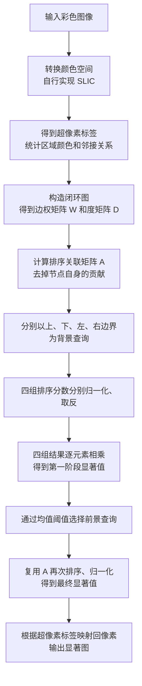
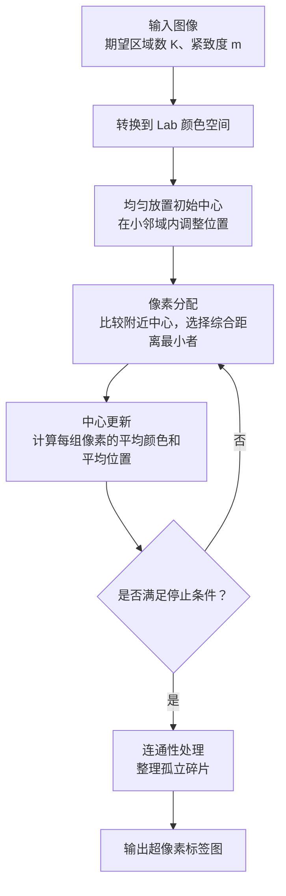

# AI 使用记录

## 第 1 次问答

时间：2026-10-21 21:56:31 +08:00｜使用者：本项目作者｜工具／模型：Codex / gpt-6-astra

**用户：**

请你先列出这个实验的实现步骤和整体的实现逻辑，让我们对整个论文的实现有一个整体的把握

**助手（2026-10-21 21:59:47 +08:00）：**

这个实验的整体逻辑是：**先把图像表示成超像素图，再利用图上的关联关系，先找出“不像背景”的区域，再用这些区域寻找完整的显著前景。**

实现可以拆成 **超像素分割、图构建、排序计算、两阶段查询、像素级输出** 五个部分。下面按实际的数据流梳理，让我们先看清每一步接收什么、完成什么、交给下一步什么。

我已经核对了论文第 2—4 节及 Algorithm 1：[Yang 等，CVPR 2013 论文](Yang_Saliency_Detection_via_2013_CVPR_paper.pdf)

整个过程如下：



这里最重要的关系是：**一幅图像只构建一次图，两阶段共用同一个排序关联矩阵。改变的是查询节点，以及排序分数的含义。**

背景查询时，分数高表示“与背景关联强”，所以要取反；前景查询时，分数高表示“与前景关联强”，直接作为显著值。

**第一步，明确输入、输出和数据表示。** 输入是一幅 \(H\times W\) 的彩色图像；输出是一幅同样大小的显著图，内部使用 \([0,1]\) 浮点数表示显著程度，保存时可以转换成灰度图。

先约定几个符号，后面的模块都沿用：

| 符号 | 含义 | 数据形状 |
|---|---|---|
| \(I\) | 输入彩色图像 | \(H\times W\times3\) |
| \(K\) | 希望得到的超像素数量 | 一个整数 |
| \(L\) | 每个像素所属的超像素编号 | \(H\times W\) |
| \(N\) | 分割后实际得到的超像素数量 | 一个整数 |
| \(C\) | 每个超像素的平均 Lab 颜色 | \(N\times3\) |
| \(W\) | 图中节点之间的直接连接权重 | \(N\times N\) |
| \(y\) | 查询节点指示向量 | 长度为 \(N\) |
| \(s\) | 每个超像素的显著值 | 长度为 \(N\) |
| \(S\) | 映射回像素后的显著图 | \(H\times W\) |

\(K\) 是期望数量，\(N\) 是实际数量。连通性处理等操作可能使两者略有不同，后面的矩阵尺寸应使用实际的 \(N\)。

**第二步，自行实现 SLIC，把像素组织成超像素。** 这一部分决定后续图的节点是什么。

SLIC 同时考虑颜色和位置。颜色相近、位置也接近的像素，更容易被分到同一个区域。其距离可以写成：

\[
d=\sqrt{d_c^2+\left(\frac{m}{h}\right)^2d_s^2},
\qquad
h\approx\sqrt{\frac{HW}{K}}
\]

这里 \(d_c\) 是 Lab 颜色距离，\(d_s\) 是空间距离，\(m\) 是紧致度，\(h\) 是初始中心的大致间隔。

实现时依次进行：

1. 将图像转换为 Lab 颜色空间。
2. 按网格放置初始中心，并在小邻域内调整到较低梯度的位置。
3. 每个中心在附近约 \(2h\times2h\) 的区域内比较距离，完成像素分配。
4. 根据当前分配，更新各中心的颜色与位置。
5. 重复分配和更新，直到达到停止条件。
6. 做连通性处理，并将最终标签连续编号。

输出是标签图 \(L\)。例如，\(L[r,c]=7\) 就表示该位置的像素属于第 7 个超像素。标准 SLIC 使用统一的紧致度参数，符合这次作业要求的可调节形式。[SLIC 作者项目页](https://www.epfl.ch/labs/ivrl/research/slic-superpixels/)

这一模块完成后，要能单独展示超像素边界，检查区域是否连通，以及改变 \(K\)、\(m\) 后结果是否合理。

**第三步，从标签图提取每个区域的信息。** 后续计算主要在区域层面进行，因此需要把像素信息汇总起来。

对每个超像素统计平均 Lab 颜色：

\[
c_i=\frac{1}{|R_i|}\sum_{p\in R_i}I_{\mathrm{Lab}}(p)
\]

其中 \(R_i\) 是第 \(i\) 个超像素包含的像素集合。

同时提取两类关系：

- **空间邻接关系**：哪些超像素共享边界。实现上可以扫描标签图中水平方向、竖直方向相邻的像素，记录不同标签之间的接触关系。
- **四侧边界集合**：分别记录接触图像上、下、左、右边缘的超像素编号。

一个超像素可能同时属于两个边界集合，比如位于左上角的区域。

**第四步，按论文规则构造闭环图。** 每个超像素作为一个节点，边决定哪些区域可以直接交换信息。

构图包含三类连接：空间直接相邻的节点、通过一个空间邻居能到达的两跳节点，以及任意两个图像边界节点。实现时可以先得到原始空间邻接，再扩展两跳关系，最后加入边界节点之间的连接。

对已经连接的节点，根据平均 Lab 颜色差设置边权：

\[
W_{ij}=
\begin{cases}
\exp\left(-\dfrac{\|c_i-c_j\|_2}{\sigma^2}\right),
& i,j\text{ 之间有边且 }i\ne j,\\[6pt]
0,&\text{其他情况}.
\end{cases}
\]

颜色越接近，权重越大。这里按照论文公式，分子使用颜色差的欧氏距离；颜色数值的范围与 \(\sigma\) 的尺度需要统一。

需要区分两个概念：**构图时所有边界节点相互连接；查询时四条边仍分别使用。** 前者规定信息如何传播，后者规定本次以谁作为参照。

随后计算度矩阵：

\[
D_{ii}=\sum_j W_{ij}
\]

\(D\) 是对角矩阵，表示每个节点连接权重的总和。

**第五步，建立可以重复使用的排序计算。** 这一模块接收查询向量 \(y\)，输出每个区域与查询集合的关联分数。

查询向量的定义很简单：

\[
y_i=
\begin{cases}
1,&i\text{ 是本次查询节点},\\
0,&\text{其他节点}.
\end{cases}
\]

先计算：

\[
B=(D-\alpha W)^{-1}
\]

再去掉自身关联：

\[
A=B-\operatorname{diag}(\operatorname{diag}(B))
\]

最后对任意查询向量计算：

\[
f=Ay
\]

因此，\(f_i\) 可以理解为“第 \(i\) 个区域与本次所有查询区域的关联程度之和”。

这里的 \(W\) 表示直接连接，而 \(A\) 还包含图中间接路径带来的关联。例如，两个区域没有直接连接，也可能通过若干颜色相近的中间区域产生较强关联。

实现时可以用基础线性方程求解功能计算 \(B\)，不需要自行编写矩阵求逆算法。**去掉对角元素这一步发生在求出 \(B\) 之后。**

**第六步，进行第一阶段：四侧背景查询与融合。** 以图像上边界为例，把接触上边界的超像素设为查询：

\[
f^{\mathrm{top}}=Ay^{\mathrm{top}}
\]

此时，\(f^{\mathrm{top}}\) 越大，说明该区域与上边界背景线索的关联越强。将它归一化到 \([0,1]\)，再取反：

\[
s^{\mathrm{top}}
=
1-\operatorname{Norm}\left(f^{\mathrm{top}}\right)
\]

对下、左、右边界重复同样的操作，得到四组显著值。然后逐元素相乘：

\[
s^{(1)}_i
=
s^{\mathrm{top}}_i
s^{\mathrm{bottom}}_i
s^{\mathrm{left}}_i
s^{\mathrm{right}}_i
\]

这就是第一阶段结果。

从乘法本身可以看出：如果某个区域在某一侧查询下被认为很像背景，其融合值就会受到抑制。因此，这一阶段可能突出物体的一部分，同时仍存在漏检或背景残留。我们需要保存四侧结果和融合结果，才能判断问题出现在哪一步。

归一化也要处理分数全部相同的情况，避免最大值等于最小值时发生除零。

**第七步，进行第二阶段：选择前景，再次排序。** 第一阶段已经提供了一些较显著的区域，现在用它们作为新的参照。

论文使用第一阶段显著值的均值作为阈值。为明确实现，在我们的节点表示下可写成：

\[
\tau=\frac{1}{N}\sum_{i=1}^{N}s_i^{(1)}
\]

\[
y_i^{\mathrm{fg}}
=
\begin{cases}
1,&s_i^{(1)}>\tau,\\
0,&\text{其他情况}.
\end{cases}
\]

这里约定使用超像素分数的均值；如果改成像素均值，就会引入区域面积权重，属于需要明确记录的实现差异。

复用前面得到的 \(A\)：

\[
f^{\mathrm{fg}}=Ay^{\mathrm{fg}},
\qquad
s^{(2)}=\operatorname{Norm}\left(f^{\mathrm{fg}}\right)
\]

这次查询代表前景，所以较高关联直接对应较高显著性。第二阶段的目的，是利用初步前景区域的颜色和图关联，进一步突出相关区域、抑制背景。

需要记住：**第二阶段不重新分割图像，也不重新构图。**

**第八步，把区域分数映射回像素。** 最终每个超像素都有一个显著值 \(s_i^{(2)}\)，利用标签图即可得到输出：

\[
S(r,c)=s^{(2)}_{L(r,c)}
\]

也就是：像素属于哪个超像素，就取那个超像素的显著值。因此，输出具有原图的空间尺寸，同一超像素内的像素共享分数。

先完成这个核心输出，并保留原始浮点结果。额外的平滑或后处理可以作为之后的独立实验，便于判断它具体改变了什么。

在代码开发上，我建议按以下顺序推进，每一阶段都能独立检查：

| 开发阶段 | 主要工作 | 完成标志 |
|---|---|---|
| 1. SLIC | 中心初始化、局部分配、中心更新、连通性处理 | 输出正确标签和边界图，参数变化合理 |
| 2. 区域与图 | 颜色统计、邻接、四侧集合、闭环连接、边权 | 在人工构造的小例子上核对连接；\(W\) 对称、度计算正确 |
| 3. 排序 | 计算关联矩阵、去除自身贡献、查询计算 | 小规模图计算可核对，结果无异常数值 |
| 4. 两阶段流程 | 四侧查询、融合、前景选择、再次排序 | 保存所有中间图，得到完整像素级显著图 |
| 5. 实验与分析 | 固定图像集、参数比较、模块对比、失败分析 | 每项结论都对应真实配置和结果 |

实验可以围绕几个具体问题设计：增加超像素数量是否改善边界、紧致度变化如何影响结果、加入边界连接带来了什么、第二阶段相比第一阶段改善了哪些图像。评价时使用有像素级标注的数据，保留显著图、精确率—召回率结果和运行时间；MAE 可以作为补充指标。

**第一轮实现的范围就定在 SLIC：输入一幅图像和 \(K,m\)，输出连通的标签图、实际区域数及边界可视化。** 等这一模块的输入输出和验证标准明确后，就可以开始实现，为后面的图与排序模块打好基础。

---

## 第 2 次问答

时间：2026-10-22 10:09:27 +08:00｜使用者：本项目作者｜工具／模型：Codex / gpt-6-astra

**用户：**

请你先为我讲解SLIC的做法

**助手（2026-10-22 10:13:28 +08:00）：**

**SLIC 的做法是：先在图像上均匀放置一批“区域中心”，再根据颜色和位置，把附近像素分给这些中心；随后更新中心，重复这个过程，最后整理成连通的超像素。**

它的全称是 *Simple Linear Iterative Clustering*，可以理解为一种适合图像的局部聚类方法。对于我们的大作业，它负责把大量像素组织成几百个小区域，后面的图流形排序再判断这些区域的显著程度。

我们用一张“绿色草地上有一朵红花”的照片来理解：草地会被分成多个小区域，花朵也会被分成多个小区域。理想情况下，这些小区域的边界能尽量贴合花朵与草地之间的颜色边界。

整个过程可以先看这张图：



先理解它最核心的两个概念：**怎么衡量像素与中心的距离，以及为什么要反复分配、更新。**

**一个像素由“颜色＋位置”共同描述。** SLIC 通常使用 Lab 颜色空间，将像素写成：

\[
p=[L,a,b,x,y]
\]

其中，\(L,a,b\) 描述颜色，\(x,y\) 描述它在图像中的位置。Lab 颜色空间中的距离可以较好地反映颜色差异。

一个聚类中心也用同样的形式表示：

\[
C_k=[L_k,a_k,b_k,x_k,y_k]
\]

初始化时，它来自某个像素；迭代之后，它代表一组像素的平均颜色和平均位置，因此不一定恰好对应某个实际像素。

同时考虑颜色与位置，是因为我们希望形成的区域具有两个特点：

- 内部颜色尽量相近，便于贴合图像边界。
- 空间位置比较集中，便于形成紧凑的小区域。

例如，两片相隔很远的红色花瓣虽然颜色相近，空间距离仍会阻止它们轻易归入同一个超像素。

**像素与中心的综合距离，是 SLIC 最重要的公式。**

先计算颜色距离：

\[
d_c=
\sqrt{(L-L_k)^2+(a-a_k)^2+(b-b_k)^2}
\]

再计算空间距离：

\[
d_s=
\sqrt{(x-x_k)^2+(y-y_k)^2}
\]

最后合成：

\[
\boxed{
D=\sqrt{d_c^2+\left(\frac{m}{S}\right)^2d_s^2}
}
\]

这里：

- \(S\) 是初始中心之间的大致间隔。
- \(m\) 是紧致度参数，控制空间距离的重要程度。

公式及局部搜索方式对应原论文第 3 节。[SLIC 原论文](https://www.cs.jhu.edu/~ayuille1/JHUcourses/VisionAsBayesianInference2022/4/Achanta_SLIC_PAMI2012.pdf)

\(S\) 用来调整空间距离的尺度。一个像素距离中心 10 个像素，对于很小的超像素可能已经很远，对于很大的超像素则未必如此；用 \(d_s/S\) 可以表达这种相对距离。

\(m\) 则控制分组偏好：

| 参数变化 | 影响 |
|---|---|
| \(m\) 较小 | 更重视颜色一致性，区域更容易沿颜色边界变化，形状可能更不规则 |
| \(m\) 较大 | 更重视位置接近，区域通常更紧凑、规整，也更可能跨过某些颜色边界 |

可以用一个**手算示例**体会这种变化。假设 \(S=20\)，某个像素有两个候选中心：

- 中心 A：颜色距离 \(d_c=2\)，空间距离 \(d_s=16\)，颜色很接近，但位置较远。
- 中心 B：颜色距离 \(d_c=6\)，空间距离 \(d_s=4\)，颜色差异较大，但位置很近。

为了比较大小，直接使用 \(D^2\) 即可：

| 紧致度 | 到中心 A 的 \(D^2\) | 到中心 B 的 \(D^2\) | 分配结果 |
|---|---:|---:|---|
| \(m=5\) | \(2^2+(5/20)^2\times16^2=20\) | \(6^2+(5/20)^2\times4^2=37\) | 分给 A |
| \(m=20\) | \(2^2+(20/20)^2\times16^2=260\) | \(6^2+(20/20)^2\times4^2=52\) | 分给 B |

因此，同一个像素在不同紧致度下可能属于不同区域。这就是 \(m\) 能改变超像素形状的原因。

接下来按执行顺序看完整算法。

**第一步，根据期望区域数初始化中心。** 假设图像有 \(H\times W\) 个像素，希望得到约 \(K\) 个超像素，那么每个区域的平均面积约为：

\[
\frac{HW}{K}
\]

把它近似看成正方形，边长就是：

\[
S\approx\sqrt{\frac{HW}{K}}
\]

例如，图像尺寸为 \(400\times300\)，希望得到 \(300\) 个超像素：

\[
S=\sqrt{\frac{400\times300}{300}}=20
\]

于是可以大约每隔 20 个像素放置一个中心。每个超像素预计覆盖约 \(20\times20=400\) 个像素。

这是初始安排。经过迭代后，各区域的形状与面积会随图像内容变化。

**第二步，把初始中心稍微移离明显边缘。** 均匀放置的中心可能恰好落在花朵与草地的交界处，这样的起点不太稳定。

SLIC 会在每个初始中心周围的 \(3\times3\) 邻域内，寻找梯度较小的位置，把中心移过去。梯度可以理解为局部颜色变化的强弱：变化较小的位置通常处于相对平坦的区域内部。

这是初始化时的小范围调整，目的是减少明显边缘或噪声对起点的影响。

**第三步，让像素选择附近最合适的中心。** 对每个中心，只检查它附近约 \(2S\times2S\) 的窗口，也就是横向、纵向各向两侧延伸约 \(S\)。

对于窗口内的像素：

1. 计算它到当前中心的综合距离 \(D\)。
2. 与它到其他候选中心的距离比较。
3. 保存距离最小的中心编号。

一个像素可能落入多个中心的搜索窗口，因此这些中心会竞争它的归属。最终它只保留一个标签。

局部搜索能明显减少计算量。假设有 12 万个像素和 300 个中心，如果每个像素都与全部中心比较，一轮需要约 3600 万次距离计算；限定附近窗口后，每个像素只需要比较少数候选中心。

需要注意，**\(2S\times2S\) 是候选搜索范围，最终超像素的形状由距离比较决定。**

**第四步，根据分配结果更新中心。** 完成一轮分配后，每个中心都有了一组属于自己的像素。

设第 \(k\) 组像素集合为 \(R_k\)，新的中心取这组像素五维特征的平均值：

\[
C_k^{\mathrm{new}}
=
\frac{1}{|R_k|}
\sum_{p\in R_k}
[L_p,a_p,b_p,x_p,y_p]
\]

也就是同时更新：

- 平均颜色；
- 平均横坐标；
- 平均纵坐标。

例如，一个中心最初放得偏左，但分给它的像素主要位于右侧，更新后中心就会向右移动。如果它所包含的像素大多是红色，它的平均颜色也会更接近红色。

**第五步，重复“分配—更新”。** 中心变化后，像素到中心的距离也发生变化，所以需要重新判断归属：

> 用当前中心分配像素 → 用当前像素分组更新中心 → 再次分配像素。

随着迭代，中心位置和区域边界通常会逐渐稳定。停止方式可以采用最大迭代次数，也可以结合中心变化量设置停止条件。

这里要理解：初始化只给出了一个粗略起点，**反复分配和更新才让区域逐渐适应图像内容。**

**第六步，检查并修正连通性。** 前面的距离规则鼓励像素聚集，但不能严格保证“拥有相同标签的所有像素都连在一起”。

例如，大部分标签为 7 的像素聚集成一块，另有几个标签为 7 的像素落在附近另一块区域中，形成孤立小碎片。如果直接把标签 7 当成一个图节点，后面的空间邻接关系就不够合理。

因此需要增加连通性处理。我们后续可以明确采用四邻域，也就是上下左右相邻，并按以下方式实现：

- 找出各标签包含的连通块。
- 将过小的孤立碎片并入接触它的合适区域。
- 对最终区域重新编号。
- 检查每个标签是否只对应一个连通区域。

这是把论文的连通性要求落实到程序中的具体策略；碎片阈值和合并规则需要在实现时明确记录。处理后，实际超像素数量可能与期望的 \(K\) 略有差异。

**SLIC 最终交给下一模块的是标签图。** 它是一个与原图同高、同宽的整数数组，例如：

```text
0 0 0 1 1
0 0 0 1 1
2 2 2 1 1
2 2 2 3 3
```

相同编号表示属于同一个超像素。程序中的含义可以写成：

```text
labels[y, x] = k
```

即位置 \((x,y)\) 的像素属于区域 \(k\)。有了这个标签图，后续才能统计每个区域的平均颜色、面积和邻接关系，进一步构建显著性检测所需的图。

我们实现这个模块时，首先验证四件事：

1. 每个像素都被分配了有效标签。
2. 每个最终标签对应的区域都连通。
3. 改变 \(K\) 时，区域数量和大小出现合理变化；改变 \(m\) 时，区域形状出现合理变化。
4. 在简单双色图像上观察边界，再用真实图像检查效果。

第一版的输出应同时包含**标签图、实际区域数，以及叠加在原图上的超像素边界图**。这三项能让我们检查实现，也能为后续实验报告保留直观证据。

---

## 第 3 次问答

时间：2026-10-22 10:13:54 +08:00｜使用者：本项目作者｜工具／模型：Codex / gpt-6-astra

**用户：**

这部分对应论文的那几页，我要去看一看论文

**助手（2026-10-22 10:14:49 +08:00）：**

我们刚才讲的 SLIC，对应 **Achanta 等人的《SLIC Superpixels Compared to State-of-the-Art Superpixel Methods》（TPAMI 2012）**。

重点看 **PDF 的第 2—4 页，也就是印在页面上的期刊页码 2275—2277**，主要内容在 **第 3 节 “SLIC Superpixels”**。

你可以直接打开这份论文：[SLIC 论文 PDF，从第 2 页开始](https://www.cs.jhu.edu/~ayuille1/JHUcourses/VisionAsBayesianInference2022/4/Achanta_SLIC_PAMI2012.pdf#page=2)。

| PDF 页码 | 页面印刷页码 | 重点位置 | 对应我们刚才讲的内容 |
|---|---:|---|---|
| **第 2 页** | **2275** | **§3 SLIC Superpixels、§3.1 Algorithm** | SLIC 的基本思想；均匀初始化中心；在 \(3\times3\) 邻域内调整中心；局部分配；更新中心；迭代 |
| **第 3 页** | **2276** | **Algorithm 1、Figure 2、§3.2 Distance Measure** | 完整算法伪代码；\(2S\times2S\) 搜索窗口示意图；颜色距离、空间距离及其归一化 |
| **第 4 页** | **2277** | **公式 (3)、§3.3 Postprocessing、§3.4 Complexity** | 最终距离公式；紧致度 \(m\) 的作用；连通性处理；算法为什么计算较快 |

我建议第一次按这个顺序阅读：

1. **先看第 2275 页的 §3.1。** 对照“初始化 → 分配像素 → 更新中心 → 重复”的流程，理解一轮迭代做了什么。
2. **再看第 2276 页的 Figure 2 和 Algorithm 1。** 图中较小的 \(S\times S\) 方框表示预期区域大小，较大的 \(2S\times2S\) 方框表示搜索范围。
3. **接着读 §3.2，一直读到第 2277 页的公式 (3)。** 我们刚才用的就是：
   \[
   D=\sqrt{d_c^2+\left(\frac{d_s}{S}\right)^2m^2}
   \]
   重点理解为什么要除以 \(S\)，以及 \(m\) 如何调节颜色与位置的相对重要性。
4. **最后看 §3.3。** 这一小节解释为什么聚类完成后还要进行连通性处理，对你作业中“输出连通超像素”的要求很重要。

读的时候注意一个符号差异：**SLIC 原论文中的 \(N\) 表示图像的像素总数**，所以它写 \(S=\sqrt{N/K}\)。在我们后续讨论显著性检测时，曾用 \(N\) 表示超像素数量；阅读两篇论文时要留意这个区别。

---

## 第 4 次问答

时间：2026-10-22 10:27:59 +08:00｜使用者：本项目作者｜工具／模型：Codex / gpt-6-astra

**用户：**

我刚刚看了一下论文，我对这一步大概的理解如下：这一步的核心就是将整个图像分成一个一个的小区域，这些小区域会被组织成超像素，然后后面我们的图形流排序再去判断这些区域的显著程度。这样就不用一个像素一个像素的进行计算。

1. 首先我们将图像转换到Lab颜色空间，p=[L,a,b,x,y]，这样即描述了颜色，有描述了位置
2. 接着我们计算距离。从直观上来想，距离应该包含两个层面：空间上的距离和时间上的距离。颜色越近，距离越近越应该认为属于一个区域。所以f恩别计算这两个距离，然后再取加权均方
3. 然后我们呢在图上放置一些初始的区域中心，根据我们期望的区域数来均匀放置
4. 然后开始循环更新像素中心：对每个中心，检查它附近的窗口，计算窗口内像素点到其他点的综合距离，然后将这个区域的中心更新到综合距离最小的点，更新中心。这样重复进行，姐可以得到一个比较合理的区域分配
5. 最后对这些区域调整连通性

**助手（2026-10-22 10:29:34 +08:00）：**

你的整体理解是对的：**SLIC 把图像划分成小区域，每个小区域就是一个超像素，后续图流形排序以这些超像素为节点计算显著程度。** 这样减少的是后续图排序的计算量；SLIC 本身仍然需要处理和分配各个像素。

你这段描述里，**最需要修正的是第 4 步：先把像素分给合适的中心，再对每组像素取平均来更新中心。** 我们逐项核对一下。

1. **转换到 Lab 颜色空间：理解正确。**

   每个像素用
   \[
   p=[L,a,b,x,y]
   \]
   表示，其中前三项描述颜色，后两项描述位置。聚类中心也用同样的五维形式表示。

2. **综合距离：思路正确，需要改两个表述。**

   你写的“空间上的距离和时间上的距离”，这里应当是 **空间距离和颜色距离**。我们处理的是一幅静态图像，没有用到时间维度。

   “颜色越接近、空间距离越近，越容易属于同一个区域”，这个理解是正确的。综合距离具体为：
   \[
   D(p,C_k)=
   \sqrt{d_c^2+\left(\frac{m}{S}\right)^2d_s^2}
   \]

   更准确的说法是：**将颜色距离和经过尺度调整的空间距离平方后相加，再开平方。** 这里没有求平均，所以称为“加权欧氏距离”比“加权均方”更准确。

3. **根据期望区域数均匀放置中心：理解正确。**

   对于 \(H\times W\) 的图像，希望分成约 \(K\) 个区域，中心间距约为：
   \[
   S=\sqrt{\frac{HW}{K}}
   \]

   还需要补上一个初始化细节：**在每个初始中心附近的 \(3\times3\) 邻域内，寻找梯度较小的位置，将中心稍作调整**，降低中心恰好落在明显边缘上的可能性。

4. **迭代过程：需要区分“分配像素”和“更新中心”两个操作。**

   你写到：

   > 计算窗口内像素点到其他点的综合距离，然后将这个区域的中心更新到综合距离最小的点。

   这里有两处需要改正：

   - 比较的是**像素与候选聚类中心之间的距离**，不是窗口内所有像素之间的两两距离。
   - “距离最小”用于决定**像素归哪个中心**；中心更新则使用**已分配像素的平均颜色和平均位置**。

5. **最后处理连通性：理解正确。**

   距离聚类可能产生孤立碎片，所以还需要检查连通块、处理碎片，并对最终区域重新编号。

我们把第 4 步展开看一下，这是 SLIC 的核心。

**先固定中心，让像素选择归属。** 假设某个像素 \(p\) 同时处于中心 A、B、C 的搜索窗口内，算出：

| 候选中心 | 像素到中心的综合距离 |
|---|---:|
| A | 8 |
| B | 3 |
| C | 6 |

于是把像素 \(p\) 分给 B。**此时改变的是像素的标签，中心 B 暂时不移动。**

对所有中心附近的像素完成距离比较后，就得到这一轮的区域分配。

**再固定像素分组，对每组取平均，更新中心。** 假设分给中心 B 的像素集合是 \(R_B\)，那么：

\[
C_B^{\mathrm{new}}
=
\frac{1}{|R_B|}
\sum_{p\in R_B}
[L_p,a_p,b_p,x_p,y_p]
\]

也就是说，新的中心包含：

- 这一组像素的平均 \(L,a,b\)；
- 这一组像素的平均 \(x,y\)。

举一个只看位置的例子：假设某组有三个像素，位置分别为

\[
(2,2),\quad(4,2),\quad(6,5)
\]

那么更新后的中心位置是：

\[
\left(
\frac{2+4+6}{3},
\frac{2+2+5}{3}
\right)
=(4,3)
\]

中心位置由平均值计算得到，**不必是这组像素中某个像素的位置，也不必是整数坐标**。颜色部分同样取平均。

接着用更新后的中心，再进行下一轮像素分配。于是形成循环：


这正对应论文 Algorithm 1 中的 **Assignment（分配）** 和 **Update（更新）** 两部分，可以再对照 [PDF 第 3 页的算法框](https://www.cs.jhu.edu/~ayuille1/JHUcourses/VisionAsBayesianInference2022/4/Achanta_SLIC_PAMI2012.pdf#page=3) 看一下。

你的第 4 步可以修订为下面这样，作为参考：

> 对每个聚类中心，在它附近约 \(2S\times2S\) 的窗口内，计算像素与该中心的综合距离。一个像素可能被多个中心的窗口覆盖，将它分配给综合距离最小的中心。完成这一轮分配后，对每组像素的 Lab 颜色和位置分别取平均，得到新的聚类中心。重复像素分配与中心更新，直到达到停止条件。

你可以重点对照这句话再看论文：**最小距离决定像素归属，组内平均值决定新的中心。**

---

## 第 5 次问答

时间：2026-10-22 10:36:52 +08:00｜使用者：本项目作者｜工具／模型：Codex / gpt-6-astra

**用户：**

意思更新迭代是：

1. 计算像素与中心的综合距离，一个像素可能归属到多个不同中心的区域中，然后将其归入到距离最小的中心
2. 在区域范围确定下来之后再在区域中取平均值，决定新的中心

**助手（2026-10-22 10:37:28 +08:00）：**

对，这次你理解准确了。只需要把第 1 点中的“可能归属到多个区域”说得更精确一点：**一个像素可能有多个候选中心，完成比较后，它只归属于其中一个中心。**

每轮迭代就是这两个步骤：

1. **固定中心，分配像素。**  
   计算像素与附近候选中心的综合距离，把它分给距离最小的中心。这一步确定每个像素的标签，中心暂时不变。

2. **固定分组，更新中心。**  
   完成所有像素的分配后，对每组像素的 **Lab 颜色和位置都取平均**：
   \[
   C_k^{\text{new}}
   =
   [\overline L_k,\overline a_k,\overline b_k,\overline x_k,\overline y_k]
   \]
   得到新的聚类中心。

这里的区域范围只是**当前这一轮的分配结果**。中心更新后，距离会发生变化，下一轮有些像素就可能改分到另一个中心，区域边界也会随之调整：

\[
\text{当前中心}
\;\longrightarrow\;
\text{分配像素}
\;\longrightarrow\;
\text{取平均更新中心}
\;\longrightarrow\;
\text{重新分配像素}
\;\longrightarrow\;\cdots
\]

重复这个过程，直到中心变化足够小或达到设定的迭代次数。

---

## 第 6 次问答

时间：2026-10-22 10:44:41 +08:00｜使用者：本项目作者｜工具／模型：Codex / gpt-6-astra

**用户：**

这里调整连通信是怎么做的

**助手（2026-10-22 10:47:45 +08:00）：**

这里的**连通性调整，就是检查“同一个标签的像素是否连成一块”，把孤立的小碎片重新分配给相邻区域**。它通常在 SLIC 的迭代结束后进行。

原论文在 **第 2277 页、§3.3 Postprocessing** 中简要说明了这一步：通过连通域算法识别孤立像素，并重新分配它们的标签。[查看论文对应页面](https://www.cs.jhu.edu/~ayuille1/JHUcourses/VisionAsBayesianInference2022/4/Achanta_SLIC_PAMI2012.pdf#page=4)

先看一个例子。下面每个字母代表一个像素的超像素标签：

```text
A A A B B B B
A A A B B A B
A A A B B B B
C C C C B B B
C C C C B B B
```

左上角有一大块 A，但右侧 B 区域中还有一个孤立的 A。

它之所以可能出现，是因为前面的聚类根据颜色和位置计算距离，**没有检查这个像素能否沿着同标签像素走到 A 的其他部分**。

我们采用“四邻域”定义连通：一个像素可以向上、下、左、右移动。只经过标签 A 的像素，如果无法从左上角的 A 走到右侧的 A，那么它们就是两个不同的连通块。

右侧这个孤立 A 被 B 包围，将它改成 B 后：

```text
A A A B B B B
A A A B B B B
A A A B B B B
C C C C B B B
C C C C B B B
```

现在 A、B、C 各自都连成一块了。**修改的是标签，原图的像素颜色不会改变。**

具体实现可以分成四步。论文对后处理描述得比较简略，下面是我们可以采用的一套明确实现策略。

**第一步，找出所有“同标签连通块”。**

从一个尚未访问的像素开始：

1. 记录它的标签，例如 A。
2. 检查它上下左右的邻居。
3. 将标签同样为 A、并且尚未访问的邻居加入搜索。
4. 继续向外扩展，直到没有新的同标签像素。

这次搜索找到的全部像素，就是一个连通块。可以用广度优先搜索、深度优先搜索，或作业允许使用的连通域标记函数来完成。

对于上面的例子，搜索结果是：

| 原标签 | 找到的连通块 | 面积 |
|---|---|---:|
| A | 左上角的一块 | 9 个像素 |
| A | 右侧孤立的一块 | 1 个像素 |
| B | 周围连通的一块 | 17 个像素 |
| C | 左下角的一块 | 8 个像素 |

注意，搜索条件是**空间相邻且标签相同**，这一步不重新判断颜色是否相似。

**第二步，先给每个连通块独立的编号。**

比如，把原来的两个 A 分别记成 A₁ 和 A₂。这样每个临时区域本身都是连通的。

这个步骤很重要：如果同一个标签分裂成两个都比较大的区域，我们也不能继续让它们共用一个标签。可以将它们保留为两个独立区域。

**第三步，将过小的连通块合并到接壤的区域。**

“过小”可以根据期望超像素面积来定义：

\[
A_{\mathrm{expected}}=\frac{HW}{K},
\qquad
T=\eta A_{\mathrm{expected}}
\]

其中 \(\eta\) 是我们需要明确记录的实现参数。例如，取 \(\eta=0.25\)，表示把面积小于期望面积四分之一的区域视为小碎片。**这是可选的实现设置，不是论文 §3.3 规定的固定阈值。**

对于一个小碎片，先找出所有与它共享边界的区域，再选择合并目标。为了让第一版行为清楚、容易检查，我们可以采用：

> 优先并入与碎片共享边界最长的区域；如果有并列，再比较平均颜色的接近程度。

在前面的例子中，孤立 A₂ 只与 B 接壤，因此直接并入 B。

之所以限定“接壤”，是因为**两个本身连通、并且相互接触的区域合并后，仍然连通**。仅仅因为颜色相近，就把碎片标成远处某个区域的标签，可能再次产生不连通问题。

合并时应更新当前区域的标签、面积和邻接关系，再继续处理其他碎片。

**第四步，重新编号并检查结果。**

处理结束后，将最终标签整理为：

\[
0,1,2,\ldots,N-1
\]

然后检查：

- 所有像素都有有效标签。
- **每个标签恰好对应一个四连通区域。**
- 实际区域数量是多少。
- 后续区域颜色、面积和邻接关系，都根据修正后的标签重新统计。

这里实际得到的区域数 \(N\) 可能与期望数量 \(K\) 略有差异，因为处理过程既可能拆分不连通区域，也可能合并小碎片。

对我们的作业，连通性处理的直接验收标准就是：**逐个检查最终标签，每个标签的连通块数量都应等于 1。**

---

## 第 7 次问答

时间：2026-10-22 10:49:35 +08:00｜使用者：本项目作者｜工具／模型：Codex / gpt-6-astra

**用户：**

这里的标签是什么

**助手（2026-10-22 10:51:31 +08:00）：**

这里的**标签，就是记录“一个像素属于哪个超像素”的编号**。

例如，我们有三个区域中心，分别编号为 `0、1、2`。在分配像素时：

- 某个像素到中心 `0` 的综合距离最小，就给它标签 `0`。
- 到中心 `1` 的距离最小，就给它标签 `1`。
- 到中心 `2` 的距离最小，就给它标签 `2`。

因此，每个像素除了自身的颜色和位置之外，还有一条分组记录：

> **这个像素当前属于第几个区域？**

把所有像素的分组记录排列起来，就得到一张与原图同样大小的**标签图**。例如：

```text
0 0 1 1
0 0 1 1
2 2 2 1
```

这里：

- 所有标签为 `0` 的像素，归在同一个超像素中。
- 所有标签为 `1` 的像素，归在另一个超像素中。
- 所有标签为 `2` 的像素，归在第三个超像素中。

**这些数字只是编号，本身没有颜色、显著程度或物体类别的含义。** 标签 `2` 不表示比标签 `1` 更显著，也不表示某种特定颜色。

程序里通常用一个整数数组保存：

```python
labels[y, x] = k
```

意思是：位置为 \((x,y)\) 的像素，被分配给编号为 \(k\) 的区域。

你前面理解的两步迭代就可以对应起来：

1. **分配像素：**找到最近的候选中心，更新这个像素的标签。
2. **更新中心：**把具有相同标签的像素收集起来，对它们的颜色和位置取平均。

之前例子中的 `A、B、C` 也是标签，只是为了方便观察用了字母。所谓“连通性调整”，就是检查：**拥有同一个标签的像素，在图像上是否确实连成一块。**

---

## 第 8 次问答

时间：2026-10-22 10:53:55 +08:00｜使用者：本项目作者｜工具／模型：Codex / gpt-6-astra

**用户：**

最终会输出一个标签图，这个标签图和原图大小相等，对应的就是原图中每个像素所属的区域标签。连通信调整就是要把同一个标签的像素连城一块。这里采用的是将小的连通块合并到周边区域的方法

**助手（2026-10-22 10:55:36 +08:00）：**

对，你对标签图和连通性调整的理解是正确的。这里把“把同一个标签的像素连成一块”再说得准确一些：

> **通过调整标签，使最终每个标签都只对应一个连通区域。**

处理过程中，像素的位置和颜色保持不变，改变的是它们所属的区域。例如，一个孤立的小块原来标为 A，周围都是 B，就可以把这个小块的标签改成 B。

我们采用的具体流程是：

1. **找连通块。** 根据当前标签，找出所有同标签的四连通区域。
2. **给不同连通块独立编号。** 即使原来标签相同，只要空间上不连通，就先作为不同区域处理。
3. **合并小块。** 将面积过小的连通块并入与它实际接壤的合适区域，修改这一整块像素的标签。
4. **重新编号并检查。** 保证最终每个标签都只有一个连通块。

还有一种情况要保留在理解中：**如果同一个旧标签对应的两块区域都比较大，可以让它们分别成为两个超像素，使用不同的新标签。**

因此，你可以把这一部分描述为：

> SLIC 输出与原图同尺寸的标签图，记录每个像素所属的超像素。聚类结束后，通过连通域检测拆分不连通的同标签区域，再把小连通块合并到相邻区域，最后重新编号，保证每个最终超像素都是连通的。

---

## 第 9 次问答

时间：2026-10-22 10:56:43 +08:00｜使用者：本项目作者｜工具／模型：Codex / gpt-6-astra

**用户：**

# 基于图形流排序的显著性检测

## SLIC


这一步的核心就是将整个图像分成一个一个的小区域，这些小区域会被组织成超像素。**后续图流形排序以这些超像素为节点计算显著程度。** 相比于按像素进行显著度计算，这样可以大大减少后续图排序的计算量

1. 首先我们将图像转换到Lab颜色空间，p=[L,a,b,x,y]，其中前三项描述颜色，后两项描述位置。聚类的中心同样使用这样的P来表示

2. 接着我们计算距离。从直观上来想，距离应该包含两个层面：空间上的距离和颜色上的距离。颜色越近，距离越近越应该认为属于一个区域。所以分别计算这两个维度的欧氏距离，然后再取加权欧氏距离，具体而言：

   先计算颜色距离：

   $ d_c= \sqrt{(L-L_k)^2+(a-a_k)^2+(b-b_k)^2} $

   再计算空间距离：

   $d_s= \sqrt{(x-x_k)^2+(y-y_k)^2} $

   最后合成：

   $D=\sqrt{d_c^2+\left(\frac{m}{S}\right)^2d_s^2}$

   这里的系数:

   S 是初始中心之间的大致间隔。

   m 是紧致度参数，控制空间距离的重要程度。m大，则更重视空间的接近性

3. 然后我们在图上放置一些初始的区域中心，根据我们期望的区域数来均匀放置

   假设图像有 $H\times W$个像素，希望得到约 \(K\) 个超像素，那么每个区域的平均面积约为：

   $\frac{HW}{K} $

   把它近似看成正方形，边长就是：

   $S\approx\sqrt{\frac{HW}{K}} $

   将整个图近似初始化为一个个的正方形区域

4. 然后开始循环更新区域和像素中心：

   1. 取中心附近2S*2S的区域
   2. 计算像素与中心的综合距离，一个像素可能归属到多个不同中心的区域中，然后将其归入到距离最小的中心
   3. 在区域范围确定下来之后再在区域中取平均值，作为新的区域中心:$ C_k^{\text{new}} = [\overline L_k,\overline a_k,\overline b_k,\overline x_k,\overline y_k] $

5. 最后对这些区域调整连通性

   上一步结束后会输出一个标签图。这个标签图和原图大小相等，对应的就是原图中每个像素所属的区域标签。连通信调整就是要把同一个标签的像素连成一块。这里采用的是将小的连通块合并到周边区域的方法

   比如：

   ```
   A A A B B B B
   A A A B B A B
   A A A B B B B
   C C C C B B B
   C C C C B B B
   ```

   调整后就是：

   ```
   A A A B B B B
   A A A B B B B
   A A A B B B B
   C C C C B B B
   C C C C B B B
   ```

   

最终输出一个标签图提供给下一步使用


我整理了一下这一步的实现流程和要点，请你检查一下是否有问题，如果没有问题的话我要开始完成代码了

**助手（2026-10-22 10:59:53 +08:00）：**

**你的核心公式、像素分配和中心更新逻辑都是正确的，已经可以作为开始编写代码的依据。** 开始前建议修正几处表述，再补齐几个实现约定，明确这些细节。

1. **标题和“超像素”的表述需要微调。**

   标题应为“**基于图流形排序的显著区域检测**”。

   开头的“这些小区域会被组织成超像素”，可以改成：

   > 将整幅图像划分为若干小区域，每个区域就是一个超像素。后续图流形排序以这些超像素为节点，计算显著程度。

2. **距离公式正确，第 2 步更适合叫“定义距离”。**

   此处是在说明之后分配像素时使用什么距离，还没有开始实际的距离计算。你给出的
   \[
   D=\sqrt{d_c^2+\left(\frac{m}{S}\right)^2d_s^2}
   \]
   以及对 \(m\) 的解释都正确。

   “颜色越近，距离越近”可以改成“**颜色越接近、空间位置越接近，越容易被分到同一区域**”，更明确一些。

3. **初始化部分需要补上中心位置调整。**

   你的流程图已经写了“在小邻域内调整位置”，但正文第 3 步还没有展开。建议补上：

   > 按间隔 \(S\) 在图像上均匀放置初始中心，再在每个中心周围的 \(3\times3\) 邻域内寻找梯度较小的位置，将中心移动过去，并更新该中心的颜色与位置特征。

   “将整个图近似初始化为一个个的正方形区域”也可以改得更准确：

   > 按规则网格初始化中心，预期每个区域的面积约为 \(S^2\)，实际区域边界由后续像素分配决定。

   这样可以避免实现时把初始网格误当成固定的区域边界。

4. **迭代部分需要明确：一个像素有多个候选中心，但只有一个归属。**

   你第 4 步的第 2 小点建议改成：

   > 一个像素可能被多个中心的搜索窗口覆盖。比较它到这些候选中心的综合距离，将它分给距离最小的中心。

   同时，中心更新应当发生在**整轮像素分配结束之后**。一轮的顺序是：

   ```text
   使用当前所有中心完成像素分配
                   ↓
   根据分配结果，计算各组的平均颜色和平均位置
                   ↓
   得到新中心，进入下一轮
   ```

   这样可以保证同一轮分配使用的是同一组中心状态。

5. **连通性部分需要补上“拆分并重新编号”。**

   你的例子和小碎片合并思路正确。但如果只合并小块，仍可能出现“一个旧标签对应两个较大、不相连的区域”的情况。

   建议把这一段改成：

   > 聚类结束后得到初步标签图。采用四邻域检测同标签连通块，先给不同连通块独立编号，再将面积过小的连通块合并到与它接壤的合适区域。最后重新编号，保证每个最终标签恰好对应一个连通区域。

   标签图具体是一个 **\(H\times W\) 的整数数组**，与原图的空间尺寸一致。实际区域数量可能与期望的 \(K\) 略有差异。

开始写代码前，还建议把下面这些约定补进实现要求中。它们属于我们的实现选择，其中碎片阈值、合并规则需要在报告中如实注明。

| 项目 | 第一版建议采用的约定 |
|---|---|
| 输入 | RGB 彩色图像；明确数值范围，统一转换为浮点 Lab，计算过程中保持尺度一致 |
| 停止条件 | 先使用可配置的最大迭代次数，初始取 `10`，便于调试和复现 |
| 距离比较 | 每轮分配开始前，将最小距离缓存重置为正无穷，再用当前中心重新比较 |
| 搜索窗口 | 以中心为基准，横纵方向各向两侧延伸约 \(S\)；超出图像部分裁剪 |
| 空区域 | 某个中心没有分到像素时，保留原中心，避免对空集合求平均产生异常值 |
| 连通性 | 使用四邻域，即上下左右相邻 |
| 小碎片阈值 | 可先取 \(T=0.25HW/K\)，并把 `0.25` 作为可配置参数 |
| 合并目标 | 优先并入共享边界最长的相邻区域；并列时选择平均 Lab 颜色更接近的区域 |
| 最终输出 | 连续编号的标签图、实际区域数，以及用于检查的边界叠加图 |

还需要让实现检查**像素是否全部被搜索窗口覆盖并获得有效标签**。这是边界、非正方形图像和中心移动时容易忽略的问题，不能直接把未分配的标签留到后续构图中。

第一版完成后，可以按这几个标准验收：

- 标签图尺寸为 \(H\times W\)，所有像素都有合法整数标签。
- 标签连续编号，实际区域数量统计正确。
- **每个标签对应的四连通块数量都为 1。**
- 在非正方形图像上可以正常运行，结果没有异常值。
- 保存不同 \(K\)、\(m\) 下的边界图，观察区域数量、尺寸和紧致程度的变化。
- 所有实验使用自己实现的 SLIC；颜色转换、梯度计算、连通域标记等可以使用作业允许的基础函数。

**你现在可以开始第一版代码了。** 第一阶段的任务范围先限定为：按这份修订后的描述实现 SLIC，并生成分割边界可视化和上述检查结果。先把这个模块跑通、核对清楚，再进入超像素图构建。

---

## 第 10 次问答

时间：2026-10-22 11:17:18 +08:00｜使用者：本项目作者｜工具／模型：Codex / gpt-6-astra

**用户：**

后面的讨论请直接围绕算法、代码实现和实验结果。

**助手（2026-10-22 11:17:29 +08:00）：**

好的，后面我会直接围绕算法、代码实现和实验结果来讨论。
