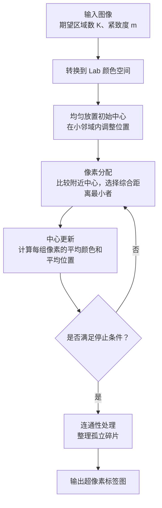

# 基于图形流排序的显著性检测

## SLIC



这一步的核心就是将整个图像分成一个一个的小区域，这些小区域会被组织成超像素。**后续图流形排序以这些超像素为节点计算显著程度。** 相比于按像素进行显著度计算，这样可以大大减少后续图排序的计算量

1. 首先我们将图像转换到Lab颜色空间，p=[L,a,b,x,y]，其中前三项描述颜色，后两项描述位置。聚类的中心同样使用这样的P来表示

2. 接着我们计算距离。从直观上来想，距离应该包含两个层面：空间上的距离和颜色上的距离。颜色越近，距离越近越应该认为属于一个区域。所以分别计算这两个维度的欧氏距离，然后再取加权欧氏距离，具体而言：

   先计算颜色距离：

   $ d_c= \sqrt{(L-L_k)^2+(a-a_k)^2+(b-b_k)^2} $

   再计算空间距离：

   $d_s= \sqrt{(x-x_k)^2+(y-y_k)^2} $

   最后合成：

   $D=\sqrt{d_c^2+\left(\frac{m}{S}\right)^2d_s^2}$

   这里的系数:

   S 是初始中心之间的大致间隔。

   m 是紧致度参数，控制空间距离的重要程度。m大，则更重视空间的接近性

3. 然后我们在图上放置一些初始的区域中心，根据我们期望的区域数来均匀放置

   假设图像有 $H\times W$个像素，希望得到约 \(K\) 个超像素，那么每个区域的平均面积约为：

   $\frac{HW}{K} $

   把它近似看成正方形，边长就是：

   $S\approx\sqrt{\frac{HW}{K}} $

   将整个图近似初始化为一个个的正方形区域

   > [!tip]
   >
   > 要避开边缘位置(因为中心点最好落在区域的内部，这样才能够代表整个区域。如果落在边缘就会混合边缘两边的颜色)
   >
   > 先均匀放置中心，再在每个中心周围的 $3\times3$ 邻域内，找到梯度最小的位置，把中心移动过去

4. 然后开始循环更新区域和像素中心：

   1. 取中心附近2S*2S的区域
   2. 计算像素与中心的综合距离，一个像素可能归属到多个不同中心的区域中，然后将其归入到距离最小的中心
   3. 在区域范围确定下来之后再在区域中取平均值，作为新的区域中心:$ C_k^{\text{new}} = [\overline L_k,\overline a_k,\overline b_k,\overline x_k,\overline y_k] $

5. 最后对这些区域调整连通性

   上一步结束后会输出一个标签图。这个标签图和原图大小相等，对应的就是原图中每个像素所属的区域标签。连通信调整就是要把同一个标签的像素连成一块。这里采用的是将小的连通块合并到周边区域的方法

   比如：

   ```
   A A A B B B B
   A A A B B A B
   A A A B B B B
   C C C C B B B
   C C C C B B B
   ```

   调整后就是：

   ```
   A A A B B B B
   A A A B B B B
   A A A B B B B
   C C C C B B B
   C C C C B B B
   ```

   

最终输出一个标签图提供给下一步使用


| 顺序 | 本次只完成的内容                                             | 完成标准                                                     | 建议提交信息                                           |
| ---- | ------------------------------------------------------------ | ------------------------------------------------------------ | ------------------------------------------------------ |
| 0    | 保存现有目录与代码骨架                                       | 文件已纳入版本管理，包能导入                                 | `chore: add SLIC project skeleton`                     |
| 1    | 添加依赖声明和 `.gitignore`                                  | 声明 NumPy、Pillow、scikit-image、pytest；忽略缓存和生成结果 | `chore: configure dependencies and ignored files`      |
| 2    | `image.prepare_rgb()`                                        | 正确转换 uint8、浮点输入；拒绝非法尺寸、范围和非有限值       | `feat: validate and normalize RGB input`               |
| 3    | `image.load_rgb()`                                           | 能读取图片，并返回统一格式的 RGB 数组                        | `feat: load images as RGB arrays`                      |
| 4    | `image.rgb_to_lab()`                                         | 转换后尺寸正确，已知颜色的 Lab 值合理                        | `feat: convert RGB images to Lab`                      |
| 5    | `initialization.compute_gradient()`                          | 纯色图梯度为零；颜色交界处有响应；边缘不越界                 | `feat: compute Lab image gradients`                    |
| 6    | `initialization.initialize_centers()`                        | 网格中心分布合理，坐标有效，返回参考间隔 `S`                 | `feat: initialize SLIC centers on a grid`              |
| 7    | `initialization.perturb_centers()`                           | 中心移动到局部低梯度位置，同时更新颜色和坐标                 | `feat: move initial centers to low-gradient positions` |
| 8    | `visualization.find_boundaries()`                            | 人工标签图的水平、竖直边界提取正确                           | `feat: extract superpixel boundaries`                  |
| 9    | `visualization.overlay_boundaries()`                         | 能叠加边界，并保持输入图像不被修改                           | `feat: overlay superpixel boundaries on images`        |
| 10   | 在 `clustering.py` 新增私有距离函数 `_compute_distance_squared()` | 颜色项、空间项及权重能通过手算样例核对                       | `feat: compute SLIC color-spatial distances`           |
| 11   | `clustering.assign_pixels()`                                 | 局部窗口内竞争分配正确，每轮重置距离，最终无未分配像素       | `feat: assign pixels to nearby SLIC centers`           |
| 12   | `clustering.compute_region_stats()`                          | 人工区域的面积、平均颜色和平均位置计算正确                   | `feat: compute superpixel region statistics`           |
| 13   | `clustering.update_centers()`                                | 正确更新非空中心，空簇保留旧中心，无除零问题                 | `feat: update SLIC cluster centers`                    |
| 14   | `connectivity.split_components()`                            | 同一标签的不同四连通块获得不同编号                           | `feat: split labels into connected components`         |
| 15   | `connectivity.relabel_contiguous()`                          | 任意有效标签被映射成连续编号，区域归属不变                   | `feat: relabel regions with contiguous identifiers`    |
| 16   | `connectivity.merge_small_components()`                      | 小块并入共享边界最长的邻区；连续多次合并仍正确               | `feat: merge small adjacent components`                |
| 17   | `connectivity.enforce_connectivity()`                        | 串联拆分、合并、编号，每个最终标签对应一个连通区域           | `feat: enforce superpixel connectivity`                |
| 18   | `core.segment_slic()`                                        | 串联完整算法，检查参数，并重新统计最终区域特征               | `feat: assemble the complete SLIC pipeline`            |
| 19   | `demo_slic.main()` 的读取与运行部分                          | 能从命令行读取真实图片，运行分割，输出实际区域数             | `feat: run SLIC from the command line`                 |
| 20   | 演示程序的结果保存功能                                       | 保存标签、边界图及参数记录                                   | `feat: save SLIC segmentation results`                 |
| 21   | 完整流程的集成验证                                           | 纯色、双色、小图、长条图和 `K=1` 均满足最终输出约定          | `test: verify the complete SLIC pipeline`              |
| 22   | README 使用说明                                              | 写明安装、运行命令、输出文件和参数含义                       | `docs: document SLIC usage and parameters`             |

"""网格中心初始化及低梯度位置调整。

中心统一使用 [L, a, b, y, x] 顺序。
"""

from __future__ import annotations

import numpy as np


def _validate_lab(lab: np.ndarray) -> np.ndarray:
    """检查 Lab 输入，并使用 float64 进行内部计算。"""
    if not isinstance(lab, np.ndarray):
        raise TypeError("lab 必须是 NumPy 数组。")

    if lab.ndim != 3 or lab.shape[2] != 3:
        raise ValueError("Lab 图像形状必须为 (H, W, 3)。")
    
    if lab.shape[0] == 0 or lab.shape[1] == 0:
        raise ValueError("图像的高度和宽度必须大于 0。")
    
    if not np.issubdtype(lab.dtype, np.floating):
        raise TypeError("Lab 图像必须是浮点数组。")
    
    if not np.all(np.isfinite(lab)):
        raise ValueError("Lab 图像不能包含 NaN 或无穷值。")
    
    return lab.astype(np.float64, copy=False)


def compute_gradient(lab: np.ndarray) -> np.ndarray:
    """计算 Lab 图像的梯度强度。

    使用水平、竖直方向颜色差的平方和：
        G = ||I[y+1, x] - I[y-1, x]||²
          + ||I[y, x+1] - I[y, x-1]||²
    
    边界采用边缘值填充，返回 (H, W) 的 float64 数组。
    """
    lab = _validate_lab(lab)
    
    padded = np.pad(
        lab,
        pad_width=((1, 1), (1, 1), (0, 0)),
        mode="edge",
    )
    
    diff_y = padded[2:, 1:-1] - padded[:-2, 1:-1]
    diff_x = padded[1:-1, 2:] - padded[1:-1, :-2]
    
    return np.sum(diff_y ** 2 + diff_x ** 2, axis=2)


def initialize_centers(
    lab: np.ndarray,
    n_segments: int,
) -> tuple[np.ndarray, float]:
    """在规则网格中初始化中心。

    参数：
        lab：形状为 (H, W, 3) 的浮点 Lab 图像。
        n_segments：期望超像素数量 K，满足 1 <= K <= H*W。
    
    返回：
        centers：(K0, 5) 的 float64 数组，顺序为 [L, a, b, y, x]。
        step：参考间隔 S = sqrt(H*W/K)。
    
    网格行列数需要取整，因此实际中心数 K0 可能与 K 略有差别。
    """
    lab = _validate_lab(lab)
    height, width = lab.shape[:2]
    
    if (
        isinstance(n_segments, (bool, np.bool_))
        or not isinstance(n_segments, (int, np.integer))
    ):
        raise TypeError("n_segments 必须是整数。")
    
    if not 1 <= n_segments <= height * width:
        raise ValueError("n_segments 必须位于 [1, H * W]。")
    
    n_segments = int(n_segments)
    step = float(np.sqrt(height * width / n_segments))
    
    # 先依据参考间隔估计行数，再根据目标数量调整列数和行数。
    # 限制行列数，兼顾单行、单列以及 K=1 的情况。
    n_rows = max(1, min(height, int(round(height / step))))
    n_cols = max(1, min(width, int(round(n_segments / n_rows))))
    n_rows = max(1, min(height, int(round(n_segments / n_cols))))
    
    # 将图像均匀划分为网格，取各单元中部的像素作为中心。
    ys = (
        (np.arange(n_rows) + 0.5) * height / n_rows
    ).astype(np.intp)
    
    xs = (
        (np.arange(n_cols) + 0.5) * width / n_cols
    ).astype(np.intp)
    
    grid_y, grid_x = np.meshgrid(ys, xs, indexing="ij")
    
    colors = lab[grid_y, grid_x].reshape(-1, 3)
    
    centers = np.column_stack(
        (
            colors,
            grid_y.ravel(),
            grid_x.ravel(),
        )
    )
    
    return centers, step


def perturb_centers(
    lab: np.ndarray,
    centers: np.ndarray,
    gradient: np.ndarray,
) -> np.ndarray:
    """将中心调整到各自 3×3 邻域内的低梯度位置。

    仅在梯度严格减小时移动，当前位置已为最低梯度时保持不变。
    排除其他中心占用的位置，避免中心重合。
    移动后同时更新 Lab 颜色和 y/x 坐标，不修改输入数组。
    """
    lab = _validate_lab(lab)
    height, width = lab.shape[:2]
    
    centers = np.asarray(centers, dtype=np.float64)
    gradient = np.asarray(gradient, dtype=np.float64)
    
    if (
        centers.ndim != 2
        or centers.shape[1] != 5
        or len(centers) == 0
    ):
        raise ValueError("centers 的形状必须为 (K0, 5)，且 K0 > 0。")
    
    if not np.all(np.isfinite(centers)):
        raise ValueError("centers 不能包含 NaN 或无穷值。")
    
    if gradient.shape != (height, width):
        raise ValueError("gradient 的形状必须与图像尺寸一致。")
    
    if not np.all(np.isfinite(gradient)) or np.any(gradient < 0):
        raise ValueError("gradient 必须包含有限的非负数值。")
    
    coordinates = centers[:, 3:5]
    
    if (
        np.any(coordinates < 0)
        or np.any(
            coordinates > np.array([height - 1, width - 1])
        )
    ):
        raise ValueError("中心坐标超出图像范围。")
    
    # 初始化中心来自实际像素；对浮点坐标取最近的整数位置。
    positions = np.rint(coordinates).astype(np.intp)
    
    occupied = {(int(y), int(x)) for y, x in positions}
    
    if len(occupied) != len(centers):
        raise ValueError("初始中心不能位于同一个像素。")
    
    adjusted = centers.copy()
    
    for index, (y, x) in enumerate(positions):
        y, x = int(y), int(x)
    
        # 暂时释放当前中心，其原位置仍可作为候选。
        occupied.remove((y, x))
    
        best_y, best_x = y, x
        best_gradient = gradient[y, x]
    
        y_start = max(0, y - 1)
        y_end = min(height, y + 2)
        x_start = max(0, x - 1)
        x_end = min(width, x + 2)
    
        for candidate_y in range(y_start, y_end):
            for candidate_x in range(x_start, x_end):
                if (candidate_y, candidate_x) in occupied:
                    continue
    
                value = gradient[candidate_y, candidate_x]
    
                if value < best_gradient:
                    best_y, best_x = candidate_y, candidate_x
                    best_gradient = value
    
        occupied.add((best_y, best_x))
    
        adjusted[index, :3] = lab[best_y, best_x]
        adjusted[index, 3:] = (best_y, best_x)
    
    return adjusted