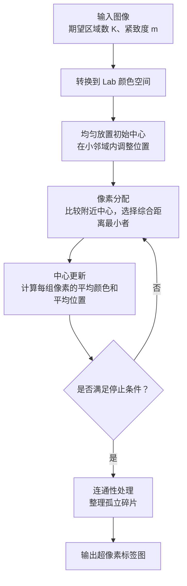
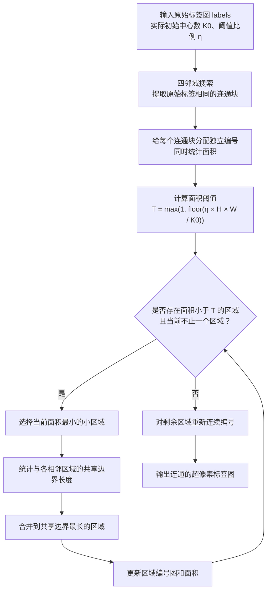

# 基于图形流排序的显著性检测

## SLIC



这一步的核心就是将整个图像分成一个一个的小区域，这些小区域会被组织成超像素。**后续图流形排序以这些超像素为节点计算显著程度。** 相比于按像素进行显著度计算，这样可以大大减少后续图排序的计算量

1. 首先我们将图像转换到Lab颜色空间，p=[L,a,b,x,y]，其中前三项描述颜色，后两项描述位置。聚类的中心同样使用这样的P来表示

2. 接着我们计算距离。从直观上来想，距离应该包含两个层面：空间上的距离和颜色上的距离。颜色越近，距离越近越应该认为属于一个区域。所以分别计算这两个维度的欧氏距离，然后再取加权欧氏距离，具体而言：

   先计算颜色距离：

   $ d_c= \sqrt{(L-L_k)^2+(a-a_k)^2+(b-b_k)^2} $

   再计算空间距离：

   $d_s= \sqrt{(x-x_k)^2+(y-y_k)^2} $

   最后合成：

   $D=\sqrt{d_c^2+\left(\frac{m}{S}\right)^2d_s^2}$

   这里的系数:

   S 是初始中心之间的大致间隔。

   m 是紧致度参数，控制空间距离的重要程度。m大，则更重视空间的接近性

3. 然后我们在图上放置一些初始的区域中心，根据我们期望的区域数来均匀放置

   假设图像有 $H\times W$个像素，希望得到约 \(K\) 个超像素，那么每个区域的平均面积约为：

   $\frac{HW}{K} $

   把它近似看成正方形，边长就是：

   $S\approx\sqrt{\frac{HW}{K}} $

   将整个图近似初始化为一个个的正方形区域

   > [!tip]
   >
   > 要避开边缘位置(因为中心点最好落在区域的内部，这样才能够代表整个区域。如果落在边缘就会混合边缘两边的颜色)
   >
   > 先均匀放置中心，再在每个中心周围的 $3\times3$ 邻域内，找到梯度最小的位置，把中心移动过去

4. 然后开始循环更新区域和像素中心：

   1. 取中心附近2S*2S的区域
   2. 计算像素与中心的综合距离，一个像素可能归属到多个不同中心的区域中，然后将其归入到距离最小的中心
   3. 在区域范围确定下来之后再在区域中取平均值，作为新的区域中心:$ C_k^{\text{new}} = [\overline L_k,\overline a_k,\overline b_k,\overline x_k,\overline y_k] $

5. 最后对这些区域调整连通性

   上一步结束后会输出一个标签图。这个标签图和原图大小相等，对应的就是原图中每个像素所属的区域标签。连通信调整就是要把同一个标签的像素连成一块。这里采用的是将小的连通块合并到周边区域的方法

   比如：

   ```
   A A A B B B B
   A A A B B A B
   A A A B B B B
   C C C C B B B
   C C C C B B B
   ```

   调整后就是：

   ```
   A A A B B B B
   A A A B B B B
   A A A B B B B
   C C C C B B B
   C C C C B B B
   ```

   

最终输出一个标签图提供给下一步使用

### 1. 读取与格式转换

1. 使用python库来读取图片
2. 然后将其统一为浮点rgb格式
3. 使用python库转换为lab格式


### 2. 初始化

主要包含两个部分

**1. 均匀撒点**

输入：形状为 (H, W, 3) 的浮点 Lab 图像、期望点个数

按照正方形划分区域，均匀撒点

**2. 边界处理**

要尽量避免区域中心点出现在图像的边界

1. 计算每个像素点的梯度
2. 对于每个中心点，看其3*3邻域，将中心点移动的邻域内梯度最小的点


### 3. 迭代

这里主要提供迭代的两个工具函数，具体的迭代在最后的主流程中做

**1. 输入图和中心点，进行像素划分**

考虑每个中心点的2S*2S邻域，将位于多个中心点的邻域内的像素点归到距离最近的中心点区域

**2. 输入图和中心点，进行中心点更新**

对于每个区域，将区域内的点的lab坐标取均值，作为中心点


### 4. 区域连通性调整

这部分是 **SLIC 的连通性后处理**：输入聚类得到的标签图，先识别独立连通块，再合并过小的碎片，最后输出每个标签都对应一个连通区域的超像素标签图。



**1. 提取连通块，同时统计面积。**

保留两张图：

- `labels`：原始聚类标签图，提取连通块时保持不变。
- `component_map`：连通块编号图，初始值为 `-1`，同时作为访问标记。

遍历所有像素，每遇到一个未访问的像素，就开始一次 BFS 或 DFS。只向**原始标签相同且未访问的上下左右邻居**扩展。

搜索到的像素统一标记为当前连通块编号，并统计像素数量作为面积。**在像素加入搜索队列时立即标记**，避免重复加入和重复计数。

这一步得到：

```
component_map       # (H, W)，每个像素所属的独立连通块编号
component_sizes     # 第 k 项是连通块 k 的像素数量
```

同一个原始标签下，如果存在多个互不连通的部分，它们此时已经有了不同的连通块编号。

**2. 根据参考面积设置小区域阈值。**

设初始化后的实际中心数为 \(K_0\)，参考面积为：

$A_{\mathrm{ref}}=\frac{HW}{K_0} $

面积阈值为：

$ T=\max\left(1,\left\lfloor\eta A_{\mathrm{ref}}\right\rfloor\right)$ 

```
min_size = max(1, int(min_size_factor * labels.size / n_centers))
```

可以先令 `min_size_factor = 0.25`，之后通过实验调整。它是我们选定的后处理参数，不是论文规定的固定值。面积**严格小于** `min_size` 的区域作为待合并对象。

**3. 将小区域逐个合并到相邻区域。**

采用我们前面确定的规则：

- 每次选择**当前面积最小**的小区域，面积相同时选择编号较小者。
- 检查其上下左右接壤的区域，统计与各区域的**共享边界长度**。
- 合并到共享边界最长的区域；长度相同时选择编号较小者。
- 只能合并到实际相邻的区域，保证合并结果仍然连通。

这里的共享边界长度，就是两个区域之间相邻像素的接触边数。

**4. 每次合并后更新状态，继续判断。**

假设将区域 `A` 合并到区域 `B`：

```
把 A 的像素编号改为 B
B 的面积增加 A 的面积
A 标记为不再存在
```

后续操作必须依据**更新后的面积和区域关系**，不能继续使用过时的邻接统计。

重复这一过程，直到没有面积低于阈值的区域，或者整幅图像只剩一个区域。

**5. 重新连续编号并输出。**

合并后可能只剩下编号 `0、3、7、9`，需要将它们整理为：

```
0、1、2、3
```

最终输出：

```
final_labels    # (H, W)，连续编号的超像素标签图
```

完成后应满足：

- 所有像素都有有效标签。
- 每个标签对应且仅对应一个四连通区域。
- 标签从 `0` 连续编号到 `K_final - 1`。
- 所有区域的面积总和等于 `H * W`。

实现时，可以将它拆成两个主要函数：**“提取连通块并统计面积”和“合并小块并重新编号”**。前者负责把不连通的部分分开，后者负责清理过小的碎片。


| 顺序 | 本次只完成的内容                                             | 完成标准                                                     | 建议提交信息                                           |
| ---- | ------------------------------------------------------------ | ------------------------------------------------------------ | ------------------------------------------------------ |
| 0    | 保存现有目录与代码骨架                                       | 文件已纳入版本管理，包能导入                                 | `chore: add SLIC project skeleton`                     |
| 1    | 添加依赖声明和 `.gitignore`                                  | 声明 NumPy、Pillow、scikit-image、pytest；忽略缓存和生成结果 | `chore: configure dependencies and ignored files`      |
| 2    | `image.prepare_rgb()`                                        | 正确转换 uint8、浮点输入；拒绝非法尺寸、范围和非有限值       | `feat: validate and normalize RGB input`               |
| 3    | `image.load_rgb()`                                           | 能读取图片，并返回统一格式的 RGB 数组                        | `feat: load images as RGB arrays`                      |
| 4    | `image.rgb_to_lab()`                                         | 转换后尺寸正确，已知颜色的 Lab 值合理                        | `feat: convert RGB images to Lab`                      |
| 5    | `initialization.compute_gradient()`                          | 纯色图梯度为零；颜色交界处有响应；边缘不越界                 | `feat: compute Lab image gradients`                    |
| 6    | `initialization.initialize_centers()`                        | 网格中心分布合理，坐标有效，返回参考间隔 `S`                 | `feat: initialize SLIC centers on a grid`              |
| 7    | `initialization.perturb_centers()`                           | 中心移动到局部低梯度位置，同时更新颜色和坐标                 | `feat: move initial centers to low-gradient positions` |
| 8    | `visualization.find_boundaries()`                            | 人工标签图的水平、竖直边界提取正确                           | `feat: extract superpixel boundaries`                  |
| 9    | `visualization.overlay_boundaries()`                         | 能叠加边界，并保持输入图像不被修改                           | `feat: overlay superpixel boundaries on images`        |
| 10   | 在 `clustering.py` 新增私有距离函数 `_compute_distance_squared()` | 颜色项、空间项及权重能通过手算样例核对                       | `feat: compute SLIC color-spatial distances`           |
| 11   | `clustering.assign_pixels()`                                 | 局部窗口内竞争分配正确，每轮重置距离，最终无未分配像素       | `feat: assign pixels to nearby SLIC centers`           |
| 12   | `clustering.compute_region_stats()`                          | 人工区域的面积、平均颜色和平均位置计算正确                   | `feat: compute superpixel region statistics`           |
| 13   | `clustering.update_centers()`                                | 正确更新非空中心，空簇保留旧中心，无除零问题                 | `feat: update SLIC cluster centers`                    |
| 14   | `connectivity.split_components()`                            | 同一标签的不同四连通块获得不同编号                           | `feat: split labels into connected components`         |
| 15   | `connectivity.relabel_contiguous()`                          | 任意有效标签被映射成连续编号，区域归属不变                   | `feat: relabel regions with contiguous identifiers`    |
| 16   | `connectivity.merge_small_components()`                      | 小块并入共享边界最长的邻区；连续多次合并仍正确               | `feat: merge small adjacent components`                |
| 17   | `connectivity.enforce_connectivity()`                        | 串联拆分、合并、编号，每个最终标签对应一个连通区域           | `feat: enforce superpixel connectivity`                |
| 18   | `core.segment_slic()`                                        | 串联完整算法，检查参数，并重新统计最终区域特征               | `feat: assemble the complete SLIC pipeline`            |
| 19   | `demo_slic.main()` 的读取与运行部分                          | 能从命令行读取真实图片，运行分割，输出实际区域数             | `feat: run SLIC from the command line`                 |
| 20   | 演示程序的结果保存功能                                       | 保存标签、边界图及参数记录                                   | `feat: save SLIC segmentation results`                 |
| 21   | 完整流程的集成验证                                           | 纯色、双色、小图、长条图和 `K=1` 均满足最终输出约定          | `test: verify the complete SLIC pipeline`              |
| 22   | README 使用说明                                              | 写明安装、运行命令、输出文件和参数含义                       | `docs: document SLIC usage and parameters`             |

