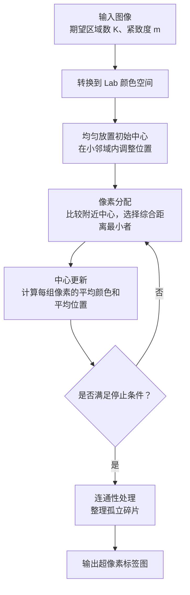
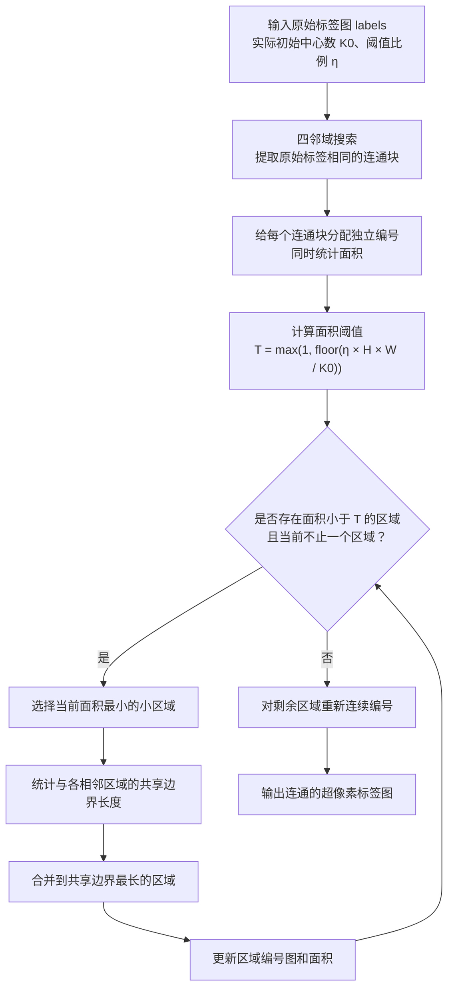

# 基于图形流排序的显著性检测

## SLIC



这一步的核心就是将整个图像分成一个一个的小区域，这些小区域会被组织成超像素。**后续图流形排序以这些超像素为节点计算显著程度。** 相比于按像素进行显著度计算，这样可以大大减少后续图排序的计算量

1. 首先我们将图像转换到Lab颜色空间，p=[L,a,b,x,y]，其中前三项描述颜色，后两项描述位置。聚类的中心同样使用这样的P来表示

2. 接着我们计算距离。从直观上来想，距离应该包含两个层面：空间上的距离和颜色上的距离。颜色越近，距离越近越应该认为属于一个区域。所以分别计算这两个维度的欧氏距离，然后再取加权欧氏距离，具体而言：

   先计算颜色距离：

   $ d_c= \sqrt{(L-L_k)^2+(a-a_k)^2+(b-b_k)^2} $

   再计算空间距离：

   $d_s= \sqrt{(x-x_k)^2+(y-y_k)^2} $

   最后合成：

   $D=\sqrt{d_c^2+\left(\frac{m}{S}\right)^2d_s^2}$

   这里的系数:

   S 是初始中心之间的大致间隔。

   m 是紧致度参数，控制空间距离的重要程度。m大，则更重视空间的接近性

3. 然后我们在图上放置一些初始的区域中心，根据我们期望的区域数来均匀放置

   假设图像有 $H\times W$个像素，希望得到约 \(K\) 个超像素，那么每个区域的平均面积约为：

   $\frac{HW}{K} $

   把它近似看成正方形，边长就是：

   $S\approx\sqrt{\frac{HW}{K}} $

   将整个图近似初始化为一个个的正方形区域

   > [!tip]
   >
   > 要避开边缘位置(因为中心点最好落在区域的内部，这样才能够代表整个区域。如果落在边缘就会混合边缘两边的颜色)
   >
   > 先均匀放置中心，再在每个中心周围的 $3\times3$ 邻域内，找到梯度最小的位置，把中心移动过去

4. 然后开始循环更新区域和像素中心：

   1. 取中心附近2S*2S的区域
   2. 计算像素与中心的综合距离，一个像素可能归属到多个不同中心的区域中，然后将其归入到距离最小的中心
   3. 在区域范围确定下来之后再在区域中取平均值，作为新的区域中心:$ C_k^{\text{new}} = [\overline L_k,\overline a_k,\overline b_k,\overline x_k,\overline y_k] $

5. 最后对这些区域调整连通性

   上一步结束后会输出一个标签图。这个标签图和原图大小相等，对应的就是原图中每个像素所属的区域标签。连通信调整就是要把同一个标签的像素连成一块。这里采用的是将小的连通块合并到周边区域的方法

   比如：

   ```
   A A A B B B B
   A A A B B A B
   A A A B B B B
   C C C C B B B
   C C C C B B B
   ```

   调整后就是：

   ```
   A A A B B B B
   A A A B B B B
   A A A B B B B
   C C C C B B B
   C C C C B B B
   ```

   

最终输出一个标签图提供给下一步使用

### 1. 读取与格式转换

1. 使用python库来读取图片
2. 然后将其统一为浮点rgb格式
3. 使用python库转换为lab格式


### 2. 初始化

主要包含两个部分

**1. 均匀撒点**

输入：形状为 (H, W, 3) 的浮点 Lab 图像、期望点个数

按照正方形划分区域，均匀撒点

**2. 边界处理**

要尽量避免区域中心点出现在图像的边界

1. 计算每个像素点的梯度
2. 对于每个中心点，看其3*3邻域，将中心点移动的邻域内梯度最小的点


### 3. 迭代

这里主要提供迭代的两个工具函数，具体的迭代在最后的主流程中做

**1. 输入图和中心点，进行像素划分**

考虑每个中心点的2S*2S邻域，将位于多个中心点的邻域内的像素点归到距离最近的中心点区域

**2. 输入图和中心点，进行中心点更新**

对于每个区域，将区域内的点的lab坐标取均值，作为中心点


### 4. 区域连通性调整

这部分是 **SLIC 的连通性后处理**：输入聚类得到的标签图，先识别独立连通块，再合并过小的碎片，最后输出每个标签都对应一个连通区域的超像素标签图。



**1. 提取连通块，同时统计面积。**

保留两张图：

- `labels`：原始聚类标签图，提取连通块时保持不变。
- `component_map`：连通块编号图，初始值为 `-1`，同时作为访问标记。

遍历所有像素，每遇到一个未访问的像素，就开始一次 BFS 或 DFS。只向**原始标签相同且未访问的上下左右邻居**扩展。

搜索到的像素统一标记为当前连通块编号，并统计像素数量作为面积。**在像素加入搜索队列时立即标记**，避免重复加入和重复计数。

这一步得到：

```
component_map       # (H, W)，每个像素所属的独立连通块编号
component_sizes     # 第 k 项是连通块 k 的像素数量
```

同一个原始标签下，如果存在多个互不连通的部分，它们此时已经有了不同的连通块编号。

**2. 根据参考面积设置小区域阈值。**

设初始化后的实际中心数为 \(K_0\)，参考面积为：

$A_{\mathrm{ref}}=\frac{HW}{K_0} $

面积阈值为：

$ T=\max\left(1,\left\lfloor\eta A_{\mathrm{ref}}\right\rfloor\right)$ 

```
min_size = max(1, int(min_size_factor * labels.size / n_centers))
```

可以先令 `min_size_factor = 0.25`，之后通过实验调整。它是我们选定的后处理参数，不是论文规定的固定值。面积**严格小于** `min_size` 的区域作为待合并对象。

**3. 将小区域逐个合并到相邻区域。**

采用我们前面确定的规则：

- 每次选择**当前面积最小**的小区域，面积相同时选择编号较小者。
- 检查其上下左右接壤的区域，统计与各区域的**共享边界长度**。
- 合并到共享边界最长的区域；长度相同时选择编号较小者。
- 只能合并到实际相邻的区域，保证合并结果仍然连通。

这里的共享边界长度，就是两个区域之间相邻像素的接触边数。

**4. 每次合并后更新状态，继续判断。**

假设将区域 `A` 合并到区域 `B`：

```
把 A 的像素编号改为 B
B 的面积增加 A 的面积
A 标记为不再存在
```

后续操作必须依据**更新后的面积和区域关系**，不能继续使用过时的邻接统计。

重复这一过程，直到没有面积低于阈值的区域，或者整幅图像只剩一个区域。

**5. 重新连续编号并输出。**

合并后可能只剩下编号 `0、3、7、9`，需要将它们整理为：

```
0、1、2、3
```

最终输出：

```
final_labels    # (H, W)，连续编号的超像素标签图
```

完成后应满足：

- 所有像素都有有效标签。
- 每个标签对应且仅对应一个四连通区域。
- 标签从 `0` 连续编号到 `K_final - 1`。
- 所有区域的面积总和等于 `H * W`。

实现时，可以将它拆成两个主要函数：**“提取连通块并统计面积”和“合并小块并重新编号”**。前者负责把不连通的部分分开，后者负责清理过小的碎片。


### 5. 对外接口

```python
centers, labels, sizes = slic(
    image=rgb,
    n_segments=200,
    compactness=10.0,
    max_iter=10,
    min_size_factor=0.25,
)
```

使用slic函数作为这个模块的对外接口，输入图像数组和必要的参数，函数完成SLIC然后输出中心点数组，label标记数组等

## 构建超像素图

### 1. 确定节点

一个超像素对应一个图节点

SLIC 输出了最终标签图和各区域的平均 Lab 颜色。后续不再逐像素建立图，而是以超像素为单位：

- 标签图用于确定区域的空间关系。
- 区域平均 Lab 颜色用于计算连接权重。
- 节点编号直接沿用最终超像素标签编号。

### 2. 确定图的连接关系

第一类是局部连接：

- 相邻区域对应的节点建立连接。
- 邻居的邻居也建立连接。

例如，原始空间邻接关系是 `A—B—C`，则额外连接 `A—C`。这里的二阶邻居依据原始空间邻接关系计算，不是不断扩展直到所有节点都连接。

第二类是图像边界连接：

- 找出接触整幅图像上、下、左、右四侧的超像素。
- 将这些边界节点两两连接，形成论文所说的闭环图。

这里的“边界”指**图像最外侧边缘**，不是任意两个超像素之间的区域边界

这两类连接分别利用局部连续性和背景先验。

| 连接规则             | 利用的特点                                                   | 希望达到的效果                                       |
| -------------------- | ------------------------------------------------------------ | ---------------------------------------------------- |
| 邻居及邻居的邻居连接 | 附近区域往往属于同一物体或同一片背景，可能具有相近的颜色和显著程度 | 让排序利用局部关联，在稍大的邻域内传播信息           |
| 图像边界节点两两连接 | 图像边界区域更可能属于背景，相似背景可能分布在不同边缘       | 让相隔较远的相似背景建立直接联系，缩短图上的传播路径 |

### 3. 计算边权

- 连接关系决定：两个区域之间是否存在直接联系。
- 边权决定：已经连接的两个区域之间，联系有多强。

设节点的平均 Lab 颜色为 \(c_i\)，采用：

$ w_{ij}= \begin{cases} \exp\left(-\dfrac{\lVert c_i-c_j\rVert_2}{\sigma^2}\right), & i\ne j\text{ 且两节点连接},\\[6pt] 0,&\text{其他情况}. \end{cases} $

颜色越接近，连接权重越大；颜色差异越大，权重越小。因此，即使天空和草地都属于边界区域，它们之间也不会仅因建立了连接就产生很强的关联。

没有直接连接的两个节点，仍然可以通过其他节点间接关联。后面的流形排序将综合整张图的连接和权重，计算各节点与查询节点的关联程度。

## 非归一化流形排序

> 给定一组查询节点，计算其他节点和这一组查询节点的关联程度

相关符号：

$W$：边权矩阵

$D$：加权度矩阵

$y$：本轮的查询指示向量，$y_i=1$表示节点i是查询节点

$f$：各节点的关联分数

$\alpha$：控制图上关联传播的参数，论文采用 `0.99`

其中度矩阵D的算法为：

对每个节点，将其所有连接权重相加：

$d_i=\sum_j w_{ij} $

再构造对角矩阵：

$D=\operatorname{diag}(d_0,d_1,\ldots,d_{N-1}) $，$d_i$就是第i个节点所有相关的边的权重之和

### 排序公式

令$B=(D-\alpha W)^{-1} $

将**这个逆矩阵的对角线清零**：

$ A_{ij}= \begin{cases} B_{ij},&i\ne j,\\ 0,&i=j. \end{cases} $

实际使用的排序分数就是：

$f=Ay$

### 算法流程

1. **计算度矩阵**

   $D_{ii}=\sum_j W_{ij} $

2. **计算关联矩阵**

   $B=(D-\alpha W)^{-1} $

3. **将关联矩阵的对角线清零**

   $B_{ii}=0 $

4. **构造查询向量，计算关联分数**

   $ y_i= \begin{cases} 1,&i\text{ 是查询节点}\\ 0,&\text{其他节点} \end{cases} \qquad f=By $


### 理解公式

#### 1. 图与关联程度

对于整个图，边权可以理解为相连的两个节点直接的关联程度。边权越大，两个区域的颜色越相似，直接联系越强。

现在，给出一组查询节点，希望计算：图中的每个节点，与这组查询节点有多大的关联？

这种关联既包括直接联系，也包括通过其他节点形成的间接联系。例如：

> 查询节点 $q$ —— 节点 $a$ —— 节点 $b$ —— 节点 $c$

虽然 $c$ 与 $q$ 没有直接连接，但查询信息可以通过 $a$、$b$ 影响 $c$。

因此，我们需要把查询节点的影响沿着图传播出去，为每个节点计算一个关联分数。这里的“排序”主要指计算这些分数，不需要真的将节点重新排列。

#### 2. 传播模型的构建

这个模型需要同时考虑两件事：

1. **图上的关联：** 联系紧密、边权较大的节点，应当相互影响，使关联分数在图上具有一定的平滑性。
2. **查询的作用：** 整个计算需要始终围绕指定的查询展开，因此要持续保留查询提供的信息。

对应到传播过程中，就是：

- 查询节点作为源头，每轮获得固定的查询输入。
- 所有节点根据上一轮邻居的分数，按边权进行加权平均，再乘上衰减系数，得到邻居传播来的影响。

查询节点也要接收邻居的影响，所以它自身的总分数会变化。固定的是每轮额外加入的查询输入。

整个模型就可以看作：

1. 确定传播规则：每个节点的关联分数由邻居节点的分数加权平均，再乘上固定的衰减系数得到
2. 确定查询输入：查询节点每一轮扩散都获得固定的输入，从而确保持续提供查询信息
3. 让查询信息从源头出发，沿着边逐步扩展，最后达到稳定状态。

#### 3. 第一轮传播

> 设节点 $i$ 的关联分数为 $f_i$，节点 $i$、$j$ 之间的边权为 $w_{ij}$。
>
> 节点 $i$ 的总边权记为：
>
> $$d_i=\sum_j w_{ij}$$
>
> 查询节点用向量 $y$ 标记：
>
> $$y_i= \begin{cases} 1, & i\text{是查询节点}\\ 0, & i\text{不是查询节点} \end{cases}$$

##### 初始分数

初始分数设置为：

$$f_i^{(0)}=\frac{y_i}{d_i}$$

也就是查询节点的初始分数为 $1/d_i$，其他节点为 $0$。

##### 第一轮传播

接下来，每个节点都从邻居接收分数。节点 $i$ 接收邻居 $j$ 信息时使用的权重为：

$$\frac{w_{ij}}{d_i}$$

再乘上衰减系数 $\alpha$，就得到传播系数：

$$\alpha\frac{w_{ij}}{d_i}$$

因此，只考虑一个查询节点 $q$，它第一次对邻居 $i$ 产生的贡献为：

$$\Delta f_i^{(1)} = \alpha\frac{w_{iq}}{d_i}\frac{1}{d_q}$$

第一轮，查询节点影响直接邻居；下一轮，已经获得分数的邻居又会影响其他节点。查询信息就这样逐步传播到图中更远的位置。

#### 4. 更新迭代

每一轮，所有节点都根据上一轮邻居的分数计算传播结果：

$$\alpha\sum_j\frac{w_{ij}}{d_i}f_j^{(t)}$$

对于查询节点，还要在这个结果上加入本轮固定的查询输入 $1/d_i$

因此，所有节点可以使用同一条更新公式：

$$\boxed{ f_i^{(t+1)} = \alpha\sum_j\frac{w_{ij}}{d_i}f_j^{(t)} + \frac{y_i}{d_i} }$$

也就是：

$$\boxed{ \text{新分数} = \text{衰减系数}\times\text{邻居旧分数的加权平均} + \text{固定查询输入} }$$

每轮固定注入查询信息，是为了让查询节点持续作为源头，使整个传播始终围绕这些查询展开。

#### 5. 稳定性推导

虽然每轮都提供查询输入，但传播来的分数会乘上小于 $1$ 的衰减系数 $\alpha$。固定输入与传播衰减可以达到平衡，因此分数不一定会无限增长。

例如，简单递推：

$$x^{(t+1)}=0.5x^{(t)}+1$$

从 $0$ 开始，结果为：

$$0,\ 1,\ 1.5,\ 1.75,\ 1.875,\ldots$$

每轮都加 $1$，但结果会逐渐接近 $2$，因为：

$$0.5\times2+1=2$$

图中的情况也是类似的，只是变成多个节点相互影响。

数学上，由于邻居分数的加权平均不会放大最大差异，再乘上 $\alpha<1$，每轮更新都会缩小不同分数状态之间的差异。若稳定结果为 $f^*$，则：

$$\max_i\vert{}f_i^{(t)}-f_i^*\vert{} \leq \alpha^t\max_i\vert{}f_i^{(0)}-f_i^*\vert{}$$

随着 $\alpha^t\to0$，迭代结果会趋向唯一的稳定解。

这里要求边权非负、各节点的度大于 $0$，并且 $0<\alpha<1$。

实际采用迭代时，可以在新旧分数的最大差值小于某个阈值时停止。它通常是逐渐逼近稳定结果，而不是某一轮突然完全不再变化。

#### 6. 最终公式

稳定时，更新前后的分数相同：

$$f^{(t+1)}=f^{(t)}=f^*$$

将它代入矩阵形式的更新公式：

$$f^*=\alpha D^{-1}Wf^*+D^{-1}y$$

两边乘上 $D$：

$$Df^*=\alpha Wf^*+y$$

移项得到：

$$\boxed{(D-\alpha W)f^*=y}$$

在前述条件下，这个线性方程组有唯一解，因此：

$$\boxed{f^*=(D-\alpha W)^{-1}y}$$

这就是论文采用的基础排序公式。上面的逐轮传播，是对这一公式的等价解释。

迭代是在逐渐接近稳定解，而求解线性方程是在直接计算同一个稳定解。因此，实现时可以通过线性方程求解完成计算，不必真的进行很多轮传播。


## 两步查询

### 背景查询

取四个边缘，分别让四个边缘作为作为查询节点进行查询，得到四组背景关联分数

每组都先归一化，再取反：

$s_{\mathrm{side}}=1-\operatorname{normalize}(f_{\mathrm{side}}) $

然后将四组显著性分数**逐元素相乘**：

$ s_{\mathrm{initial}} =s_{\mathrm{top}}\odot s_{\mathrm{bottom}} \odot s_{\mathrm{left}}\odot s_{\mathrm{right}} $

> [!tip]
>
> 四侧分别提供不同的背景线索，例如上侧可能是天空，下侧可能是草地。一个区域只要与其中一侧的背景关联很强，就有较强的背景证据
>
> ```
> 与某一侧背景关联强
>     ↓
> 该侧给出的显著性分数低
>     ↓
> 四侧分数相乘后，融合分数也低
> ```
>
> 如果采用平均值就没有这种效果了

这样得到初步的超像素级显著结果，这个是从背景的角度出发，计算和背景的相似度。

### 前景查询

根据第一阶段融合结果的平均显著值，选择高于阈值的超像素作为前景候选。

注意，这里选择的是**显著性高的节点**，它们与背景的关联通常较弱，也就是比较显著的区域

再计算所有节点与这些前景候选的关联程度：

$s_{\mathrm{final}} =\operatorname{normalize}(Ry_{\mathrm{foreground}}) $

这次关联越强，显著性越高，直接使用归一化结果

## 最终输出

1. 将前景查询得到的显著性分数归一化
2. 利用标签图将分数还原到像素级
3. 最终输出灰度图
